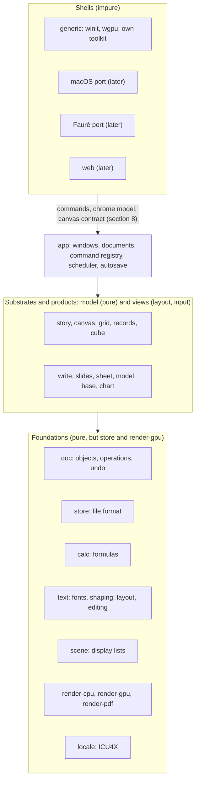
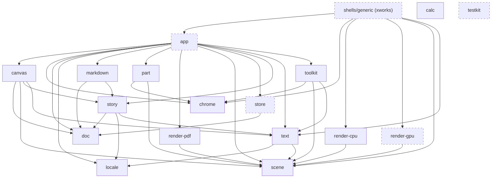
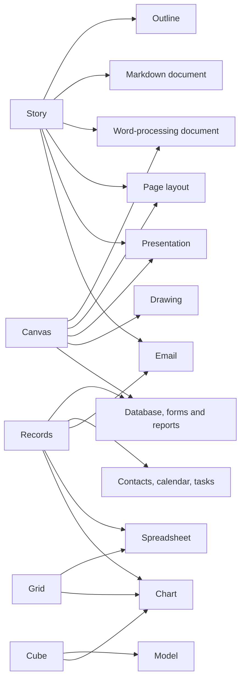

# Architecture

**Status: approved by the project owner in review session pamnqej6
(2026-10-18).** Treat the decisions here as settled; those still open are in
section 14. To change a decision, discuss it with the project owner first,
then update this document.

## 1. Goals

xWorks is an office suite built from scratch to be **usable, fast and
correct**. Microsoft Office shows what happens when thirty years of
compatibility layers pile up. We want to find out how good an office suite
can be without them.

- **Usable.** Everyday work in a few obvious steps. Nothing appears unasked,
  and nothing reflows behind your back.
- **Fast.** Every interaction finishes within a frame, or shows progress and
  never blocks. Startup, opening and saving are measured against budgets
  (section 12), and CI fails when a budget is broken.
- **Correct.** A document means one thing. It lays out the same and computes
  the same on every machine, every time. Saving never loses work, and arithmetic
  follows rules a user can predict.

**Design rule.** When a choice comes up, ask:

> What would we build if the file formats, menus and habits of 1990s office
> software had never existed, but we knew everything those suites taught us?

Office conventions that are genuinely good (the grid, styles, master slides,
the outline view, Improv's categories) stay. Accidents of history (the 1900
leap-year bug, three ways to number a list, page breaks that change with the
printer driver) go.

## 2. Settled decisions

- **Native first, web later** (project owner, 2026-10-18). There is one Rust
  core. The first shell is a native desktop app for Linux, Windows and macOS.
  The core also compiles to WebAssembly, so a browser build can come later
  without a rewrite. That rules out threads, files or clocks inside the core
  (section 3).
- **Our own file format only** (project owner, 2026-10-18). It carries no
  legacy. Modules that import and export other formats (OOXML, ODF, CSV, PDF)
  come later. They live outside the core and convert to and from our model;
  the model never bends to fit them. Markdown is the one exception (below).
- **Operation-based core; collaboration later** (project owner, 2026-10-18).
  Every change is an operation in a transaction. Operations are what undo,
  history, autosave and scripting work on, and later what live multi-user
  editing exchanges. The rules in section 5 keep that later step possible
  without paying for it now.
- **Our own GPU toolkit for the generic version; native widgets in later
  platform ports** (project owner, 2026-10-18). A port for macOS (AppKit),
  and one for [Fauré](../../faure), will use those platforms' own menus,
  toolbars, panels and dialogs. That comes late, once the core functionality
  is dialed in, but the shell is designed for it from the start (section 8).

These were settled in review session pamnqej6 (project owner, 2026-10-18):

- **One integrated app,** in which every kind of document is a part and
  parts embed in each other (section 4).
- **SQLite as the file container,** with a fixed, versioned schema
  (section 6).
- **Continuous autosave into the file,** with named versions; Save marks a
  version (section 6).
- **Fonts embedded in documents,** subset where the font's license requires
  (section 6).
- **128-bit decimal numbers** (section 7), confirmed by M1's prototype
  (review h6nsn9xm, 2026-10-19): calc's own decimal128 in pure Rust, with
  exact equality.
- **Vello's sparse-strips renderers** for drawing (D7, project owner,
  2026-10-19): `vello_cpu` in render-cpu and `vello_gpu` in render-gpu
  (section 10).
- **MIT / Apache-2.0** licensing (section 11).
- **A walking skeleton (M1) before the tracks fan out**
  ([TRACKS.md](TRACKS.md)).
- **Five substrates** (story, canvas, grid, records, cube), with document
  types as views over them, as an advisory way to organize the code, not a
  product requirement (section 4).
- **Markdown files open and save as themselves,** early, in the Story track,
  while the story stays structure-only (section 6).

## 3. System overview



Arrows point from a layer to the layers it depends on.

**Three layers, and code only depends downwards.**

- **Foundations and track models are pure,** but for the two foundations
  that reach outside: `store`, which reads and writes files, and
  `render-gpu`, which drives the GPU (CLAUDE.md, "Pure crates"). The pure
  ones do no I/O, open no threads, read no clocks and draw nothing to a
  screen. Bytes come in and data structures come out. That makes them
  testable without a display, identical in WebAssembly, and safe to run
  on any thread. `crates/clippy.toml` forbids the calls that would break
  that, and CI builds every pure crate for WebAssembly.
- **Track views** turn a model into layout and a display list, and turn input
  events into commands. They are also pure: given the same model, size and
  events, they give the same output.
- **The app and the shells** own everything impure: windows, files, threads,
  timers, the clipboard, the GPU and the platform's widgets.

### The crates and their contracts

Each crate's contract is the doc comment at the head of its `lib.rs`
(M2's stage 8; review 7fnfdhb5): what it's for, what a caller may rely on,
each invariant with the test that holds it, and what it doesn't promise,
so no one leans on it. What follows sums each one up; the `lib.rs` is the
contract. Arrows point from a crate to the crates it depends on; dashed
crates are impure.



`calc` waits for the grid, which nothing has yet, and `testkit` is for
tests and tools alone. The tools build on the crates above: `shot` and
`budgets` on `app` and the renderers, `xworks-dump` on `store`, and
`fetch-fonts` on `testkit`.

What every contract shares: lengths are layout units, 914 400 to the
inch, with y growing down from a page's top left; the same input gives
the same output every run, and on every platform where the crate says
so; and outside input, files, fonts, pictures, Markdown, sessions and
what's typed, gives errors, never panics, each reader with its fuzz
target.

- **`doc`** (F1): a document is objects with stable IDs, changed only by
  operations. A document is always valid: the story is a tree of blocks
  of kinds that hold each other, always with a paragraph, runs covering
  their text, and styles based on their own kind without loops; a
  snapshot that isn't valid is refused, saying why. An operation that
  fails changes nothing; inverses restore exactly; IDs are never reused;
  clones are O(1) snapshots that never change; rebasing converges; and
  nothing walks the tree by recursion. It doesn't say what properties
  mean: `story` does.
- **`store`** (F2): the `.xw` file. A file under a document's name is
  always whole and opens at a committed transaction, whenever its writer
  stops; reopening gives the same document, dump and undo history; one
  program writes a document at a time, by its lock; a newer schema's file
  is never written to, an older one's upgraded all at once or not at
  all; and nothing read is trusted. It doesn't promise to survive a power
  cut whole, only a crash.
- **`calc`** (F6): so far decimal128's arithmetic, exact where results fit
  in 34 digits and rounded once, half to even, otherwise, in integers, so
  the same everywhere; every result in range, equality exact, and text
  read as a number or none. Values, formulas and recalculation come in
  M3.
- **`locale`** (F3): Unicode's divisions of text by its languages, from
  ICU4X's compiled-in data: graphemes, line breaks, words, sentences,
  scripts and bidi levels, at byte offsets on character boundaries,
  covering the text. A line break may fall inside a grapheme; `text`
  keeps lines from ending there.
- **`text`** (F3): fonts, shaping, paragraph layout and the caret, in
  integers, so a paragraph lays out the same everywhere. Lines cover the
  text and fit their room but for one grapheme too wide; justified lines
  fill it; a hyphen layout adds isn't text; the caret stands between
  graphemes and is found where it's drawn; fonts and patterns that don't
  read are errors. Callers make the spans; spans that don't cover the
  text panic.
- **`scene`** (F4): the display list, data that owns what it holds and
  goes to any thread. An item's bounds hold all it draws, damage
  rectangles are enough to redraw a frame, and images are resampled the
  same everywhere.
- **`render-cpu`** (F4): the reference renderer. At its portable level
  the same page draws the same pixels on every platform, whatever it drew
  before, which the goldens check on Linux, Windows and macOS; its
  fastest level is within a few of 255. A run whose font isn't one panics
  inside glifo; `text` only makes runs of fonts it loaded.
- **`render-gpu`** (F4): the GPU renderer for the shells, within a few
  levels of render-cpu, its canvas drawing only what changed. Its tests
  need a GPU and run by hand on Windows.
- **`render-pdf`** (F4): tagged PDF, the same bytes each time, text kept
  as text in reading order, images as figures, a kept sRGB JPEG as its
  file; a page or font PDF can't hold is an error.
- **`chrome`** (F5): commands and the chrome model, described, never
  drawn. A spec whose IDs, menu items, shortcuts, arguments or access keys
  don't hold together is refused; shortcuts match without Shift, Primary
  being Command on a Mac; lengths read as typed and show as they read.
- **`part`** (F5): the canvas contract, an interface. Positions are the
  surface's layout units, a part describes and its host draws, and the
  same input gives the same frames, accessibility tree and requests.
  Embedding comes with the canvas track.
- **`toolkit`** (F5): the generic shell's widgets, drawing the chrome model
  from one layout that both draws and hits, so what a click lands on is
  what's drawn there; it reads the model and never changes it.
- **`app`** (F5): documents in windows, Elm-style. Every edit is a
  transaction written as it's committed; what's drawn is the document as
  it stands, laid out afresh only where it changed; the same events give
  the same document and frames, so sessions play headless; a Markdown file
  stays Markdown, asking before it can't; a document is open once. A
  damaged JPEG can still panic inside zune-jpeg (review 7fnfdhb5).
- **`testkit`** (F7): images, golden hashes the same on every platform,
  and the workspace's files for tests and tools.
- **`story`** (S1): the story substrate: what `doc`'s properties mean, the
  stylesheet resolved along its chains, the tree's reading order, and
  paragraphs laid out at their places. Every value resolves: unset, of
  the wrong kind or past its limits, a property takes its style's; a
  paragraph's layout depends only on it, its style and its place; and
  stylesheet files are refused, never trusted. Merging and updating
  sheets are operations, undone whole.
- **`canvas`** (S2): automatic pages. Every line is placed once, in
  order; a page breaks by the rules of orphans, widows and keeping with
  what follows; and where a page breaks depends only on what's before it,
  so an edit leaves the pages before it. Masters, frames and floats come
  with Write (T1).
- **`markdown`** (S1): Markdown files as themselves. A file untouched is
  written back byte for byte, an edit changes only what it edited, what's
  written reads back as the same story, and what Markdown can't hold is
  refused rather than lost. Nothing walks the story by recursion, but
  reading takes time in the square or cube of how deep blocks nest, a
  fault stage 8 found.

The generic shell and the tools are programs, not crates to build on;
each has a short doc at the head of its `main.rs` saying what it does and
how it's run.

## 4. Substrates, views and parts

xWorks is **one application** that opens every kind of document, as
ClarisWorks did (project owner, 2026-10-18). It is not a bundle of separate
programs.

### Substrates

**Advisory** (project owner, 2026-10-18). This is how the code is
organized, not a concept users see or a requirement of the product. It holds
only while it keeps the code well organized and maintainable. Where forcing
something into a substrate would make the code worse, give that thing its own
model and record why here.

The idea comes from the owner's answer to decision 8 of review pamnqej6. Many
familiar document types are special cases of each other. A presentation is a
pasteboard of landscape pages. A text document is a few big text frames per
page, and a drawing is small scattered frames, if any. An outline is a terse
text document, and a Markdown file is a text document with structure and no
styling. So xWorks has a small number of **substrates**: kinds of content,
each with its own data model and its own way of addressing things. Every
document type people know is one or two substrates seen through a **view**.

| Substrate | What it holds | Things are addressed by | Views |
|---|---|---|---|
| **Story** | a tree of blocks: headings, paragraphs, lists, quotes, tables, embedded parts | block IDs and text anchors | outline; draft (structure, no pages); poured into frames on a canvas |
| **Canvas** | pages or an open pasteboard, with masters, holding positioned objects: text frames showing stories, shapes, images, embedded parts | object IDs and coordinates | pages; slide sorter; presenter; drawing |
| **Grid** | an open-ended sheet of cells, with formulas that refer to positions | row and column | the grid |
| **Records** | typed tables, relations and queries | table, key and field | table; form; list; card; calendar; report |
| **Cube** | Improv's model: categories of named items, and formulas over them | category items, by name | pivot views, rearranged by dragging categories |

Story and canvas are the substrates of documents. Grid, records and cube are
the substrates of data. Each of those three is a type of its own because its
addressing is: a spreadsheet *is* positional references, a database *is* keys,
and a model *is* names.

Some things are views rather than substrates:

- **Charts** read live, by reference, from a grid range, a records query or a
  cube view, and go wherever a part can be embedded.
- **Forms and reports** are canvases whose frames are bound to records.

### Document types as substrates and views



- **Outline:** a story, in the outline view.
- **Markdown document:** a *structure-only* story. It has no direct
  formatting; its look comes only from the stylesheet. That maps one to one
  onto CommonMark with tables.
- **Word-processing document:** a story poured into a canvas whose pages are
  generated automatically from page styles. Automatic pagination, with
  footnotes, floats and tables that break across pages, is a layout mode of
  the canvas, not a separate engine. Its first form (M1) breaks paragraphs
  between lines with no widows or orphans and keeps headings with what
  follows. Where a page breaks depends only on what comes before it, so an
  edit never moves the breaks before it, and a long document can be laid
  out again from the paragraph that changed.
- **Page layout (DTP):** a canvas with pages laid out by hand and stories
  threaded through frames.
- **Presentation:** a canvas of slide-sized pages in sequence, with masters.
  Each slide's text is a small story. Its outline view edits all of them as
  one outline.
- **Drawing:** a canvas, usually one large page or an open pasteboard, mostly
  of shapes.
- **Spreadsheet:** a grid. A table inside a sheet, with typed columns and
  structured references, is a records table living in the grid, and a
  database table can be opened in a grid view.
- **Model:** a cube. A cube can be fed from a records query, and a pivot of a
  table is a cube derived from it.
- **Database:** records, with forms and reports on canvases.
- **Contacts, calendar and tasks:** records with built-in schemas and
  purpose-made views.
- **Email:** a mailbox is a records table, a message body is a story, and
  writing a message is editing a story. The mail protocols belong to the app
  layer, outside the pure core.

**What this buys:**

- **One outline, many outputs.** Ideas typed into an outline can be laid out
  as a document or as slides by changing the view, not by exporting.
- **Write, Slides, page layout and Draw share one canvas engine.** Each adds
  only what makes it different: automatic pagination, slide sequence and
  presenting, threading and typographic control, or drawing tools.
- **Markdown is exact.** A structure-only story reads and writes Markdown
  without loss.
- **Data flows by reference.** Charts, record tables and cube feeds all point
  at their source, so one change updates every place it shows.

**What a file is.** A `.xw` file holds any number of substrate objects and
views. Its "kind" is just the view it opens in, which also decides the
commands the shell shows. A report with a chart from a sheet holds a story, a
canvas, a grid and a chart view, all in one file.

### Parts

The unit of embedding is the **part**: a view of a substrate object, placed
inside another. Examples are a chart in a report, a live sheet range on a
slide, and a model view in a memo. Every part implements one interface:

- lay out within constraints (a width, or a page box), producing a display
  list
- hit-test a point, and take input events as commands
- describe its commands and the inspector fields for its current selection
- read and write its objects through `doc` (section 5)

Embedding is in-process and typed, with none of OLE's or OpenDoc's
machinery. One shared document model and one file format make that possible.

## 5. Document model and operations (`doc`)

**Objects with stable IDs.** A document is a graph of typed objects:
paragraphs, cells, slides, shapes, records, styles. Each has an ID that never
changes and is never reused. Operations refer to objects by ID, and to text
positions by an anchor (paragraph ID and offset) that is carried across edits.
Array indices are never used as addresses. That rule is what makes
collaboration possible later, and it makes cross-references and comments
survive editing now.

**Operations.** An operation is a small, typed change: insert text, set a
property, move an object, set a cell's formula. Every operation:

- is **invertible**. Applying it returns its inverse, and undo replays the
  inverses.
- is **serializable**, in the file's history and later over the network.
- has a defined **rebase** against every other kind of operation, stating
  how it moves when a concurrent operation lands first. Rebasing isn't used
  until collaboration, but property tests check it from the start. An
  operation without a sound rebase doesn't get merged. Rebase may consult
  the document both operations apply to (project owner, 2026-10-22, review
  pysc65hp). Moving a block can only be checked against a concurrent move
  that would make a cycle by looking at the tree, and collaboration's
  clients hold the document they rebase onto.

A **transaction** groups operations into one undoable step with a name ("Undo
Typing", "Undo Sort"). Commands produce transactions; nothing else changes a
document.

**Immutable snapshots.** Documents are persistent data structures: an edit
produces a new version that shares everything unchanged with the old one.
Snapshots are cheap, so layout, recalculation, spell checking, rendering and
saving all run on background threads against a snapshot, while the UI thread
goes on editing. Large tables (sheets, databases) are stored in chunks, so an
edit copies one chunk, not the table.

**Collaboration, when it comes,** uses a central server that orders
transactions, with clients rebasing their pending work onto the server's
order, as Google Docs and Figma do. That's simpler and faster than a CRDT,
and the rules above are all it needs from the model. Offline editing and
peer-to-peer sync are not goals.

**What M2's stage 2 built** (objects and the block tree). The choices
below are the stage's own, open to the owner's review unless marked
settled.

- **A story is a tree of blocks.** Its paragraphs and containers
  (`doc::Block`) nest: a list holds items, an item or a quote holds blocks
  as the story does, a table holds rows, and a row holds its cells, each a
  paragraph. Headings and code blocks are paragraphs set apart by their
  style (`code: true` for code, as `heading` marks headings), so Enter in
  code breaks its line (U+2028) rather than the paragraph. Containers may
  be empty, as Markdown's `-` is an empty item, but the story always has a
  paragraph. Nothing in the tree is walked by recursion, so no file can
  exhaust the stack.
- **Blocks are made, deleted and moved by operations:** InsertBlock with
  everything in it, DeleteBlock, whose inverse carries the whole subtree
  back, MoveBlock and SetBlockProp, after M1's six so the file format's
  positions hold. M1's operations keep their fields and meaning; a split's
  new paragraph goes after it in its own container, and a join needs the
  next paragraph in the same one.
- **Rebasing two blocks' operations** keeps both changes where its rules
  can: blocks put in one place keep the first one's first; a place after a
  block moved or deleted becomes the place after the one before it; a
  deleted block takes every change inside it with it. Where two can't both
  have their way (moves that together would nest a block in itself,
  deletions that together would leave no paragraph), rebase finds it by
  applying both orders to the document, and the first one wins; `conflict`
  says when. So the two orders always meet. Property tests show M1's
  operations never conflict, and only deletions and moves of blocks do.
- **Child lists stay `Arc<Vec>`,** copied when their own container changes,
  as M1's story was, which the tree confines to one container.
- **Marks:** emphasis and strong are M1's italic and bold; `code` sets a
  run in JetBrains Mono on a tint, and `link` (with `link-title`) holds a
  link's target. A table's column alignment is its cells' `align`; its
  columns share its width, and its first row is its header.
- **`story::flow`** lays the tree out as paragraphs in reading order, each
  in its place: indent, its list item's marker (bullets by depth from the
  sheet, numbers counted, never stored), its quotes' bars, the table cell
  it is, and the containers around it. Nesting past 32 lays out as if it
  stopped there. Lists and quotes indent from the left, also for
  right-to-left paragraphs, until documents have a direction.
- **`canvas`** pours a table's row as one block, and draws markers in
  their gutters, quotes' bars, code on its tint, links in their colour and
  tables' rules. The structure nests, and tagged PDF says `L`, `LI`,
  `Lbl`, `LBody`, `BlockQuote`, `Code`, `Table`, `TR`, `TH` and `TD`. A
  story of paragraphs draws exactly as before.
- **The editor** keeps working by position in the reading order; deleting
  across blocks, joining at their edges, pasting and Enter, Backspace,
  Delete and Tab learn the tree (`app::blocks`): Enter in an empty item or
  at an empty quote's end leaves it, Backspace at an item's start takes it
  out a level, Tab and Shift+Tab nest and un-nest items and move between
  cells, and elsewhere Tab types a tab. The commands for lists, quotes,
  code and tables have shortcuts but no places in the menus yet, as M1's
  menus are an approved golden; the designed chrome places them.
- **Typing lays out one paragraph:** while no container changes, the flow
  is kept, every other paragraph's layout stays where it is, and only the
  changed paragraph's block is made again before pouring, which made a
  keystroke's update cheaper than M1's.

**Pictures in the story** (M2's stage 7; open to the owner's review). A
picture is in a paragraph's text, as Markdown's `` is: the
character U+FFFC, whose run names the picture by its ID in the file
(`picture`), says what it shows (`picture-alt`) and gives the size it's
placed at (`picture-width`, `picture-height`). A paragraph holding one
picture and nothing else is a figure, as a Markdown image alone in its
paragraph is. Inline rather than a block of its own, because:

- Markdown's images are inline, often alone in a paragraph but not
  always, and stage 6 reads and writes Markdown; a block couldn't hold
  an image within a line.
- Operations, rebasing and the editor already serve characters and their
  runs: placing, deleting, undoing and copying out a picture needed no new
  operation or object, and the file's encoding is as it was.
- Layout sets a picture as an inline object (`text::Inline`), a box on the
  baseline that lines break around and grow to hold, scaled down to its
  paragraph's width.

A figure with a caption can come later as a container of a figure
paragraph and its caption, which this doesn't prevent.

## 6. File format (`store`)

One file per document, with the extension `.xw`, the same for every kind of
part. The kind is recorded inside the file.

**Markdown files stay Markdown** (project owner, 2026-10-18). A `.md` file
opens as a structure-only story and saves back as `.md`, CommonMark with
tables, without loss. This comes early, in the Story track, not with the
later interchange modules, because a large share of documents written today
are Markdown. If someone adds something Markdown can't hold, such as a styled
run or an embedded sheet, xWorks asks before turning the document into an
`.xw` file; a Markdown file never changes format silently. A `.md` file has
no room for history, so continuous saving writes the whole file (atomically,
through a rename), and undo history and named versions last only as long as
the document is open.

- **Its language** comes from `lang` in its YAML front matter where there
  is one, as Pandoc, Quarto and Hugo write it. The front matter is kept as
  written (project owner, 2026-10-22, review pysc65hp).
- **Headings are paragraph styles** with a level, as Markdown's `#` lines
  are paragraphs with a level, and a section is a heading and what follows
  it up to the next heading of its level or higher. Moving sections,
  folding and the outline view act on those runs of blocks (project owner,
  2026-10-22, review pysc65hp).
- **Its stylesheet is a Markdown file's program's,** since Markdown can't
  hold one; an `.xw` document carries its own (below).
- **Reading and writing** (project owner, 2026-10-24, review ys9vyag1):
  - it's read with pulldown-cmark and written by our own writer;
  - blocks left untouched are saved byte for byte as their author wrote
    them, and edited blocks follow the file's own habits where they're
    clear (its bullets, emphasis and wrapping), or else a standard style;
  - GitHub's strikethrough and task lists are read and written besides
    CommonMark with tables, and so are its autolinks, bare web addresses,
    which the owner took after trying stage 6 (review jy4a2tx5); other
    extensions are kept as written;
  - a picture is linked where it is, by its path, relative to the file
    where one exists, not copied.
- **Its tables are Markdown's** in M2: a header row, rows of cells of one
  paragraph each, and column alignment. Fuller tables come with Write
  (project owner, 2026-10-22, review pysc65hp).

**What M2's stage 6 built** (Markdown as itself). The choices below are
the stage's own, open to the owner's review.

- **A crate of its own, `markdown`**, pure, rather than part of `story`:
  the story stays the substrate, Markdown a format beside it, and the
  fuzz target links only what reads Markdown. It reads with
  pulldown-cmark, CommonMark with GitHub's tables, strikethrough, task
  lists, footnotes and alerts, and writes with its own writer.
- **What the story holds of Markdown:** stage 2's blocks and marks, and
  `strikethrough`; a list item's `task`, its box, drawn in its bullet's
  place and ticked by a click or Check Off; a quote's `alert`; pictures
  in the text, each linked by its path. What it doesn't hold, HTML,
  thematic breaks, link reference definitions, footnotes and mid-document
  metadata, is a code block, or a run, marked `source`: shown as code,
  editable as Markdown, and written back as it is. Front matter isn't in
  the story; it's kept as it was, and its `lang` is the paragraphs'
  language. Headings run to six levels, so the sheet has Heading 4 to 6.
- **A picture's link rides as its ID.** In a Markdown document a
  picture's `picture` is its link as written, and `picture-src` says so;
  `picture-title` holds its title. The app draws it from where the link
  points, relative to the file's folder; one that isn't there is the
  tint. Placed, it's linked relative to the file where a relative path
  reaches it, absolute otherwise, with forward slashes, and the status
  bar says which. Made an `.xw` file, the document keeps each picture by
  its hash, and `picture` becomes that.
- **Byte for byte.** The reader keeps each block's whole lines in the
  file. Writing, a block that's as it was read, where it was, inside
  containers written as they were, is copied as it was, and so is what
  was between two such blocks. An edited paragraph keeps the lines its
  edit left as they were and writes the rest afresh. A list item's
  number or task box that changes is spliced into its line. What's
  written afresh follows the paragraph's own habits (its emphasis, line
  breaks and links by reference), then the file's (bullets, numbering,
  fences, wrapping width, padded tables), then the standard style; and
  each block written afresh is read back to check it says what the story
  does, written more plainly if not.
- **What Markdown can't hold is asked about, and the edit isn't made
  until the person answers:** made an `.xw` file, the document is
  written beside the Markdown file with its history so far, its named
  versions and its pictures, so Undo reaches back past the change; or it
  stays Markdown without the edit. Spaces at the ends of what a mark
  covers are left outside it, and empty paragraphs between blocks are
  left out, as Markdown can't hold them either; the document shows them
  until it's opened again. Emphasis that starts with punctuation inside
  a word has no Markdown and is asked about too.
- **A Markdown file is written whole on each edit,** beside itself and
  renamed into place, through a symbolic link to the file it names, with
  its permissions; it's locked while it's open as an `.xw` file is.
  Named versions live in memory, shared by the app's windows, and go
  when the document closes. A file that isn't UTF-8 opens read-only.
  New Markdown Document makes "Untitled.md", named after its first line
  as a new document is.
- **Measured** (budgets, not yet budgeted): a Markdown file of 1.1 MB,
  21,945 paragraphs, opens in 353 ms, and a keystroke in it, the file
  written back whole, takes 13.8 ms, under WSL with render-cpu. That
  needed a draft to draw only what's in view, and the writer to find
  what was edited from the document's difference from the file's
  (`Document::changed_since`).

**From stage 6's review** (project owner, 2026-10-24, review jy4a2tx5):
- **A Markdown file is saved on a worker, gathered:** written within a
  second of an edit, flushed to disk before it's renamed into place, and
  at once on close. A crash loses at most the last second, never the
  file, as with `.xw` files.
- **Changes other programs make are noticed,** before xWorks writes and
  when its window comes forward. With nothing of its own unwritten,
  xWorks reads the file again, as an edit Undo takes back; otherwise it
  asks whether to keep the file's version, its own, or its own as a copy
  beside it.
- **A Markdown file's lock lives in xWorks' own folder,** out of git's
  sight, and still keeps a second xWorks from writing the file. An `.xw`
  file's stays hidden beside it.
- **Changing the language of all the text writes `lang`** into the front
  matter, adding front matter where there is none. Part of the text in
  another language still asks to make the file an `.xw` file.
- **Thematic breaks are drawn as rules:** a block the story holds, which
  `.xw` documents get too, from Insert.
- **GitHub's alerts are shown as written,** the `[!NOTE]` kept as source
  at the quote's start, as the extensions not taken are.
- **Ctrl+Enter is kept for a page break,** as Word, Writer and Google Docs
  have it; Check Off has no shortcut for now.
- **Markdown files have `.xw` files' budgets:** a 500-page file opens in
  200 ms, and a keystroke takes 16.7 ms.
- **Addresses typed become links in every document** (project owner,
  2026-10-25, review jy4a2tx5), `.xw` documents too: a web or e-mail
  address becomes a link once a space or punctuation follows it, and Undo
  right after takes the link off, as Word, Pages, Writer and Google Docs
  do.

**What stage 6's follow-up built** (from review jy4a2tx5). The choices
below are its own, open to the owner's review.

- **Saving on a worker.** An edit still makes the file's bytes as it's
  made, as that's what checks Markdown holds it; what moves off the
  keystroke is the writing. A thread of each open Markdown document's
  own, not a task on the worker pool, as it sleeps while it gathers,
  writes the latest bytes 500 ms after the first edit not yet written
  (`spec/editing.ron`): beside the file, flushed to disk, renamed into
  place, and the folder flushed on Linux and macOS
  (`store::write_whole`). Closing a window writes at once, and so does
  quitting, which closes them all.
- **Another program's changes** are told by the file's stamp: its size,
  its modified time and which file it is, its inode, or on Windows its
  volume and file index, through winapi-util, a new dependency already
  in the build. With nothing unwritten, the file is read again as one
  edit, Read Again, which Undo takes back, writing from the file as it
  was, so byte for byte. Otherwise xWorks asks: keep its version, read
  again, with yours a step back in Undo; keep yours, written over it; or
  keep yours as "NAME (xWorks).md" beside it, which the window then
  shows, the file as the other program left it. Escape asks again at the
  next edit or when the window comes forward, nothing written meanwhile;
  a window closed unanswered keeps yours as the copy. A file another
  program took away is written again by the next write.
- **The lock's folder** is `locks` in xWorks' folder for settings and
  the documents opened lately, its name the file's and the first sixteen
  hexadecimal digits of the SHA-256 of its canonical path; the system's
  folder for temporary files where the shell names none. It's per
  person: two people on one computer, with folders of their own, don't
  see each other's locks.
- **`lang` in the front matter:** with every paragraph in one other
  language, its text too, the front matter's `lang` says that one,
  edited in place, YAML's or TOML's, or added, with `---` front matter
  of `lang` alone and a blank line where the file has none. Until the
  file is read again, each writing after such a change takes time in the
  whole story, as every paragraph differs from the file as read.
- **A rule** is a block of a kind of its own, the sixth, holding nothing.
  Having no text, it goes with the paragraph after it in reading order,
  or after the last; the editor's reading order stays paragraphs, so the
  caret steps over it, Backspace after it and Delete before it take it,
  and a selection across it takes it. It's drawn a hairline wide in the
  rules' colour, across its column, in a quote under its bar, with space
  above and below that the document's stylesheet sets, `rule-space` in
  its document section: Neutral's is 9 points, which made its version 2;
  the other sheets have none and take Neutral's. Written afresh it's
  `---`, or `***` or `___` beside an item's `-` on its line, which would
  make the line itself a rule. Insert, Rule splits the caret's paragraph
  there. A rule is in schema 3, stage 9's, without a schema of its own:
  a build of schema 2 sees such a file is newer, as for stage 9's
  styles, and a build of stage 9 without rules, of the same schema,
  finds a rule damaged.
- **Alerts:** the `[!NOTE]` alone on a quote's first line is a run of
  kept Markdown, "alert"; written afresh, it stays alone on its line.
- **Autolinks** follow GitHub's spec for the extension, for www.,
  http:// and https:// and e-mail addresses: not its extended protocols,
  `mailto:` and `xmpp:`, and not `http://localhost`, whose domain has no
  period, which the spec asks for and GitHub doesn't. An address with a
  character from an escape or entity in it isn't one, so plain text that
  would read as one is written with its `.` after `www`, `:` after its
  scheme or `@` escaped. Typing makes a link when whitespace, a line's
  end, or one of `,;:!?)"'` follows the address, but not a period, as
  addresses have them inside; Undo right after takes the link off and
  leaves the caret, and typing on in a link made so takes it along, as
  part of the typing. Pasting links the addresses that came with it, as
  an edit of its own Undo takes back, since in a Markdown file an
  address left plain would be written escaped. `.xw` documents link
  addresses as typed and pasted too (below; `spec/editing.ron`).
- **Measured** (under WSL, render-cpu, the 95th percentile): a 500-page
  Markdown file, 0.6 MB and 13,545 paragraphs, opens in 150 ms, about
  half of it reading the Markdown, once it was laid out once rather than
  on pages and again as a draft; a keystroke in it takes 6.6 ms, of which
  making the file's bytes is about 1.6 ms, once runs of blocks as the
  file had them are copied whole.

**A document carries its own stylesheet and page style** (project owner,
2026-10-24, review ydqhfds0), edited by operations like the rest of it, so
it looks the same wherever it opens.
- xWorks comes with about half a dozen stylesheets for different moods,
  and people keep their own, in a configuration folder.
- A new document gets a copy of the one chosen, so it never depends on
  what's installed.
- People change a document's stylesheet and define their own styles. A
  layout of tab stops is a style of its own, to use again in a document.

**How styles build on each other** (project owner, 2026-10-24, review
30dmn1js), after research across Word, Pages, InDesign, FrameMaker, the
Claris applications, Nisus Writer, WordPerfect, LibreOffice Writer and
QuarkXPress, with CSS as what not to do:
- **Based-on chains of any depth, made visible,** as InDesign, Nisus
  Writer and Writer have them. A style sets only what differs from the
  style it's based on, and the stylesheet's defaults are complete, so
  every chain ends in a value.
- **Ground rules,** from what goes wrong elsewhere:
  - one source: a document's look is its stylesheet and its own direct
    formatting, with no link to a template and no automatic updating;
  - styles are named by ID, so renaming one is a single edit;
  - values are absolute, with no percentages of a parent and no toggles;
  - containers lend geometry only: a list or a quote gives indents and
    markers, never fonts, and nothing matches by context;
  - a style changes only when it's edited, and redefining one from a
    selection is an explicit command;
  - marks are character styles: emphasis, strong, code and links come
    from the stylesheet.
- **Direct formatting is seen and cleared.** The inspector shows where
  each value comes from: the text itself, its style, a style it's based
  on, or the defaults. A mark after the style's name says the selection
  has direct formatting, and View, Show Direct Formatting tints it, off
  by default. Clear Formatting removes it. Applying a paragraph style
  replaces the paragraph's own paragraph properties but never its
  character formatting; a modifier clears that too.
- **A stylesheet that comes with xWorks may change.** The document keeps
  its copy, which records the sheet and the version it came from, and
  xWorks offers to show what changed and apply it, never by itself.
- **Pasting from another document:** the destination's styles win,
  matched by role and name, and styles it lacks come along. Nothing is
  renamed "Body 2".
- **Columns are the page style's:** how many, the gutter, a rule between,
  and whether the last page balances. The page style lists the styles
  that span its columns, by heading level or any other, so whether a
  heading spans depends on the layout, as typographers have it; a column
  break goes in the text. Only the columns above a spanning paragraph and
  at the end balance. The model is settled now, and built with Write
  (T1).
- **The stylesheets that come with xWorks:** Neutral (Source Serif 4 and
  Inter, today's default), Book (EB Garamond, justified and hyphenated),
  Literary (Alegreya), Modern (Inter throughout), Technical (Source Serif
  4, numbered headings, JetBrains Mono) and Manuscript (double-spaced,
  for submissions), each approved as a golden.
- **Named parts beside the chains** (project owner, 2026-10-24, review
  30dmn1js): faces, colours, tab layouts and list definitions are named
  parts in the document's stylesheet, as InDesign's swatches and Word's
  theme fonts are, and styles refer to them by ID. Changing the Text face
  changes every style that uses it, in one place, without hanging every
  style from Body. A tab layout is a part several styles can use: that's
  what "a layout of tab stops is a style of its own, to use again"
  (review ydqhfds0) becomes, since a style has one base. Parts are edited
  by operations as styles are, and undo, history, rebase, pasting
  (matched by role and name) and stylesheet updates cover them. The
  inspector's sources include them: a value comes from the text, its
  style, a style up its chain, a part, or the defaults. The six
  stylesheets define their faces and colours as parts.

**What M2's stage 9 built** (a document's own styles). The choices below
are the stage's own, open to the owner's review unless marked settled.

- **Styles and parts are one kind of object** (`doc::Style`, of a
  `doc::StyleKind`: paragraph, character or page style, or a face,
  colour, tab layout or list definition), listed in order by the
  document's stylesheet (`doc::Sheet`), a second root beside the story.
  The sheet's own properties are the defaults, complete, so every chain
  ends in a value and says so; what the whole document shares (default
  tab stops, how quotes, code and tables look); and the sheet and version
  it was copied from. A style's name and role are among its properties:
  its role (`body`, `heading-1`, `emphasis`, `text` …) is what another
  sheet's style matches it by. Paragraphs name their style, runs their
  character style, and styles their parts, by reference
  (`doc::Value::Ref`).
- **Four operations,** after the others: InsertStyle, DeleteStyle,
  SetStyleProp (on a style, a part or the sheet) and SetBase. A base of
  another kind, a base for a part, or one that would make a style based
  on itself is refused, and so is deleting a style another is based on.
  A paragraph naming a deleted style, or a style a deleted part, takes
  what it would without it, as concurrent edits can leave that. Of two
  concurrent bases that would loop together, the one rebased later is
  dropped, by the check that finds moves of blocks that can't both have
  their way; property tests show no sequence of bases, alone or
  concurrent, makes a loop.
- **How a run looks:** its paragraph style's values along the chain to
  the defaults, then to the program's Neutral for what a damaged sheet
  lacks; over them its character style's, then each of its marks'
  character styles in a fixed order (code, emphasis, strong,
  strikethrough, link), then its own formatting. Character styles set
  only what they say: their chains don't end in the defaults.
- ★ **Marks stay marks.** A run's `bold`, `italic`, `code`,
  `strikethrough` and `link` apply the sheet's character style of the
  role `strong`, `emphasis`, `code`, `strikethrough` and `link`, so Bold
  is strong and Markdown's files and their readers are as they were.
  Direct formatting is then text's own font, size, colour and underline,
  and a paragraph's own alignment, spacing, line height, indents and tab
  stops; a language isn't formatting. Built, Clear Formatting left bold,
  as InDesign's Clear Overrides leaves character styles; the owner had it
  take marks too (below).
- **Containers lend geometry:** a table's cells take only their own
  indents and their column's alignment, and a paragraph that starts a
  list item, or a numbered heading, only its own first-line indent, so a
  book's indented, justified body text doesn't reach into cells or after
  bullets. Built, a table's header row was still bold by its place, as
  Markdown has it; the owner gave it a Table Header style (below).
- **Neutral is M2's look:** its headings are based on a Heading style
  that holds their face, weight and keeping with what follows, listed
  after the styles paragraphs take. Every golden of M2's renders as it
  did, but where this stage's chrome shows (below).
- **Schema 3** has schema 2's tables. A schema 2 file, and a schema 1
  file after its own upgrade, gains the sheet schema 2's documents were
  laid out in, Neutral at version 1, frozen in `spec/format/upgrade-2.ron`
  at IDs above any the file used, and its paragraphs' styles named by ID,
  in every snapshot and log entry, in one SQLite transaction; since the
  follow-up, with a Table Header its header rows take (below). M2's file
  is kept as a fixture and opens with its own dump, as M1's does
  (`spec/format/`).
- **Resolving stays cheap:** an editor resolves its document's sheet once
  (`story::StyleSheet`) and keeps it while no style changed, by the
  identity of the sheet's objects, as layout keeps a paragraph's; a style
  edited lays every paragraph out again, and a paragraph whose style
  changed walks the flow again, as headings may be numbered after it.
- **The six stylesheets** are data in `spec/styles/`, in the order
  `spec/styles.ron` lists them. Book sets EB Garamond on an A5 page,
  justified and hyphenated, paragraphs told apart by an indent; Literary
  sets Alegreya ragged, with headings in Alegreya SC; Modern sets Inter;
  Technical numbers its headings by level, their numbers hanging in a
  wider margin, as a list definition with the role `headings` writes
  them; Manuscript double-spaces 12 point text with half-inch indents and
  an inch of margin. Book, Literary and Manuscript have a First Paragraph
  style without the indent. Their faces, EB Garamond, Alegreya and
  Alegreya SC (OFL 1.1), are fetched by hash and load only once a
  document's stylesheet sets text in them, as the CJK faces load once
  text needs them; `shot` draws one sample document in each.
- **New documents** copy Neutral; File, New with Stylesheet lists the six
  and the person's own. File, Replace Stylesheet With takes another,
  matched by role and then by name as pasting matches, the incoming
  sheet's definitions winning and the document's own styles staying, one
  undoable step.
- **People's own stylesheets** are files in `stylesheets/` in the system's
  configuration folder, beside the settings, each read as outside input,
  checked against every limit and never trusted (a fuzz target reads
  them). Format, Styles, Keep Stylesheet as My Own keeps the document's
  there under its sheet's name, or "My Neutral" for one that came with
  xWorks; keeping it again replaces it, one version on, and since the
  follow-up keeps the version it replaces (below).
- ★ **An update is offered, never applied:** a document whose sheet came
  from one of a newer version, xWorks' or the person's own, says so in
  the status bar when it opens; Format, Styles, Update Stylesheet shows
  what would change, style by style, to take in one step or leave. It
  compared the document's styles with the newer sheet's, so a style the
  person changed would show and be taken back too. The owner had updates
  made three-way (below), which needs each sheet's older versions kept;
  the follow-up built that, and compares two ways only where the version
  the document copied can't be had.
- **The inspector** marks the style's name with "+" where the selection
  has formatting of its own, as InDesign does. A Style tab, between Text
  and Page, shows the caret's paragraph style: its name, which can be
  typed over (renaming is one edit), its base, each value with where it
  comes from (this style, the style up its chain that sets it, or the
  defaults; a face, colour or tab layout shown as the part it names), a
  button to let a value the style sets itself go, and what the selection
  sets itself, to clear. Sources are in the Style tab, not beside the
  Text tab's values, which show the selection's (settled, below).
- **Direct formatting seen and cleared:** View, Show Direct Formatting
  tints text's own formatting amber and marks a paragraph's with a bar,
  off until turned on; Clear Formatting (Ctrl+\, as Google Docs has it)
  takes it away. A style applied replaces the paragraph's own paragraph
  formatting and keeps its text's; ★ held Shift as it's chosen from the
  inspector's list takes the text's away too, as InDesign's
  Alt+Shift-click does, and since the follow-up its marks and character
  styles with it, as Clear Formatting takes them (below).
- **The page style is the document's:** the Page tab sets its size and
  margins, refusing margins that leave no room.
- ★ **Pasting with styles** keeps, in the program, a fragment of what Copy
  copied, beside the text it puts on the system's clipboard, and uses it
  while the clipboard still holds that text, in any window: the
  destination's styles win, matched by role and then name, and those it
  lacks come with their chains, as `story::merge` brings them. Built, the
  fragment held paragraphs alone, and the first took the style of the
  one at the caret, so a heading and a quote pasted as body text (review
  sjj5ak5a); since the follow-up it holds the blocks they're in, their
  pictures come along, and only the styles the pasted text uses come
  (below, "What stage 9's follow-up built: pasting"). Other programs get
  plain text, as before, and in M2 (settled, below); putting HTML on the
  clipboard too would let them, and xWorks read theirs, which needs the
  shells' clipboards to carry it.
- **Markdown files** take the program's Neutral when they're read, as
  their paragraphs need styles to name, and a change to the stylesheet in
  one is asked about, as Markdown can't hold it.

**From stage 9's review** (project owner, 2026-10-26, review sjj5ak5a):
- **A stylesheet sets space above and below a quote,** as it sets a
  table's. Book and Manuscript set off their extracts with it.
- **A Table Header style:** a table's header row's paragraphs take it, as
  headings take theirs, so nothing looks as it does by where it sits.
- **Clear Formatting clears everything, marks too,** leaving plain text
  in its paragraph's style: the text's own formatting, its character
  style, and its emphasis, strong, code, strikethrough and links.
- **Taking a newer stylesheet is three-way:** xWorks keeps each version
  of its sheets, so an update shows only what the new version changed,
  and keeps the person's own changes.
- **Where a value comes from shows in the Style tab,** as built; the Text
  tab's "Body +" says there's direct formatting.
- **The inspector edits every kind of style before M2's exit:** character
  styles, faces, colours, tab layouts and list definitions, and it
  scrolls.
- **Other programs get plain text in M2;** formatted copying to them
  (HTML) comes with Write.

**What stage 9's follow-up built: stylesheets** (from review sjj5ak5a).
The choices below are its own, open to the owner's review; ★ marks those
that need the owner's decision.

- **A quote's space** is `quote_space` in a stylesheet's document
  section, `quote-space` in the document's sheet, beside `table_space`.
  The flow marks the paragraph or rule each quote starts with and the one
  it ends with, in reading order (`Place::quote_above`, `quote_below`),
  and pouring adds the space to what those blocks have above and below
  themselves, as a table's adds to its neighbours', outside the quote's
  bar, dropped at the top and foot of a page as any space is. Where
  quotes start or end together, as one nested at the start of another,
  the space goes in once. A sheet without it has none, not the
  program's, so documents from before keep their look.
- **Book and Manuscript set off their extracts:** Book by half a line
  above and below, 7.2 pt of its 14.375 pt leading, as its paragraphs
  are told apart by an indent with no space between and a whole line
  would open a hole in an A5 page; Manuscript by one single-spaced line,
  12 pt, half its double spacing. Literary, Modern and Technical have
  space between paragraphs already and leave it out, and so does
  Neutral, whose goldens hold.
- **Table Header** is a paragraph style with the role `table-header`
  (`story::TABLE_HEADER`) in each of the six sheets, based on Body, so a
  header cell is the body's text but for what the style says: Neutral
  bold, as header rows were by their place; Book and Manuscript italic,
  as a book and a manuscript keep bold for little; Literary in its
  headings' small capitals; Modern bold in its headings' darker ink;
  Technical bold in its headings' face. A table's cells still take only
  their own indents and their column's alignment, so Book's justified,
  indented Body doesn't reach into them. Nothing is bold by its place:
  `story::base_style` reads the paragraph's style alone.
- **Where a table is made,** its header row's paragraphs name Table
  Header and its other cells name no style, as before: `story::build`,
  a Markdown table read in, and Insert, Table. Pasting made no table
  then; a copied table's cells pasted as paragraphs, and those of its
  header row took the default style, as Table Header is a header row's.
  Since the follow-up's pasting (below), a table pastes as a table, its
  first row in Table Header. Tagged PDF still marks the first row's
  cells as headers, by their place, which is structure, not looks.
- **Markdown** writes a table's first row as its header by its place,
  never the style. It holds Table Header in a header row and body text in
  the other rows; a header cell in another style, or Table Header
  anywhere else, is a style Markdown can't hold, asked about as any
  other is.
- ★ **A schema 3 document from before Table Header,** whose sheet has
  none, opens and draws: its header rows name no style, so they're in
  body text, plain, like its other rows, not bold as they were. Taking a
  newer version of its sheet brings Table Header into the sheet but
  doesn't name it on the header rows; Insert, Table does from then on.
  Schema 3 hasn't reached anyone beyond tests, so nothing else is done.
- **Schema 2's upgrade, amended** rather than a schema 4 added: the
  frozen sheet gains a Table Header before Heading, the body's text in
  bold, so it's Neutral at version 1 and that style, which a test checks
  against Neutral's version 1, kept. Every paragraph that's ever a cell of
  a table's first row, in a snapshot or a table an operation inserts,
  names Table Header wherever its style is set to none or to the default
  style, in snapshots and log entries alike; schema 2's tables keep their
  shape, rows only ever added after a row, so every snapshot says what
  replaying the log does. The m2 fixture's expected dump has its header
  row in Table Header.
- **Clear Formatting clears everything:** the text's own formatting, its
  character style and its marks, emphasis, strong, code, strikethrough
  and links with their titles (`story::styles::CLEARED_FROM_TEXT`), and
  the paragraph's own paragraph formatting; with nothing selected, the
  caret's paragraph's, all of it, and the marks pending at the caret. A
  language isn't formatting and stays; pictures and Markdown kept as
  written are text and stay. The command is on wherever there's any of
  that to clear; the "+" after a style's name and Show Direct Formatting
  still mean the text's own formatting alone, as marks are character
  styles. A style applied with Shift held takes the same away. In a
  Markdown file the text is then written plain.
- **The sheets' versions are kept,** frozen, in `spec/styles/versions/`
  as `NAME-VERSION.ron`, each with a comment saying so above the file as it
  was: Neutral 1, recovered from history, and 2, and Book, Literary,
  Modern, Technical and Manuscript 1. This follow-up's changes made
  Neutral 3 and the others 2. A test checks every kept version reads and
  passes the sheet checks, is older than its current file, and that none
  is missing, and that each updates to the current one. The app reads
  them as it reads the current ones (`Resources::kept`).
- **People's own sheets keep their versions too:** keeping a sheet again
  copies the file it replaces to `versions/` beside it, as
  `NAME-VERSION.ron`, before writing the new one. A kept version is
  outside input, read as own sheets are, and one that doesn't read, or
  isn't the version its name says, is as if it weren't there; the
  `stylesheet_update` fuzz target takes two sheets as such files and
  updates documents from one to the other, and runs nightly beside
  `stylesheet_file`, which CI hadn't run.
- **Update Stylesheet is three-way** (`story::update`): the version the
  document copied, its `origin`, is the base; the newer version; and the
  document's own sheet. Styles and parts are matched between each two by
  role, then by name, as pasting matches them, and values compared with
  their references to parts mapped between the three.
  - A value the newer version changed and the document didn't is taken;
    one the document changed and the newer version didn't stays; one
    both changed alike is left; one both changed differently stays as
    the document has it, and the panel says so. A style's base is
    compared the same way.
  - Styles and parts the newer version adds, those the base hadn't, come
    in, each after the style before it in the newer sheet's order, so
    Table Header comes after Code. One the document already has, matched
    by role or name, as a schema 2 document's upgraded Table Header, is
    compared as if the base had it empty: where they agree, there's
    nothing to say.
  - One the base had and the document removed stays removed, the
    person's own change: nothing is said if the newer version left it as
    it was, and that it stays removed if it changed it. A style the newer
    version bases on it is based on the nearest up the newer version's
    chain that the document has, or on nothing, without the values the
    removed one set; a value the newer version makes name it stays as the
    document has it, said.
  - ★ One the newer version removes goes only if nothing uses it (a
    paragraph, a run, a list, another style's base or value, or the
    sheet) and the document didn't change it; otherwise it stays, said.
  - The document then records the newer version as its origin, and the
    whole update is one step Undo takes back.
  - The panel lists what the newer version changed that the document
    takes, then what it keeps as it has it. Where the base can't be had,
    as for a sheet of one's own whose kept version is gone, it compares
    the document's sheet with the newer one, as before, the newer one's
    winning, and the panel says the person's own changes would go too.
  - **Every style and part has a role** in the current sheets, one of
    its kind's own (Heading, the base every heading shares, was the only
    one without: its role is `heading`), so a style the person renamed is
    still matched by its role, its new name kept. Kept versions are as
    they were: a document copied from one has a Heading matched by name
    until an update gives it its role. ★ A style without a role, as one
    of the person's own, renamed in the document or in the newer version,
    is still a style removed and one added.

**What stage 9's follow-up built: the inspector's screens** (review
sjj5ak5a). The choices below are the follow-up's own, open to the owner's
review; ★ marks those the owner should decide.
- ★ **Choosing what to edit.** The Style tab stays between Text and Page.
  At its head are two lists, a kind (Paragraph styles, Character styles,
  Faces, Colours, Tab layouts, Lists) and one of that kind, with New and
  Delete under them: one list grouped by kind would be thirty rows and
  more, taller than a window. The tab opens on the caret's paragraph
  style and follows the caret (settled, below) until the person chooses another style or
  part, which it then keeps however the caret moves; opening the tab
  again follows the caret once more.
- ★ **Following a part.** Where a value names a part, a style's face,
  colour or tab layout, or, in the Text tab, the list definition the
  caret's list takes, its row's label is a link to the part's screen,
  and "Back to" the style goes back. A link in the label's place, not an
  arrow at the row's end, as an arrow beside the button that lets a value
  go left the value too little room.
- **Each screen.** A character style sets each value it can (face, size,
  weight, slant, colour, underline, strikethrough, ligatures), and "Not
  set" is a choice of its own, noted as "the paragraph's", as the text
  then has it as its paragraph does. A face's family is chosen from those
  xWorks has, each shown in itself, or in Inter where it can't show its
  own name, as a script's can't. A colour is typed as `#rrggbb` (or
  `#rgb`, or without `#`) beside its swatch. A tab layout's stops are a
  section each, a field for its place, read from the ruler's zero in its
  unit as the Text tab reads a paragraph's (a layout has no paragraph,
  so as one straight in the story), and lists for its alignment and
  leader. A list definition shows at least three levels, each its marker,
  a bullet or a numbering, its bullet or how its number reads and where
  it starts, its indent and its marker's gap. A part's screen says what
  uses it.
- ★ **Leaders and levels are new to the model.** A tab stop's leader is a
  character, kept after its position (`"end 4950000 ."`) and in
  stylesheet files, and drawn as glyphs on a grid from the paragraph's
  edge, so leaders one under another line up; it isn't part of the text.
  A list definition's level is a set of properties, `level-2-marker` and
  so on, each one edit; what a level doesn't set it takes from the
  definition, as every list did before. Technical's heading numbers are
  its Headings definition's levels. An update takes both three-way as it
  takes any value: a level's properties one by one, a leader with its
  layout's stops. No sheet that comes with xWorks sets either yet, so
  none changed version. ★ The "hanging indent" asked for is the room
  between the marker and the text ("Marker gap"), as our markers hang
  right-aligned before the text.
- **New, rename and delete** for every kind, each one step for Undo. New
  makes a style based on the one shown, or a part that copies it, named
  "New Colour" and so on, shown to rename. Delete is refused where another
  style is based on it, and the screen says which; a part styles use can
  be deleted, and they take what they would without it, as the model has
  it.
- **The flaws.** A paragraph style's weight and slant are two rows,
  Weight (Regular, Bold) and Slant (Upright, Italic). A note beside a
  value, where it comes from, takes the room its words need, so "As its
  fonts" fits its field; what still doesn't fit ends in an ellipsis.
- **The inspector scrolls** under its tabs: with the wheel and touchpad,
  a thin bar at its edge whose thumb drags and whose track pages, and Tab
  in a field moving to the next and scrolling it into view. Each row is
  drawn as a group of its own, so a scroll redraws only the inspector and
  a hover or a caret only its row. Screen readers get the inspector as a
  pane of tabs and a scroll view, each control where it's drawn and
  hidden when it's scrolled away. A recorded session's start keeps the
  scroll, and the style chosen.
- **Format, Styles' access key is S;** Align to Start's moves from S to
  A, as every letter of "Styles" was another item's (settled, below).

**What stage 9's follow-up built: pasting** (from review sjj5ak5a, where
a heading and a quote pasted into another document arrived as body text).
The choices below are its own, open to the owner's review; ★ marks those
that need the owner's decision.

- **What Copy keeps** (`app::editor::clip`) is a slice of the story's
  tree, as a document of its own: the stretches of the paragraphs copied,
  with their runs and own properties; the blocks wholly between the first
  and the last, rules among them; and every container around them up to
  the story, with its own properties, a list's numbering, an item's task
  box. It notes whether the first paragraph was copied from its start and
  the last to its end, and keeps the document's stylesheet and pictures
  (below). A row copied in part keeps its shape, its cells not copied
  empty. The text on the system's clipboard, and how a paste is known to
  be of the fragment, are as before.
- **A paragraph copied in part is text** (`app::blocks::paste`): copied
  alone, its runs go in at the caret, and the paragraph there keeps its
  style, as before. A paragraph is whole (settled, below) when the selection runs from
  its start to its end, without the break after it, as a paragraph has
  no mark to select: a heading selected along its line and pasted into a
  paragraph's middle splits it and goes between the halves. Word and
  Writer take such a selection as text, in the style of the paragraph it
  lands in, and bring the heading only with its paragraph mark.
- **A whole paragraph comes as a paragraph,** in its own style, matched
  as the destination's: before the caret's paragraph, at its start; after
  it, at its end; between its halves, in its middle, each half keeping
  the paragraph's style; and in place of an empty paragraph, ★ whatever
  that one's style, so a heading pasted on an empty line is a heading,
  with no empty paragraph left over. The caret goes to the end of what
  was pasted.
- **A first or last paragraph copied in part** joins the text before or
  after the caret, taking that paragraph's style, as text does; a
  container that held nothing else, as its list item, doesn't come. A
  selection that ends at a paragraph's start takes only the break before
  it, so pasted at a paragraph's end it leaves an empty paragraph after
  what it brought, in that paragraph's style, the caret in it, as text
  ending in a line break would.
- **Containers come along:** a quote's paragraphs in a quote; list items
  in a list of their kind, numbered or bulleted, with their nesting and
  task boxes; a table as a table, its columns' alignment kept; a rule as
  a rule; a code block as a code block, with its language. A copy that
  begins or ends partway into a container brings the containers around
  what it copied, up to the story: one item pastes as a list of one item,
  and items copied from deep in a list keep their depth, in an item of
  their own that has nothing else and shows no marker. ★ Rows pasted
  outside a table come as a table of those rows, whose first row's cells
  take the destination's Table Header where they name no style or the
  default, as Insert, Table makes them, so no row is a header by its
  place alone, which a Markdown file would ask about.
- **Pasted inside a container,** blocks nest where the model allows, as
  blocks of the item or quote the caret is in, with two exceptions where
  nesting would surprise. ★ List items pasted into a list item join its
  list at the caret's level, in that list's numbering or bullets: after
  the caret's item, which keeps what's before the caret, what's after it
  going to an item of its own after them; before it if the caret is at
  its start. What the slice holds after them goes on in the last item
  pasted. ★ A quote pasted into a quote is one quote: its blocks join it
  at the caret. Where the model can't hold them, a paste is text, as
  before: code takes lines as its own line breaks, and a table's cell
  takes them as spaces, so a table or rows pasted into a cell are text.
  A cell is never joined to text outside its table, and one cell copied
  alone is text.
- **Styles:** the destination's win, matched by role and then name;
  only those the pasted text uses come (settled, below), with the styles up their chains
  and the parts their values name (`story::merge_used`), not all of the
  other sheet's that the destination lacks, as stage 9 brought them. A
  paragraph of Book's body text pasted into a Neutral document, or a
  Markdown file, brings no style; one in Book's First Paragraph brings
  that style alone, based on Neutral's Body.
- **Pictures come along** where they can be had: in the same document,
  as they are. From an `.xw` file, Copy reads each picture's bytes from
  its file, and the destination's file keeps them, by their hashes, as
  Insert Picture does, before the paste is made. From a Markdown file,
  Copy notes the file each link names: an `.xw` document reads and keeps
  it, and a Markdown file links it from its own folder, relatively where
  it can; a link that names no file, as a web address, stays as written
  in a Markdown file. ★ A Markdown file can't hold a picture an `.xw`
  file keeps, so it asks before such a paste, as for anything else it
  can't hold; made an `.xw` file, it keeps the picture, which the
  question holds until it's answered. A picture whose file can't be had
  stays behind, its character with it, and the status bar says so.
- **Markdown files** take what they can hold as it's written; a style of
  another document's own or a picture an `.xw` file keeps is asked
  about, and the paste isn't made until the person answers.
- **One step:** a paste is one transaction, of InsertBlock for what comes
  whole, SplitParagraph, InsertText, MoveBlock and DeleteBlock around the
  caret, and InsertStyle for styles that come along; Undo takes it back
  whole, and history and rebasing take it as any edit. No operation was
  added.
- **Tested** (`crates/app/tests/pasting.rs`) case by case, and over a
  quarter, spread evenly, of the selections from paragraphs' starts,
  second characters and ends to others' in a document of every kind of
  block, each pasted at nine places of every kind: the document holds
  together, no text is lost or doubled, and Undo takes the paste back. A document a command opens in a
  session, as New does, now opens in a window the session goes on in, so
  `spec/sessions/paste-blocks.ron` copies a heading, a quote and a list
  into another document through the commands. A recorded session keeps
  text pasted as the clipboard's text, as before, so what was copied
  before it began pastes as text when it plays back.

**From the follow-up's review** (project owner, 2026-10-27, review
sjj5ak5a):
- **A paragraph copied from its start to its end is whole,** without the
  break after it, which xWorks doesn't show: a heading selected along its
  line pastes as a heading, wherever it goes.
- **Pasting brings only the styles the pasted text uses,** with their
  chains and the parts they name, as Word does.
- **The Style tab follows the caret** until a style or part is chosen,
  then keeps it; choosing the tab again follows the caret.
- **Format, Styles' access key is S,** and Align to Start's is A.

**What stage 8 built: finishing the follow-up** (M2's exit, review
7fnfdhb5). The choices below are its own, open to the owner's review; ★
marks those that need the owner's decision.
- **The ruler shows a stop's leader:** a run 12 pixels long, ending 2
  pixels before the stop's mark, on the line of the mark's foot, in the
  ruler's ink, as its indents are drawn, with the ticks under it
  cleared: dots two pixels square, four apart; dashes four pixels long;
  or a line, all on whole pixels, so they're sharp at the ruler's size,
  light and dark (`chrome::Stop`'s `leader`, `chrome::LeaderLook`). A
  leader of another character than a dash or a line shows as dots.
  What a point hits is as before.
- **The Text tab sets a stop's leader** from a list beside its
  alignment, none, dots, dashes or a line, the tab layout's screen's,
  from the same code (`tab-stop-leader`); one edit, "Leader", Undo takes
  back. An edit that leaves a paragraph's stops as they were now leaves
  the paragraph alone, so a leader where there's no stop makes no edit.
  A Markdown paragraph has no stops of its own, so a leader there needs
  a stop first, which asks, as anything Markdown can't hold does.
- **A list chooses its list definition** from the Text tab's List row,
  whose name became a list of the document's definitions, its label
  still the link to the one taken (`list-definition`, one edit, named
  after the definition). The lists the selection is in each take it.
  - ★ The definition a list's kind takes anyway is named by none: the
    list's `list` is unset, so Markdown holds it, and the list follows
    its kind's after a stylesheet is replaced, as before.
  - ★ A definition of the other kind turns the list that kind: given
    one that numbers, a bulleted list is numbered, and the status bar
    says "Numbered the list, as Roman numbers its items", rather than
    keeping its kind and showing numbers Markdown would write as
    bullets. A definition numbers if its first level does.
  - Markdown can't hold a list naming a definition of its own
    (`markdown::What::ListDefinition`): a Markdown file's sheet is
    Neutral, whose only definitions are its two kinds' own, so this asks
    only of a list that came named, as one pasted from a document.
  - Pasting brings a list's definition along, matched by role and name
    as styles are, and an update keeps it, three-way, as tests show.
- **Lists that pop up scroll** (`toolkit::Popup`): a menu, its
  submenu, the editor's panel, and an inspector's choices.
  - ★ A field's list goes under its field where it fits, over it where
    only that fits, and otherwise in the larger of the two rooms, as
    tall as it, scrolling; over the field, it may cover the title bar's
    buttons, as a menu covers what's under it. A menu or the panel stays
    inside the window, as tall as it at most.
  - It scrolls with the wheel over it, and with a scroll bar as the
    inspector's, its thumb lit under the pointer, its list wider by the
    bar so no row is under it; rows out of sight aren't drawn or hit,
    and those partly out are cut at its edge.
  - ★ A field's list opens with the row chosen in its middle, as far as
    the rows go, as macOS opens a pop-up on its choice; the arrows, Page
    Up and Down, Home and End then light another and scroll only as far
    as shows it whole. A menu's keys scroll what they light into view,
    round its ends too, and the panel's do.
  - Screen readers get an inspector's open list as a list box of its
    choices, each where it's drawn as scrolled, hidden out of sight, the
    one set selected and the one lit active. Menus and the panel aren't
    in the tree, as they weren't before.
- **M2's exit session** (`spec/sessions/exit-m2.ron`) writes a document
  with pictures, in Book, and a Markdown file by New Markdown Document,
  quits, opens both again through File, Open, and prints them. What a
  session needed, the least: the player quits as the shell does,
  closing every window, and starts again in a new document, as xWorks
  started without a file does, which stays, empty; a document open in a
  window behind comes forward rather than opening twice, as the shell
  has it; and a session played keeps the windows behind its last.
  - ★ It prints by Export as PDF, which writes beside each document the
    PDF Print writes to the system's folder for temporary files and
    hands to the system to print, which a headless session can't follow.
  - Its pictures are the app's test pictures, 32 by 24 pixels, placed at
    96 to the inch, so a third of an inch wide.
  - ★ Found doing it: a first-line indent moves the stops on a
    paragraph's first line by its width, as the text measures them from
    where that line starts, and the story moves them by the start indent
    alone. Book's indented Body puts "12.40" past the column's end, so
    the session sets its costs in First Paragraph. It isn't fixed here:
    it's in `text`, which stage 8's other part changes.

**Container: SQLite** (project owner, 2026-10-18). A document is an SQLite
database with a fixed, versioned schema: objects, the transaction log, embedded
fonts and images, and metadata. The reasons:

- **Saving is atomic and incremental.** Saving a large file writes only what
  changed, and a crash or full disk never leaves a half-written file.
- **Opening is lazy.** A million-row sheet opens on its first screen; the
  rest loads as needed.
- **History is free.** The transaction log is a table. Autosave appends to it
  continuously, so a crash loses at most the last second of work.
- **It is the best-tested storage engine there is,** it runs in WebAssembly,
  and the database track needs an engine anyway.

**Saving is continuous** (project owner, 2026-10-18). Every transaction is
written to the file as it happens; there is no "Save changes?" dialog and no
recovery file. Save names a version, which the user can go back to or copy
out as a document of its own. Undo history and named versions survive closing
the file.

The cost of SQLite is one C dependency (bundled through rusqlite) and files that aren't
text. To make up for the second, `xworks dump` writes any document in a
canonical text form, and tests and goldens use that form.

**The format is specified,** in `spec/format/`, as part of the work rather
than after it. A reader that sees a newer schema version opens the file
read-only and says so; it never guesses.

**How schema 1 works** (M1). The file is marked by SQLite's application ID
and its schema by the user version. A new file is written beside its name
and renamed into place. Each transaction is appended to the log in an
SQLite transaction of its own, with a snapshot of the whole document every
hundred entries; opening reads the latest snapshot and replays the log
after it, and rebuilds undo and redo from the whole log, so history
survives closing. Nothing read is trusted: a snapshot or log entry that
doesn't hold together is an error.

- **Operations and snapshots are binary** (project owner, 2026-10-22,
  review dfx97ttt), in postcard's specified wire format. Enums are written
  by their variants' positions, so new variants of `doc`'s types go at the
  end; a test pins the bytes.

**Schema 2** (M2) holds the block tree and its operations, whose variants
come after M1's, and adds an `image` table for pictures: each one's
original bytes and format, by the SHA-256 of the bytes, as fonts are kept.
Opening a schema 1 file upgrades it in one SQLite transaction, or leaves it
as it was: every snapshot and log entry is read with schema 1's types,
frozen in `store`, and written in schema 2's encoding. A file M1 wrote is
kept as a fixture (`spec/format/fixtures/`), which must open with M1's own
dump of it.
- **A commit survives a crash of the program** (project owner, 2026-10-22,
  review dfx97ttt): SQLite runs in write-ahead-log mode with
  `synchronous = NORMAL`. A power cut can lose the last transactions, but
  never the file.
- **A document carries only fonts that aren't bundled** (project owner,
  2026-10-22, review dfx97ttt). The bundled Noto fonts are on every
  install, and embedding the CJK faces would add 16 to 25 MB to any
  document with one CJK character. In M1 every font is bundled, so none
  is embedded.

**Documents carry their fonts** (project owner, 2026-10-18). The fonts a
document uses are embedded, subset where the font's license requires it, so it
lays out the same on every machine. Missing-font substitution, and the reflow
it causes, is one of the commonest ways office documents break.

**What M2's stage 7 built** (storage). The choices below are the stage's
own, open to the owner's review unless marked settled.

- **A document is open to write in one program at a time** (settled:
  project owner, 2026-10-23, review a23vvez8). The program writing it
  holds a lock on a hidden file beside it, a dot, its name and `-lock`
  (`.Report.xw-lock`), as SQLite's own files beside it are its name and
  `-wal` or `-shm`. The dot hides it on Linux and macOS, and on Windows
  it's made hidden (project owner, 2026-10-23, review k07a0fw7). The lock is the standard library's `File::try_lock`,
  flock on Linux and macOS and LockFileEx on Windows, so it needs no
  dependency; locking the document's own file would fight SQLite's locks
  on Windows. The system lets a lock go when its program ends, however it
  ends; the lock file goes when the document closes. Any other program
  opens the document read-only and says who has it, as the lock file says
  ("open in xWorks, process 4120 on studio"), or, on Windows, whose lock
  keeps others from reading even that, that another program has it.
  Within one xWorks, the shell brings forward the window that has a
  document rather than open it again. A document renamed or moved while
  it's open takes its lock file along, still held (`Store::moved`).
- **Named versions** open read-only in windows of their own, opened only
  to read (`Store::open_to_read`), without the lock, so the document goes
  on being written meanwhile. Copy Out writes one as a document of its
  own beside the original, "Report (Version 2).xw", with no history,
  carrying the fonts and the pictures it shows (`Store::copy_out`).
- **Pictures are kept** in schema 2's `image` table, once each by the
  SHA-256 of their bytes, and never deleted, as undoing may bring one
  back. Bytes that aren't what their ID says are damage. The dump lists
  pictures where a file has some, so M1's fixture dumps as it did.

## 7. Values and formulas (`calc`)

One formula language serves every track: sheet cells, model formulas,
database computed fields and queries, and fields in text. Each track binds
names differently (`B7`, `Revenue[Q3]`, `Order.Total`); the parser, type
checker, evaluator and function library are shared.

**Typed values.** A value is one of: number, text, boolean, date, time,
date-time, duration, error, empty, or array. Dates are dates, not serial
numbers: there is no 1900 leap-year bug and no 1900/1904 epoch switch.

**Numbers are decimal** (project owner, 2026-10-18; confirmed 2026-10-19,
review h6nsn9xm). Arithmetic is IEEE 754 decimal128's: 34 significant
digits, rounded half to even, so `0.1 + 0.2 = 0.3` and money adds up to the
cent. Binary floating point causes the commonest "the spreadsheet is wrong"
complaints, and Excel hides them with display rounding that breaks equality
tests. Transcendental and statistical functions compute in binary and round
to decimal at a documented boundary.

- **The implementation is calc's own** (`calc::decimal`), in pure Rust, so
  the core stays pure and builds for WebAssembly. Neither library fitted:
  `fastnum` isn't decimal128, and libdecNumber is C. It passes decimal128's
  test cases and agrees with libdecNumber on ten million random results
  (`prototypes/decimal/`).
- **The cost is speed:** about 30 ns to add and 13 ns to multiply, where
  binary takes about one. A million-cell recalculation takes 160 ms on one
  thread, and one frame covers a chain of about 100,000 dependent cells.
- **Equality is exact** (project owner, 2026-10-19). `=` compares values as
  the arithmetic computes them, with no tolerance: `(1/3)*3 = 1` is false,
  because the left side is 0.999…9 to 34 digits. Number formats show it as
  1, and `ROUND` makes it 1. Comparing with a tolerance would break
  transitivity, and with it sorting and lookups.

**Recalculation** is incremental, over a dependency graph, on worker threads,
against snapshots. Its results don't depend on thread count or scheduling:
order-sensitive operations such as summing a range always run in a defined
order. Cycles are errors unless the user turns on iteration for that part.

**The function library is data.** Each function's signature, documentation and
test cases live in `spec/functions/` as RON files. Tests are generated from
them, and so are the help pages and the autocomplete.

## 8. Shells, toolkit and native ports

The shell boundary is drawn so that a platform port replaces the chrome and
keeps the documents. Three things cross it.

**1. Commands.** Every user action is a named command with typed arguments,
an enabled state, a checked or mixed state, a title and a default shortcut:
`format.bold`, `sheet.insert-rows`, `slides.play`. Commands are described as
data (`spec/commands/`), and drive everything: menus, toolbars, shortcuts,
the command palette, undo names, macros, scripting, tests and the agent
interface. The Fauré port publishes them as a scripting dictionary to
Fauré's broker, and the macOS port can later map them to AppleScript.

**2. The chrome model.** The app describes its chrome declaratively, the way
the Elm architecture describes a view: menus, toolbars, an inspector made of
typed fields (a font picker, a length, a color, a choice), dialogs as forms,
and the status bar. It describes *what* is there, never pixels. The generic
toolkit draws this model itself. The macOS port builds NSMenus, NSToolbars and
panels from it, and the Fauré port builds Fauré toolkit widgets and publishes
menus through Fauré's menu protocol. Chrome that can't be expressed in the
model is a gap in the model, to be filled there, not in one shell.

**3. The canvas contract.** Document content is always drawn by xWorks, in
every shell, because it must look identical everywhere. A shell gives each
part a surface and passes it input events (pointer, keys, IME composition,
scrolling, gestures). The part returns frames (a display list) and an
accessibility tree (AccessKit), says where its caret is, for the input
method, and what the pointer looks like over it, and asks its host for what
only the host can do, such as the clipboard and files (`part`). It doesn't
ask to be drawn again: the host draws again where its frames differ
(section 10).

**The generic shell** uses winit for windows and input, wgpu for drawing,
AccessKit for accessibility, and the xWorks toolkit for the chrome: a small,
retained, data-driven toolkit that draws the chrome model with the same
renderer as the documents. It doesn't try to be a general-purpose GUI library.

**App model.** The app follows the Elm architecture, as Fauré's toolkit does:
a model, an `update(command)` and a `view` that returns the chrome model. It
avoids webs of shared mutable callbacks, and app logic can be tested without a
display.

**Threads.** The UI thread handles input, applies transactions, appends
each to the document's file, paginates and draws frames. A worker pool
(rayon) lays paragraphs out and decodes pictures, against snapshots, within
the step that needs them, and a Markdown file is written by a thread of its
own (section 6). Work that outlasts a frame, such as recalculation, spelling
and import, is to run on the pool too, its results tagged with the version
they were computed for. There is no async runtime.

### The interaction model

Settled in M2's UX design (project owner, 2026-10-22, review frhewnk0).
Each piece has a native counterpart, so the macOS and Fauré ports map it
rather than invent it.

- **A window per document.** Where the platform tabs windows (macOS),
  windows tab; there's no tab strip of our own.
- **Parts are edited in place.** Double-click or Enter goes into a part,
  and Escape comes out; menus and the inspector follow what's selected.
- **One selection, at one level.**
  - A click selects at the current level, Enter or a double-click goes in a
    level, and Escape goes out.
  - A word-processing page starts inside its text, a slide at its objects,
    and a sheet at its cells.
- **The chrome:**
  - a menu bar with every command;
  - an inspector, a side panel of the selection's properties, opened and
    closed by the person;
  - a command palette that finds every command by name;
  - the status bar.

  There's no global toolbar. A document shows a ruler with its tab stops,
  which can be hidden; tab settings apply to the document or to a
  paragraph style. A few contextual buttons may sit in the window's title
  bar and in inspector panels, such as switching between draft and pages,
  with Claude Desktop as the model of how few.
- **The keyboard:**
  - each platform's own shortcuts, with menu access keys on Windows and
    Linux;
  - every command reachable from the palette;
  - remapping later, as shortcuts are data;
  - Vim motions as an option later, not a priority now;
  - moving by word as each platform does: Ctrl+Right stops at the next
    word's start on Windows and Linux, Option+Right at the word's end on
    a Mac (project owner, 2026-10-23, review dcn5ejrd).
- **The look:**
  - Inter, bundled, for the interface, with Noto for scripts it lacks;
  - compact rows of 24 to 28 px, for mouse and keyboard;
  - light and dark, following the system;
  - Lucide's icons (ISC licence) where the chrome needs them;
  - white pages on an off-white desk, which is easier on the eyes than a
    grey one.
- **Views:** a Markdown document opens as a draft, one continuous column
  without pages, with pages a command away. A word-processing document
  opens on pages.
- **xWorks draws its own title bar** in the generic shell, holding the
  menus, the document's name, the contextual buttons and the window's own
  buttons (project owner, 2026-10-22, review 3ce247c2). The macOS port
  uses AppKit's unified title bar and toolbar instead.

Settled for M2's stages 5 and 7 (project owner, 2026-10-23, review
a23vvez8):

- **Files are opened and saved through the system's own dialogs** (rfd):
  portals on Linux, the common dialogs on Windows.
- **A new document is named after its first heading or line** until it's
  named by hand; with continuous saving there's no Save As moment to ask.
- **A document is never open twice.** If this xWorks has it open, its
  window comes forward; if another program has it, it opens read-only and
  says why.
- **xWorks keeps the last few minutes of what a person does,** in memory,
  as a session, and writes it out when asked or when xWorks fails, for
  bug reports. It holds the keys pressed, and so the document's text,
  but not the undo history from before it, so it never holds text deleted
  before it (project owner, 2026-10-23, review k07a0fw7).

From trying the chrome live (project owner, 2026-10-24, review ydqhfds0):

- **The ruler spans the window,** but its ticks and numbers stop at the
  page's edges. Its origin is the text column's left edge, as word
  processors have it (Word, Pages, Writer); page layout's rulers start at
  the page's edge (InDesign, QuarkXPress, FrameMaker), which the canvas
  can offer later.
- **Its units are a choice** in a View submenu: centimetres, inches and
  picas.
- **The caret blinks at the system's rate.**

From those, built (project owner, 2026-10-24, review 77nh3z47):

- **Where the ruler counts from is a choice** too, beside its units in
  View, Units: the margin, the text column's start, or the paper's left
  edge. It's kept between runs with the unit.
- **The space above and below a paragraph is in points,** as type is set.
  Tab stops, indents and the page are places on the ruler, so they read
  in its unit.
- **The inspector's tab stops read as the ruler does,** from its zero, in
  a list or a quote too, and a place typed there is where the stop goes
  on the ruler. A stop still belongs to its paragraph's place, so it
  moves with its margin or its list.

The owner approved mockups of all this as goldens (`mockup-pages`,
`mockup-pages-dark`, `mockup-draft-dark` and `mockup-palette`, drawn by
`shot`, review 3ce247c2); the chrome M2 builds matches them.

**What M2's stage 5 built** (the designed chrome). The choices below are
the stage's own, open to the owner's review unless marked settled.

- **A window holds a part.** `app::Window` draws the chrome and gives the
  document's area to the `app::Editor`, the first part behind the canvas
  contract (`part`): a surface, input in its own coordinates, and back
  frames, an AccessKit tree, its caret, the pointer's shape, requests for
  the clipboard and files, its commands' state, the inspector's fields
  and the ruler.
- **The chrome model grew** (`chrome`): titles mark access keys with `&`;
  commands take typed arguments (text and numbers), which the inspector,
  the ruler, submenus the app fills (Open Recent) and scripts give them;
  the inspector is tabs of sections of rows of controls (a choice from a
  list, a length with its unit, a toggle, segments, a button); the ruler
  is a column with a paragraph's indents and stops. The look is data:
  `spec/themes/chrome.ron` for type and sizes, `light.ron` and `dark.ron`
  for each look's colours by role, which the mockups read too.
- **The menus** are File, Edit, View, Insert, Format and Help; stage 7's
  commands sit in File (Versions, Copy Out), Insert (Picture) and Help
  (Save Recent Session), and Versions lists them over the document. Every
  command that runs without an argument is in one, but for moving the
  caret, which is keys, and languages and sizes, which the inspector sets;
  the palette finds them all, by a title's start, a word's, the letters
  anywhere, then in order from a word's start. Alt let go alone, or F10,
  gives the menus the keyboard on Windows and Linux; Alt and a letter
  opens one. New shortcuts avoid Ctrl+Alt, which is AltGr on Windows: the
  palette is Ctrl+Shift+P, the inspector Ctrl+Shift+I and the ruler
  Ctrl+Shift+R.
- **The draft** is the story in a column at most 640 pixels wide on the
  desk, in the look's ink; it prints on pages as ever.
- **The ruler** spans the window and is marked from the page's one edge
  to the other, numbered out from the column's start both ways. In the
  draft, which has no page, the column stands for the page, so its marks
  stay over the column. It measures in the person's unit, from View,
  Units (`chrome::Marks`): centimetres to their quarters; inches to
  their eighths; picas numbered every six, an inch, and ticked every
  three, every one and every six points. A paragraph's indents and stops
  are measured from its own place, which a list or a quote moves in. A
  click at its foot sets a stop, snapped to the finest ticks (2.5 mm, an
  eighth of an inch, six points); a stop dragged off it goes.
- **Lengths in the person's unit.** The inspector shows the page's and
  the paragraph's lengths in it (tab stops, indents and margins), picas
  as typographers write them, "3p6", and type sizes and the space above
  and below a paragraph in points (review 77nh3z47). The unit
  is kept in `settings.ron` beside the recent documents (`app::Settings`).
  Until the person chooses, it's the system's: inches where measurements
  are US customary (Windows' own setting, or the locale's region
  elsewhere), centimetres otherwise.
- **The caret blinks** at the system's rate, read off the event loop from
  Windows' registry (`CursorBlinkRate`, `CaretTimeout`), GNOME's
  `gsettings`, KDE's `kdeglobals` and macOS's user defaults, with
  Windows' 530 ms where none say (`app::Blink`). It shows steadily while
  the person types or moves it and for a pause after, a blink's shown
  time, or a whole blink as GTK has it on GNOME. Then it blinks, and
  where the system stops it (Windows after 5 s, GNOME after 10 s) it
  shows steadily again. It blinks only in the window with the keyboard.
  The shell wakes for each blink, and a blink draws only the caret's
  pixels again. Headless sessions and `shot` never blink.
- **Paragraphs carry their own** spacing, line height (in thousandths of
  the largest font size on a line: 1 200 is 1.2 times the font), start,
  end and first-line indents, and tab stops, as properties (`story::keys`)
  over their style's. A paragraph's own stops take the place of its
  style's and the document's set ones; the document's default stops
  follow them.
- **Naming.** A document's name comes from its first heading, or with
  none its first line, while its file is still called "Untitled" or after
  that text; the title bar shows it as it's typed, and the file takes it
  when the caret leaves that paragraph or the window closes. Clicking the
  name renames the document in place; File, Move To moves it through the
  system's dialog. Either way it's named by hand from then on. The file
  moves in one place, `Editor::relocate`, which closes the database first
  so SQLite folds its log into the file. The documents opened lately, ten,
  are kept in the system's folder for settings.
- **Screen readers** get the text as a multiline text input of
  paragraphs and headings, each line a text run with its graphemes, where
  each sits, where its words start, and the selection in them.

**A document's own page size and margins, and tab stops set for a
style,** waited for documents to hold their stylesheet and page style,
which M2's stage 9 built (section 6): the Page tab sets the page now, and
Redefine Style from Selection gives a style a paragraph's tab stops, or
the Style tab a tab layout the sheet names.

**The session recorder** (built in M2's stage 7; open to the owner's
review but where settled above). Each window notes every event it
handles as a step of a session (`app::recorder`), in the format of
`spec/sessions/`, and now and then, when the window is at rest, a
checkpoint: its document, which shares what's unchanged, its selection,
scroll and run of typing, and what its chrome showed (stage 5
moved the recorder from the editor to the window, so what's done in the
chrome plays back too). What's kept starts at the newest
checkpoint at least five minutes old (`spec/recorder.ron`), and a session
starts there, its document written whole, so it plays back headless to
the same document (`Window::resume`), which tests show; only an Undo
reaching back past its start takes back less than it did live. Text pasted is
kept as what the clipboard held; a picture placed, as its file's path,
so a session played on another machine lacks the picture. Save Recent
Session writes it, and when xWorks fails the shell's panic hook writes
every window's, to "xWorks sessions" in the documents folder, where the
person finds their documents, and says where: in the status bar, or on
the terminal. Nothing is sent anywhere.

## 9. Text (`text`)

Text is the hardest shared piece; every track depends on it. We write our own
layout and editing, on the same pure-Rust stack Fauré uses:

- **Fonts and glyphs:** skrifa (fontations). **Shaping:** HarfRust.
  rustybuzz was archived in 2026 and isn't used.
- **Unicode and locale:** ICU4X for line breaking, word and sentence
  segmentation, bidirectional text, collation, case mapping, and number and
  date formatting. For bidi, ICU4X has the data and `unicode-bidi` runs the
  algorithm on it.
- **Paragraph breaking:** optimal (Knuth–Plass) breaking for justified
  text, and first-fit where it's cheaper and looks the same, with
  hyphenation from TeX's pattern files.
- **Layout units are fixed-point integers.** One unit is 1/914 400 inch,
  divisible by points (12 700), millimetres (36 000) and 96-dpi pixels
  (9 525). With integer layout, line and page breaks are identical on
  every platform and in WebAssembly, where float behavior can differ.
- **Editing:** carets, selections and bidi caret movement are part of
  `text`, so the word processor, text boxes on slides, sheet cells and
  database fields all edit text the same way. An input method's
  composition is the editor's for now (`app::Editor`), which lays it out
  in the text it's typed into.

**How a paragraph is laid out.** Its text is divided into items of one
style, one face, one bidi level and one script, and each item is shaped on
its own, with the text around it as context so letters join across style
changes. A character comes from its style's family if that has it, or else
from the first of the family's fallbacks that does; the fallbacks are data
(`spec/text/fonts.ron`). Spaces and punctuation stay in the face of the text
before them when it has them, so Arabic keeps Arabic spaces. Lines are broken
first fit where UAX #14 allows, and each candidate line is measured as it
will be shaped: where a break falls between glyphs that interact, such as a
kerning pair, the line's edge is shaped again. A word too wide for a line is
broken between graphemes. Spaces at a line's end hang past it. Each line is
then ordered for display on its own (UAX #9, rules L1 and L2), aligned, and
made as tall as its fonts' ascent and descent.

**Justified, hyphenated and tabbed text** (M2, stage 3). Ragged lines stay
first fit, so typing never moves a line above the caret. Justified ones
break by Knuth and Plass's algorithm, measured by the same function, and
scored with TeX's integer badness, penalties and demerits (line penalty,
hyphens, consecutive hyphens, a hyphen ending the last line but one, and
neighbours of different tightness), so they break the same everywhere. A
first pass allows TeX's tolerance of 200; where no paragraph fits that, as
in narrow columns, a second scores lines with emergency stretch, a
sixteenth of the width, and badness past TeX's cap, so a looser line is
always worse. Lines stretch, never shrink: at their spaces, half a space
each, and between Chinese and Japanese characters, a quarter of one;
Arabic and Hebrew at their spaces only. The last line and lines ending at
a hard break sit at the start.

- **Hyphenation** is Liang's, on TeX's pattern files as they ship, with
  each language's exceptions and minimums (`spec/text/hyphenation.ron`).
  Styles hyphenate where their lines are justified, unless they say
  otherwise; ragged lines that do hyphenate only where a line would
  otherwise leave a tenth of it empty (project owner, 2026-10-23, review
  dcn5ejrd). Soft hyphens always break.
- **Ligatures** are a style's to set, class by class: standard,
  contextual, discretionary and historical (project owner, 2026-10-23,
  review dcn5ejrd). Code sets none, so it shows exactly what was typed.
- **The hyphen a break adds** is U+2010 where the face of the letter
  before it has it, and the hyphen-minus otherwise, shaped in that face.
  It's no character of the text: it's part of the letter's cell, so the
  caret at the line's end stands after it, and in PDF it reads as a soft
  hyphen, U+00AD, as tagged PDF asks of hyphens layout adds. A soft hyphen
  where a line breaks shows the same glyph in its own place.
- **Tabs** go to stops set on the paragraph's style and the document,
  then to default stops at the document's interval (12.5 mm), measured
  from the paragraph's start edge: start, end, centred, and decimal on a
  character the stop names. A justified line stretches after its last tab.
- **Line heights and indents** (M2, stage 5): a line can be made a
  multiple of its largest font size tall, the difference from its fonts'
  own split evenly above and below, and a paragraph's first line indented
  from its start edge, or hung out past it; both breakers measure the
  first line in the room it has.
- **Language** decides more than letterforms. Japanese and Chinese break
  lines by CSS's `normal` rules for their language, which let a line start
  with a small kana; other text by UAX #14's default, `strict`. Words and
  sentences, for moving the caret, double and triple clicks, and counting,
  come from ICU4X's segmenters with the text's language; Chinese and
  Japanese words from its dictionary, which adds 2 MB to the program.
  Hyphenated compounds count as one word. A document's language is its
  paragraphs', set on the first when it's made and passed on as
  paragraphs split.

**The caret** stands between graphemes, and a cursor is an offset with an
affinity: whether it belongs with the character before it or the one after.
Where directions meet, one offset is two places on screen, and where a line
wraps, one offset is the end of one line and the start of the next; the
affinity says which. The caret keeps to the character just typed or just
moved past, so it stands where the next character typed in that script will
appear. It moves two ways: on screen, left and right grapheme by grapheme,
going on at the next line in the paragraph's reading order; and in the
text's order, forward and back. **The arrow keys move it on screen**: Left
always moves it left, in mixed-direction text too (project owner,
2026-10-21). Hit-testing a point finds the nearer edge of the grapheme
there. Selections are logical ranges, highlighted as one rectangle per
stretch that is together on screen.

**Italic in a family without one** is the upright face slanted (project
owner, 2026-10-21). Noto has no italic for Arabic, Hebrew or CJK; `text`
marks such runs as oblique, and the display list slants their glyphs.

**Fonts for M1** are Noto: Serif and Sans with italics, Naskh and Sans
Arabic, Serif and Sans Hebrew, and the pan-CJK Serif and Sans, whose `locl`
feature picks Japanese, Korean or Chinese forms by language. Noto Serif
falls back to the serif CJK face and Noto Sans to the sans (project owner,
2026-10-21). They come to 87 MB, so they're fetched by hash (`cargo run -p
fetch-fonts`) rather than committed (project owner, 2026-10-21).

**Documents' fonts from M2** are Source Serif 4 for serif, a transitional
face after Fournier's, Inter for sans and JetBrains Mono for code (project
owner, 2026-10-22, review pysc65hp). Noto stays the fallback for every
script they lack. Other moods, Garamond's or Alegreya's, can come as
stylesheets of their own.

**A document has a language,** the system's when it's made, and text can be
set to another (project owner, 2026-10-22, review pysc65hp). Language picks
hyphenation, Japanese line breaking and local letterforms, and goes to PDF
and screen readers.

**Hyphenation** follows TeX's pattern files, by Liang's algorithm, for
English (US and UK), German, French, Spanish, Norwegian (Bokmål and
Nynorsk), Swedish, Russian and Greek (project owner, 2026-10-22, review
pysc65hp). The files ship unmodified, beside the fonts, and are read when a
language needs them; their licences (MIT, permissive notices, and LPPL for
Swedish and Russian) all allow that.

Fauré's `text` and `typeset` crates are tuned for pixel-exact Platinum UI
text; xWorks needs resolution-independent document text. The two share the
stack and the lessons, not the crates.

## 10. Rendering (`scene`, `render-*`)

Views produce a **display list** (`scene`): glyph runs, paths, fills,
strokes, images, clips, and transforms, in layout units. Three backends draw
it:

- **render-cpu:** a software rasterizer, the reference. Output is the same
  every run, so tests and golden images use it, and it is also the fallback
  when there's no usable GPU.
- **render-gpu:** wgpu, for the shells. It must match render-cpu closely,
  not bit for bit; tests compare the two within a tolerance.
- **render-pdf:** PDF output, for print and export. Printing is "render to
  PDF, hand it to the system", so what prints is what's on screen.

**The renderers are Vello's sparse-strips pair** (D7, project owner,
2026-10-19): `vello_cpu` inside render-cpu and `vello_gpu` inside
render-gpu, behind our own `scene`. M1's comparison
(`prototypes/renderers/`) chose them over Vello's compute renderer and over
tiny-skia:

- **They agree.** The two share one architecture and one drawing API, and
  `vello_gpu`'s pixels are within 1 of `vello_cpu`'s on text and 6 on
  gradients, out of 255. Goldens rendered on the CPU hold for the GPU.
  Vello's compute renderer differs by up to 60 on a few percent of pixels.
- **They're fast enough.** With their glyph cache, a full A4 page of text
  takes 3.5 ms on a GTX 1070, and 6.6 ms on eight CPU threads.
- **They start fast.** `vello_gpu` compiles its shaders in 0.6 s on a cold
  DirectX 12, against 4.8 s for the compute renderer.
- **They reach the web** through WebGL as well as WebGPU.

What follows from them:

- **The glyph cache is experimental** in both crates, and it changes glyph
  pixels compared with uncached drawing. Cached CPU and GPU renders still
  agree. If it fails us, text is twice as slow until we cache glyphs
  ourselves.
- **`vello_cpu` has two outputs, at most 1 apart:** one for the wide SIMD
  paths (AVX2 on x86-64, NEON on Arm) and one for the narrow ones (SSE2,
  and the scalar fallback). Within each, Linux, Windows and macOS draw
  identical pixels, on any number of threads. Goldens therefore render at
  one pinned level (project owner, 2026-10-22, review 64capttj): the
  scalar fallback, render-cpu's `Level::Portable`,
  which every machine has, Arm included, and which CI checks on Linux,
  Windows and macOS. The screen uses the fastest level the machine has.

**What M1 built.** `scene` holds pages of fills, strokes and glyph runs.
`text` paints a laid-out paragraph into it: each glyph carries the text its
cluster shows, and a run in a family without an italic is marked oblique,
which every renderer slants by 12° about its baseline. render-cpu draws
with `vello_cpu`, single-threaded, so it stays a pure crate; the app runs
it on its workers. render-pdf writes with krilla (from the Typst project),
which embeds each font subset to the glyphs used, with a Unicode mapping so
text can be searched and copied.

**PDF is tagged from M1** (project owner, 2026-10-22, review 64capttj).
Pages come with the document's structure, its paragraphs and headings in
reading order, and each glyph run says which block its text belongs to and
in what language. The PDF's tag tree holds each block once, with its text
from every page it falls on, in reading order. Text is written in the
order it reads: a line's runs in logical order, and a right-to-left run's
glyphs from its right end. So Arabic and Hebrew extract as typed even in
readers that don't apply the bidi algorithm, and screen readers follow
the document's structure. Fills and strokes are artifacts, outside it.

**Images** (project owner, 2026-10-22, review pysc65hp) are PNG, JPEG, GIF
and WebP; a GIF shows its first frame. Each is converted to sRGB when it's
placed, so print matches the screen, and the file keeps the original's
bytes, so better colour management later loses nothing. Every decoder gets
a fuzz target.

**What M2's stage 4 built** (images and drawing):

- **The display list** has images and groups. A `scene::Image` is sRGB and
  premultiplied, at most 4 094 pixels a side, and holds copies of itself
  halved down to a pixel, made by an area-averaging resampler in integers,
  so every platform gets the same pixels. Renderers draw an image from its
  smallest copy at least as large as it's drawn, bilinearly: the copies
  stand in for the mipmaps neither vello renderer has. A group draws its
  items through a transform, within a clip. Items outside groups are drawn
  at their coordinates scaled, as in M1, so M1's goldens kept their hashes.
- **The app decodes pictures** (`app::picture`) with png, zune-jpeg, gif
  and image-webp, and converts them to sRGB from their ICC profiles with
  moxcms. A JPEG turns as its EXIF orientation says. A picture with more
  pixels than `spec/pictures.ron` allows is refused from its header.
- **A damaged JPEG can make zune-jpeg 0.5.15 panic:** its AVX2 code
  checks the bounds of its output and unwraps the failure. `krilla` turns
  that code on, and no option turns it off. 0.5.16's third release
  candidate decodes the input the nightly fuzzing found, and upstream
  knows of the kind (zune-image issues 361 and 409). xWorks waits for
  0.5.16 and takes it when it's released (project owner, 2026-10-28,
  review 7fnfdhb5). Until then the nightly fuzzing of JPEG pictures may
  find it again.
- **render-gpu keeps images in vello_gpu's atlas** only while they're
  drawn, at most 64 at once in as many atlas pages, so the atlas can't run
  out of room, and each with a texel of border copied from its edge:
  vello_gpu clamps a sample before taking half a texel off it, which blends
  an image's last two texels at its right and bottom edges, where
  vello_cpu holds the edge.
- **render-pdf writes images as figures**, with their alternative text,
  from the same sRGB pixels the screen draws. An sRGB JPEG is to pass
  through unchanged instead, keeping its size (project owner, 2026-10-23,
  review dcn5ejrd). Stage 7 built that: a colour JPEG shown as it's
  stored, without a profile or with one that converts to sRGB as itself,
  keeps its file in its `scene::Image`, and render-pdf writes the file as
  it is, through krilla's JPEG path. A grey, CMYK or turned JPEG, or one
  in another space, prints from its pixels.
- **Pictures in documents** (stage 7) are drawn by `canvas` where their
  characters stand, from the pictures the app decoded (`canvas::Pictures`),
  as images in the structure where their characters are, so PDF tags each
  as a figure with its alternative text; a figure paragraph is a figure
  block. One the document's file lacks is a tint.
- **Underline and strikethrough** are fills that `text` places from each
  run's font's own `post` and `OS/2` tables, as long as its glyphs but for
  the spaces hanging at a line's end. As fills they're decoration in PDF,
  outside the reading order.
- **Windows draw only what changed.** A window keeps a canvas, a texture
  of its own; each frame diffs the view's display list against the one the
  canvas shows and draws only the damage into it, then copies it whole to
  the window, as wgpu presents only whole frames. The display lists are
  diffed, rather than the view saying what changed, so the view stays a
  function of the editor's state and nothing that changes the state has to
  say where; chrome, documents and parts are all covered alike. The diff
  is Myers' algorithm over hashes of the items, and each changed item
  damages its bounds; a glyph run's are its font's bounding box.
- **Tests read PDF text with a second reader** (`testkit::pdf`), through
  the fonts' ToUnicode maps and krilla's `/ActualText`, which pdf-extract
  ignores, misreading Arabic.

## 11. Security, robustness and licensing

- **License:** MIT / Apache-2.0, at the user's option (project owner,
  2026-10-18). As for Fauré, copyright in largely AI-generated code is
  uncertain in some jurisdictions and copyleft depends on it, so a permissive
  license is the safer fit. Dependencies must be permissively licensed too;
  `cargo deny` checks it. The Boost license (BSL-1.0) is allowed, for the
  crates that reach the Windows clipboard (project owner, 2026-10-22,
  review yzmxnt0g).

- **No macros run on open.** Scripts in a document run only after the user
  allows them, and then only with the capabilities they declare (this
  document, the network, files); nothing gets ambient access. Macro viruses
  should be impossible by construction, not patched later.
- **Every reader is fuzzed:** the file format, and later every importer.
  Malformed input gives an error, never a panic, a hang or unbounded memory.
- **Limits are explicit:** nesting depth, formula length, table sizes, image
  dimensions. Each limit is documented, and tested at the limit.
- **Unsafe Rust is forbidden** in every crate. A shell or renderer backend
  that comes to need it is listed in CLAUDE.md first, with the owner's
  approval, and each use is justified in a comment; none is listed.

## 12. Performance budgets

M1, the walking skeleton ([ROADMAP.md](ROADMAP.md)), measured what's
achievable. The owner settled four budgets as proposed (keystroke,
opening a report, scrolling and saving) and revised memory's to 120 MB
(project owner, 2026-10-22, review 094846qg). Cold start's 300 ms stands
as proposed, and the plan the owner chose for it in that review meets it.
The sheet's two stay proposals until a sheet exists. All are measured by
hand on the project owner's workstation at each milestone's exit, with a
benchmark harness that any machine can run (project owner, 2026-10-18). Later, a self-hosted CI runner on a fixed machine with a GPU
will check them on every push, and a regression will fail the build; that
runner is a noted to-do, not yet planned.

The harness is `tools/budgets`. It reads the numbers it measures against
from `spec/budgets.ron`, whose names must match this table's rows, and
judges each by its 95th percentile.

**Memory is judged on a real GPU** (project owner, 2026-10-24, review
77nh3z47): on Windows now, and on native Linux once the owner's
workstation runs it. Under WSL about 72 MB of an empty window's memory is
Mesa's software GPU, which no one using xWorks runs, so the harness shows
WSL's figure for information.

| Interaction | Budget |
|---|---|
| Cold start to an editable blank document | 300 ms |
| Keystroke to the glyph on screen | one frame at 60 Hz (16 ms) |
| Open a 500-page report, first page shown | 200 ms |
| Open a sheet with 1 million filled cells, first screen | 300 ms |
| Recalculate after one edit, typical dependent chain | under one frame |
| Scroll any document | every frame at the display's rate |
| Save after a small edit, any document size | 50 ms |
| Memory for an empty document window | 120 MB |
| Open a 500-page Markdown file, first page shown | 200 ms |
| Keystroke in a Markdown file to the glyph on screen | one frame at 60 Hz (16 ms) |

A Markdown file has an `.xw` file's budgets (project owner, 2026-10-24,
review jy4a2tx5): `tools/budgets` makes one of Markdown files of our own,
over and over, until it fills as many automatic pages as the report.
Opening one is held a tenth within its budget, the 95th percentile at
180 ms or less on the owner's workstation, as runs there vary by about
10 ms (project owner, 2026-10-28, review 7fnfdhb5).

**Measured at M1's exit** (2026-10-22), on the owner's workstation: 16
threads, a GeForce GTX 1070. Windows draws with render-gpu on Vulkan;
Linux runs under WSL, whose only GPU is software, so it draws with
render-cpu. The 95th percentile of each, with the first measurement in
brackets where the plans below changed it:

| Interaction | Linux (WSL) | Windows |
|---|---|---|
| Cold start to an editable blank document | 146 ms (198) | 289 ms (894) |
| Keystroke to the glyph on screen | 16.1 ms | 12.7 ms |
| Open a 500-page report, first page shown | 105 ms | 162 ms |
| Scroll any document | 11.9 ms | 8.6 ms |
| Save after a small edit, any document size | 0.1 ms (worst 9 ms) | 0.1 ms (worst 18 ms) |
| Memory for an empty document window | 113 MB (193) | 64 MB (191) |

The first measurement missed two budgets, and the owner chose a plan for
each (review 094846qg):

- **Memory:** the CJK faces, 83 MB of the 87 MB of bundled fonts, load
  only once text needs them (`on_demand` in `spec/text/fonts.ron`). Under
  WSL, most of what's left is the software GPU's 72 MB.
- **Cold start:** the GPU opens on a thread from the program's start; on
  Windows Vulkan comes first, which opens in a fifth of DirectX 12's
  time; and render-cpu draws the first frames while vello_gpu compiles its
  shaders on a thread. Measuring that showed the surface's FIFO swapchain
  took 170 ms to make, so the shell presents with Mailbox where it can,
  which took 40 ms, and frees 50 MB.

The first start of a newly built program is slower, up to 0.8 s on
Windows, while the GPU driver compiles and caches its shaders.

## 13. Engineering approach

As with Fauré, most code will be written by agents, so checking it, not
writing it, is the bottleneck. The rules follow from that:

- **Tests come first.** Every track starts with its acceptance tests, specs
  and golden renders. People write or approve those, and agents implement
  until they pass.
- **Output is the same on every run, and nothing needs a screen.** Views
  render through render-cpu into exact images. The `shot` tool renders any
  document, part or scripted session to a PNG, so agents can see what they
  built. Goldens are stored as hashes, as in Fauré.
- **Scripted sessions** replay input (commands, or raw events) against the
  headless app and compare the resulting document dump and frames.
- **Specs are data:** commands, functions, styles, default themes and limits
  live as RON under `spec/`, where they make readable diffs.
- **Properties and fuzzing:** operations are property-tested for inversion
  and rebase. Readers are fuzzed, every night in CI from the corpora the
  last runs kept (`.github/workflows/fuzz.yml`), and formulas are
  differentially tested against independent implementations where their
  meanings coincide.
- **Plain, explicit Rust; small crates; few pinned dependencies.** That
  keeps each agent's context bounded and its feedback loop fast. Contracts
  between crates are written before parallel work starts on either side.

## 14. Open decisions

Review session pamnqej6 settled D2 to D6 and D9 (section 2), and D1, Rust,
stable, edition 2024 on Fauré's toolchain, which it assumed without
objection (project owner, 2026-10-18). D7, the renderer, was settled on
M1's measurements (project owner, 2026-10-19; section 10). This remains:

| # | Decision | Recommendation | Alternatives |
|---|---|---|---|
| D8 | Macro and scripting language | decide later, with the scripting track; commands are its foundation either way | — |

## 15. Tech stack (proposed)

| Area | Choice |
|---|---|
| Language | Rust, stable toolchain, edition 2024 |
| Windows and input (generic shell) | winit |
| GPU | wgpu |
| 2D rendering | our `scene` display list, drawn by `vello_cpu` and `vello_gpu` (D7) |
| PDF | krilla |
| Text | skrifa, HarfRust; our own layout and editing; TeX hyphenation patterns |
| Unicode and locale | ICU4X |
| Accessibility | AccessKit |
| File dialogs (generic shell) | rfd: portals on Linux, the common dialogs on Windows (review a23vvez8) |
| Storage | SQLite through rusqlite (bundled) |
| Decimal arithmetic | our own decimal128, `calc::decimal` (review h6nsn9xm) |
| Persistent data | our own: `doc`'s map of objects, a trie of shared nodes; chunked structures for tables, with the grid |
| Parallelism | rayon; no async runtime |
| macOS port (later) | objc2 bindings to AppKit |
| Fauré port (later) | Fauré's toolkit, menu protocol and scripting broker |
| Errors, logging, data | thiserror (libraries), anyhow (tools only), tracing, serde + RON |
| Tests | cargo-nextest, golden hashes of renders (`testkit`), proptest, cargo-fuzz; the budgets measured by `tools/budgets` |

## 16. Repository layout (planned)

```
crates/
  doc/          objects, IDs, operations, transactions, undo, snapshots
  store/        the .xw format: schema, reading, writing, history, dump
  calc/         values, decimal numbers, formula language, functions, recalculation
  locale/       ICU4X wrappers: segmentation, collation, number and date formats
  text/         fonts, shaping, paragraph layout, hyphenation, editing
  scene/        the display list
  render-cpu/  render-gpu/  render-pdf/
  part/         the part interface, embedding, the canvas contract
  chrome/       commands and the chrome model
  toolkit/      the generic shell's toolkit, drawing the chrome model
  app/          documents, windows, scheduler, autosave; no platform code
  story/  canvas/  grid/  records/  cube/    substrates: model and views
  markdown/     Markdown files read into stories and written back as they were
  write/  slides/  sheet/  model/  base/  chart/   product features over them
  testkit/      images, golden hashes, the workspace's files for tests
shells/
  generic/      winit + wgpu
  macos/  faure/  web/     later
tools/
  shot/         render a document, part or session to PNG
  xworks-dump/  canonical text form of a document
  budgets/      the performance budgets, measured
  fetch-fonts/  the fonts, patterns and examples fetched by hash
spec/
  format/  commands/  documents/  golden/  markdown/  sessions/  styles/  text/  themes/
  functions/  limits/    later
docs/
  ARCHITECTURE.md  TRACKS.md  ROADMAP.md
```
