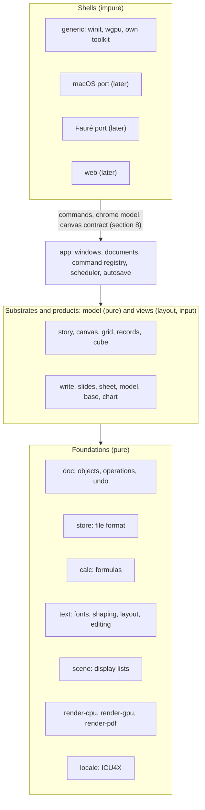
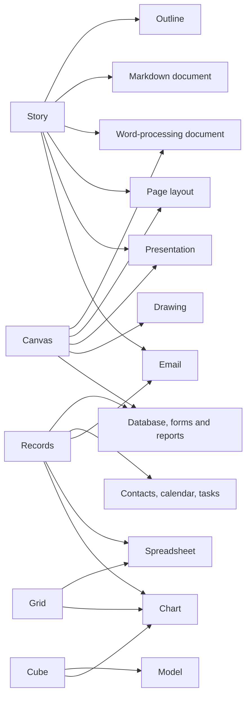

# Architecture

**Status: approved by the project owner in review session pamnqej6
(2026-10-18).** Treat the decisions here as settled; those still open are in
section 14. To change a decision, discuss it with the project owner first,
then update this document.

## 1. Goals

xWorks is an office suite built from scratch to be **usable, fast and
correct**. Microsoft Office shows what happens when thirty years of
compatibility layers pile up. We want to find out how good an office suite
can be without them.

- **Usable.** Everyday work in a few obvious steps. Nothing appears unasked,
  and nothing reflows behind your back.
- **Fast.** Every interaction finishes within a frame, or shows progress and
  never blocks. Startup, opening and saving are measured against budgets
  (section 12), and CI fails when a budget is broken.
- **Correct.** A document means one thing. It lays out the same and computes
  the same on every machine, every time. Saving never loses work, and arithmetic
  follows rules a user can predict.

**Design rule.** When a choice comes up, ask:

> What would we build if the file formats, menus and habits of 1990s office
> software had never existed, but we knew everything those suites taught us?

Office conventions that are genuinely good (the grid, styles, master slides,
the outline view, Improv's categories) stay. Accidents of history (the 1900
leap-year bug, three ways to number a list, page breaks that change with the
printer driver) go.

## 2. Settled decisions

- **Native first, web later** (project owner, 2026-10-18). There is one Rust
  core. The first shell is a native desktop app for Linux, Windows and macOS.
  The core also compiles to WebAssembly, so a browser build can come later
  without a rewrite. That rules out threads, files or clocks inside the core
  (section 3).
- **Our own file format only** (project owner, 2026-10-18). It carries no
  legacy. Modules that import and export other formats (OOXML, ODF, CSV, PDF)
  come later. They live outside the core and convert to and from our model;
  the model never bends to fit them. Markdown is the one exception (below).
- **Operation-based core; collaboration later** (project owner, 2026-10-18).
  Every change is an operation in a transaction. Operations are what undo,
  history, autosave and scripting work on, and later what live multi-user
  editing exchanges. The rules in section 5 keep that later step possible
  without paying for it now.
- **Our own GPU toolkit for the generic version; native widgets in later
  platform ports** (project owner, 2026-10-18). A port for macOS (AppKit),
  and one for [Fauré](../../faure), will use those platforms' own menus,
  toolbars, panels and dialogs. That comes late, once the core functionality
  is dialed in, but the shell is designed for it from the start (section 8).

These were settled in review session pamnqej6 (project owner, 2026-10-18):

- **One integrated app,** in which every kind of document is a part and
  parts embed in each other (section 4).
- **SQLite as the file container,** with a fixed, versioned schema
  (section 6).
- **Continuous autosave into the file,** with named versions; Save marks a
  version (section 6).
- **Fonts embedded in documents,** subset where the font's license requires
  (section 6).
- **128-bit decimal numbers** (section 7), confirmed by M1's prototype
  (review h6nsn9xm, 2026-10-19): calc's own decimal128 in pure Rust, with
  exact equality.
- **Vello's sparse-strips renderers** for drawing (D7, project owner,
  2026-10-19): `vello_cpu` in render-cpu and `vello_gpu` in render-gpu
  (section 10).
- **MIT / Apache-2.0** licensing (section 11).
- **A walking skeleton (M1) before the tracks fan out**
  ([TRACKS.md](TRACKS.md)).
- **Five substrates** (story, canvas, grid, records, cube), with document
  types as views over them, as an advisory way to organize the code, not a
  product requirement (section 4).
- **Markdown files open and save as themselves,** early, in the Story track,
  while the story stays structure-only (section 6).

## 3. System overview



Arrows point from a layer to the layers it depends on.

**Three layers, and code only depends downwards.**

- **Foundations and track models are pure.** They do no I/O, open no
  threads, read no clocks and draw nothing to a screen. Bytes come in and
  data structures come out. That makes them testable without a display,
  identical in WebAssembly, and safe to run on any thread.
- **Track views** turn a model into layout and a display list, and turn input
  events into commands. They are also pure: given the same model, size and
  events, they give the same output.
- **The app and the shells** own everything impure: windows, files, threads,
  timers, the clipboard, the GPU and the platform's widgets.

## 4. Substrates, views and parts

xWorks is **one application** that opens every kind of document, as
ClarisWorks did (project owner, 2026-10-18). It is not a bundle of separate
programs.

### Substrates

**Advisory** (project owner, 2026-10-18). This is how the code is
organized, not a concept users see or a requirement of the product. It holds
only while it keeps the code well organized and maintainable. Where forcing
something into a substrate would make the code worse, give that thing its own
model and record why here.

The idea comes from the owner's answer to decision 8 of review pamnqej6. Many
familiar document types are special cases of each other. A presentation is a
pasteboard of landscape pages. A text document is a few big text frames per
page, and a drawing is small scattered frames, if any. An outline is a terse
text document, and a Markdown file is a text document with structure and no
styling. So xWorks has a small number of **substrates**: kinds of content,
each with its own data model and its own way of addressing things. Every
document type people know is one or two substrates seen through a **view**.

| Substrate | What it holds | Things are addressed by | Views |
|---|---|---|---|
| **Story** | a tree of blocks: headings, paragraphs, lists, quotes, tables, embedded parts | block IDs and text anchors | outline; draft (structure, no pages); poured into frames on a canvas |
| **Canvas** | pages or an open pasteboard, with masters, holding positioned objects: text frames showing stories, shapes, images, embedded parts | object IDs and coordinates | pages; slide sorter; presenter; drawing |
| **Grid** | an open-ended sheet of cells, with formulas that refer to positions | row and column | the grid |
| **Records** | typed tables, relations and queries | table, key and field | table; form; list; card; calendar; report |
| **Cube** | Improv's model: categories of named items, and formulas over them | category items, by name | pivot views, rearranged by dragging categories |

Story and canvas are the substrates of documents. Grid, records and cube are
the substrates of data. Each of those three is a type of its own because its
addressing is: a spreadsheet *is* positional references, a database *is* keys,
and a model *is* names.

Some things are views rather than substrates:

- **Charts** read live, by reference, from a grid range, a records query or a
  cube view, and go wherever a part can be embedded.
- **Forms and reports** are canvases whose frames are bound to records.

### Document types as substrates and views



- **Outline:** a story, in the outline view.
- **Markdown document:** a *structure-only* story. It has no direct
  formatting; its look comes only from the stylesheet. That maps one to one
  onto CommonMark with tables.
- **Word-processing document:** a story poured into a canvas whose pages are
  generated automatically from page styles. Automatic pagination, with
  footnotes, floats and tables that break across pages, is a layout mode of
  the canvas, not a separate engine. Its first form (M1) breaks paragraphs
  between lines with no widows or orphans and keeps headings with what
  follows. Where a page breaks depends only on what comes before it, so an
  edit never moves the breaks before it, and a long document can be laid
  out again from the paragraph that changed.
- **Page layout (DTP):** a canvas with pages laid out by hand and stories
  threaded through frames.
- **Presentation:** a canvas of slide-sized pages in sequence, with masters.
  Each slide's text is a small story. Its outline view edits all of them as
  one outline.
- **Drawing:** a canvas, usually one large page or an open pasteboard, mostly
  of shapes.
- **Spreadsheet:** a grid. A table inside a sheet, with typed columns and
  structured references, is a records table living in the grid, and a
  database table can be opened in a grid view.
- **Model:** a cube. A cube can be fed from a records query, and a pivot of a
  table is a cube derived from it.
- **Database:** records, with forms and reports on canvases.
- **Contacts, calendar and tasks:** records with built-in schemas and
  purpose-made views.
- **Email:** a mailbox is a records table, a message body is a story, and
  writing a message is editing a story. The mail protocols belong to the app
  layer, outside the pure core.

**What this buys:**

- **One outline, many outputs.** Ideas typed into an outline can be laid out
  as a document or as slides by changing the view, not by exporting.
- **Write, Slides, page layout and Draw share one canvas engine.** Each adds
  only what makes it different: automatic pagination, slide sequence and
  presenting, threading and typographic control, or drawing tools.
- **Markdown is exact.** A structure-only story reads and writes Markdown
  without loss.
- **Data flows by reference.** Charts, record tables and cube feeds all point
  at their source, so one change updates every place it shows.

**What a file is.** A `.xw` file holds any number of substrate objects and
views. Its "kind" is just the view it opens in, which also decides the
commands the shell shows. A report with a chart from a sheet holds a story, a
canvas, a grid and a chart view, all in one file.

### Parts

The unit of embedding is the **part**: a view of a substrate object, placed
inside another. Examples are a chart in a report, a live sheet range on a
slide, and a model view in a memo. Every part implements one interface:

- lay out within constraints (a width, or a page box), producing a display
  list
- hit-test a point, and take input events as commands
- describe its commands and the inspector fields for its current selection
- read and write its objects through `doc` (section 5)

Embedding is in-process and typed, with none of OLE's or OpenDoc's
machinery. One shared document model and one file format make that possible.

## 5. Document model and operations (`doc`)

**Objects with stable IDs.** A document is a graph of typed objects:
paragraphs, cells, slides, shapes, records, styles. Each has an ID that never
changes and is never reused. Operations refer to objects by ID, and to text
positions by an anchor (paragraph ID and offset) that is carried across edits.
Array indices are never used as addresses. That rule is what makes
collaboration possible later, and it makes cross-references and comments
survive editing now.

**Operations.** An operation is a small, typed change: insert text, set a
property, move an object, set a cell's formula. Every operation:

- is **invertible**. Applying it returns its inverse, and undo replays the
  inverses.
- is **serializable**, in the file's history and later over the network.
- has a defined **rebase** against every other kind of operation, stating
  how it moves when a concurrent operation lands first. Rebasing isn't used
  until collaboration, but property tests check it from the start. An
  operation without a sound rebase doesn't get merged. Rebase may consult
  the document both operations apply to (project owner, 2026-10-22, review
  pysc65hp). Moving a block can only be checked against a concurrent move
  that would make a cycle by looking at the tree, and collaboration's
  clients hold the document they rebase onto.

A **transaction** groups operations into one undoable step with a name ("Undo
Typing", "Undo Sort"). Commands produce transactions; nothing else changes a
document.

**Immutable snapshots.** Documents are persistent data structures: an edit
produces a new version that shares everything unchanged with the old one.
Snapshots are cheap, so layout, recalculation, spell checking, rendering and
saving all run on background threads against a snapshot, while the UI thread
goes on editing. Large tables (sheets, databases) are stored in chunks, so an
edit copies one chunk, not the table.

**Collaboration, when it comes,** uses a central server that orders
transactions, with clients rebasing their pending work onto the server's
order, as Google Docs and Figma do. That's simpler and faster than a CRDT,
and the rules above are all it needs from the model. Offline editing and
peer-to-peer sync are not goals.

**What M2's stage 2 built** (objects and the block tree). The choices
below are the stage's own, open to the owner's review unless marked
settled.

- **A story is a tree of blocks.** Its paragraphs and containers
  (`doc::Block`) nest: a list holds items, an item or a quote holds blocks
  as the story does, a table holds rows, and a row holds its cells, each a
  paragraph. Headings and code blocks are paragraphs set apart by their
  style (`code: true` for code, as `heading` marks headings), so Enter in
  code breaks its line (U+2028) rather than the paragraph. Containers may
  be empty, as Markdown's `-` is an empty item, but the story always has a
  paragraph. Nothing in the tree is walked by recursion, so no file can
  exhaust the stack.
- **Blocks are made, deleted and moved by operations:** InsertBlock with
  everything in it, DeleteBlock, whose inverse carries the whole subtree
  back, MoveBlock and SetBlockProp, after M1's six so the file format's
  positions hold. M1's operations keep their fields and meaning; a split's
  new paragraph goes after it in its own container, and a join needs the
  next paragraph in the same one.
- **Rebasing two blocks' operations** keeps both changes where its rules
  can: blocks put in one place keep the first one's first; a place after a
  block moved or deleted becomes the place after the one before it; a
  deleted block takes every change inside it with it. Where two can't both
  have their way (moves that together would nest a block in itself,
  deletions that together would leave no paragraph), rebase finds it by
  applying both orders to the document, and the first one wins; `conflict`
  says when. So the two orders always meet. Property tests show M1's
  operations never conflict, and only deletions and moves of blocks do.
- **Child lists stay `Arc<Vec>`,** copied when their own container changes,
  as M1's story was, which the tree confines to one container.
- **Marks:** emphasis and strong are M1's italic and bold; `code` sets a
  run in JetBrains Mono on a tint, and `link` (with `link-title`) holds a
  link's target. A table's column alignment is its cells' `align`; its
  columns share its width, and its first row is its header.
- **`story::flow`** lays the tree out as paragraphs in reading order, each
  in its place: indent, its list item's marker (bullets by depth from the
  sheet, numbers counted, never stored), its quotes' bars, the table cell
  it is, and the containers around it. Nesting past 32 lays out as if it
  stopped there. Lists and quotes indent from the left, also for
  right-to-left paragraphs, until documents have a direction.
- **`canvas`** pours a table's row as one block, and draws markers in
  their gutters, quotes' bars, code on its tint, links in their colour and
  tables' rules. The structure nests, and tagged PDF says `L`, `LI`,
  `Lbl`, `LBody`, `BlockQuote`, `Code`, `Table`, `TR`, `TH` and `TD`. A
  story of paragraphs draws exactly as before.
- **The editor** keeps working by position in the reading order; deleting
  across blocks, joining at their edges, pasting and Enter, Backspace,
  Delete and Tab learn the tree (`app::blocks`): Enter in an empty item or
  at an empty quote's end leaves it, Backspace at an item's start takes it
  out a level, Tab and Shift+Tab nest and un-nest items and move between
  cells, and elsewhere Tab types a tab. The commands for lists, quotes,
  code and tables have shortcuts but no places in the menus yet, as M1's
  menus are an approved golden; the designed chrome places them.
- **Typing lays out one paragraph:** while no container changes, the flow
  is kept, every other paragraph's layout stays where it is, and only the
  changed paragraph's block is made again before pouring, which made a
  keystroke's update cheaper than M1's.

**Pictures in the story** (M2's stage 7; open to the owner's review). A
picture is in a paragraph's text, as Markdown's `` is: the
character U+FFFC, whose run names the picture by its ID in the file
(`picture`), says what it shows (`picture-alt`) and gives the size it's
placed at (`picture-width`, `picture-height`). A paragraph holding one
picture and nothing else is a figure, as a Markdown image alone in its
paragraph is. Inline rather than a block of its own, because:

- Markdown's images are inline, often alone in a paragraph but not
  always, and stage 6 reads and writes Markdown; a block couldn't hold
  an image within a line.
- Operations, rebasing and the editor already serve characters and their
  runs: placing, deleting, undoing and copying out a picture needed no new
  operation or object, and the file's encoding is as it was.
- Layout sets a picture as an inline object (`text::Inline`), a box on the
  baseline that lines break around and grow to hold, scaled down to its
  paragraph's width.

A figure with a caption can come later as a container of a figure
paragraph and its caption, which this doesn't prevent.

## 6. File format (`store`)

One file per document, with the extension `.xw`, the same for every kind of
part. The kind is recorded inside the file.

**Markdown files stay Markdown** (project owner, 2026-10-18). A `.md` file
opens as a structure-only story and saves back as `.md`, CommonMark with
tables, without loss. This comes early, in the Story track, not with the
later interchange modules, because a large share of documents written today
are Markdown. If someone adds something Markdown can't hold, such as a styled
run or an embedded sheet, xWorks asks before turning the document into an
`.xw` file; a Markdown file never changes format silently. A `.md` file has
no room for history, so continuous saving writes the whole file (atomically,
through a rename), and undo history and named versions last only as long as
the document is open.

- **Its language** comes from `lang` in its YAML front matter where there
  is one, as Pandoc, Quarto and Hugo write it. The front matter is kept as
  written (project owner, 2026-10-22, review pysc65hp).
- **Headings are paragraph styles** with a level, as Markdown's `#` lines
  are paragraphs with a level, and a section is a heading and what follows
  it up to the next heading of its level or higher. Moving sections,
  folding and the outline view act on those runs of blocks (project owner,
  2026-10-22, review pysc65hp).
- **Its stylesheet is a Markdown file's program's,** since Markdown can't
  hold one; an `.xw` document carries its own (below).
- **Reading and writing** (project owner, 2026-10-24, review ys9vyag1):
  - it's read with pulldown-cmark and written by our own writer;
  - blocks left untouched are saved byte for byte as their author wrote
    them, and edited blocks follow the file's own habits where they're
    clear (its bullets, emphasis and wrapping), or else a standard style;
  - GitHub's strikethrough and task lists are read and written besides
    CommonMark with tables, and other extensions are kept as written;
  - a picture is linked where it is, by its path, relative to the file
    where one exists, not copied.
- **Its tables are Markdown's** in M2: a header row, rows of cells of one
  paragraph each, and column alignment. Fuller tables come with Write
  (project owner, 2026-10-22, review pysc65hp).

**A document carries its own stylesheet and page style** (project owner,
2026-10-24, review ydqhfds0), edited by operations like the rest of it, so
it looks the same wherever it opens.
- xWorks comes with about half a dozen stylesheets for different moods,
  and people keep their own, in a configuration folder.
- A new document gets a copy of the one chosen, so it never depends on
  what's installed.
- People change a document's stylesheet and define their own styles. A
  layout of tab stops is a style of its own, to use again in a document.

How styles build on each other (cascading, inheritance) is still open,
to be researched across Word, Pages, InDesign, the Claris applications,
Nisus Writer, WordPerfect and FrameMaker; CSS is the example of what not
to do. So is the experience of setting text in columns.

**Container: SQLite** (project owner, 2026-10-18). A document is an SQLite
database with a fixed, versioned schema: objects, the transaction log, embedded
fonts and images, and metadata. The reasons:

- **Saving is atomic and incremental.** Saving a large file writes only what
  changed, and a crash or full disk never leaves a half-written file.
- **Opening is lazy.** A million-row sheet opens on its first screen; the
  rest loads as needed.
- **History is free.** The transaction log is a table. Autosave appends to it
  continuously, so a crash loses at most the last second of work.
- **It is the best-tested storage engine there is,** it runs in WebAssembly,
  and the database track needs an engine anyway.

**Saving is continuous** (project owner, 2026-10-18). Every transaction is
written to the file as it happens; there is no "Save changes?" dialog and no
recovery file. Save names a version, which the user can go back to or copy
out as a document of its own. Undo history and named versions survive closing
the file.

The cost of SQLite is one C dependency (bundled through rusqlite) and files that aren't
text. To make up for the second, `xworks dump` writes any document in a
canonical text form, and tests and goldens use that form.

**The format is specified,** in `spec/format/`, as part of the work rather
than after it. A reader that sees a newer schema version opens the file
read-only and says so; it never guesses.

**How schema 1 works** (M1). The file is marked by SQLite's application ID
and its schema by the user version. A new file is written beside its name
and renamed into place. Each transaction is appended to the log in an
SQLite transaction of its own, with a snapshot of the whole document every
hundred entries; opening reads the latest snapshot and replays the log
after it, and rebuilds undo and redo from the whole log, so history
survives closing. Nothing read is trusted: a snapshot or log entry that
doesn't hold together is an error.

- **Operations and snapshots are binary** (project owner, 2026-10-22,
  review dfx97ttt), in postcard's specified wire format. Enums are written
  by their variants' positions, so new variants of `doc`'s types go at the
  end; a test pins the bytes.

**Schema 2** (M2) holds the block tree and its operations, whose variants
come after M1's, and adds an `image` table for pictures: each one's
original bytes and format, by the SHA-256 of the bytes, as fonts are kept.
Opening a schema 1 file upgrades it in one SQLite transaction, or leaves it
as it was: every snapshot and log entry is read with schema 1's types,
frozen in `store`, and written in schema 2's encoding. A file M1 wrote is
kept as a fixture (`spec/format/fixtures/`), which must open with M1's own
dump of it.
- **A commit survives a crash of the program** (project owner, 2026-10-22,
  review dfx97ttt): SQLite runs in write-ahead-log mode with
  `synchronous = NORMAL`. A power cut can lose the last transactions, but
  never the file.
- **A document carries only fonts that aren't bundled** (project owner,
  2026-10-22, review dfx97ttt). The bundled Noto fonts are on every
  install, and embedding the CJK faces would add 16 to 25 MB to any
  document with one CJK character. In M1 every font is bundled, so none
  is embedded.

**Documents carry their fonts** (project owner, 2026-10-18). The fonts a
document uses are embedded, subset where the font's license requires it, so it
lays out the same on every machine. Missing-font substitution, and the reflow
it causes, is one of the commonest ways office documents break.

**What M2's stage 7 built** (storage). The choices below are the stage's
own, open to the owner's review unless marked settled.

- **A document is open to write in one program at a time** (settled:
  project owner, 2026-10-23, review a23vvez8). The program writing it
  holds a lock on a hidden file beside it, a dot, its name and `-lock`
  (`.Report.xw-lock`), as SQLite's own files beside it are its name and
  `-wal` or `-shm`. The dot hides it on Linux and macOS, and on Windows
  it's made hidden (project owner, 2026-10-23, review k07a0fw7). The lock is the standard library's `File::try_lock`,
  flock on Linux and macOS and LockFileEx on Windows, so it needs no
  dependency; locking the document's own file would fight SQLite's locks
  on Windows. The system lets a lock go when its program ends, however it
  ends; the lock file goes when the document closes. Any other program
  opens the document read-only and says who has it, as the lock file says
  ("open in xWorks, process 4120 on studio"), or, on Windows, whose lock
  keeps others from reading even that, that another program has it.
  Within one xWorks, the shell brings forward the window that has a
  document rather than open it again. A document renamed or moved while
  it's open takes its lock file along, still held (`Store::moved`).
- **Named versions** open read-only in windows of their own, opened only
  to read (`Store::open_to_read`), without the lock, so the document goes
  on being written meanwhile. Copy Out writes one as a document of its
  own beside the original, "Report (Version 2).xw", with no history,
  carrying the fonts and the pictures it shows (`Store::copy_out`).
- **Pictures are kept** in schema 2's `image` table, once each by the
  SHA-256 of their bytes, and never deleted, as undoing may bring one
  back. Bytes that aren't what their ID says are damage. The dump lists
  pictures where a file has some, so M1's fixture dumps as it did.

## 7. Values and formulas (`calc`)

One formula language serves every track: sheet cells, model formulas,
database computed fields and queries, and fields in text. Each track binds
names differently (`B7`, `Revenue[Q3]`, `Order.Total`); the parser, type
checker, evaluator and function library are shared.

**Typed values.** A value is one of: number, text, boolean, date, time,
date-time, duration, error, empty, or array. Dates are dates, not serial
numbers: there is no 1900 leap-year bug and no 1900/1904 epoch switch.

**Numbers are decimal** (project owner, 2026-10-18; confirmed 2026-10-19,
review h6nsn9xm). Arithmetic is IEEE 754 decimal128's: 34 significant
digits, rounded half to even, so `0.1 + 0.2 = 0.3` and money adds up to the
cent. Binary floating point causes the commonest "the spreadsheet is wrong"
complaints, and Excel hides them with display rounding that breaks equality
tests. Transcendental and statistical functions compute in binary and round
to decimal at a documented boundary.

- **The implementation is calc's own** (`calc::decimal`), in pure Rust, so
  the core stays pure and builds for WebAssembly. Neither library fitted:
  `fastnum` isn't decimal128, and libdecNumber is C. It passes decimal128's
  test cases and agrees with libdecNumber on ten million random results
  (`prototypes/decimal/`).
- **The cost is speed:** about 30 ns to add and 13 ns to multiply, where
  binary takes about one. A million-cell recalculation takes 160 ms on one
  thread, and one frame covers a chain of about 100,000 dependent cells.
- **Equality is exact** (project owner, 2026-10-19). `=` compares values as
  the arithmetic computes them, with no tolerance: `(1/3)*3 = 1` is false,
  because the left side is 0.999…9 to 34 digits. Number formats show it as
  1, and `ROUND` makes it 1. Comparing with a tolerance would break
  transitivity, and with it sorting and lookups.

**Recalculation** is incremental, over a dependency graph, on worker threads,
against snapshots. Its results don't depend on thread count or scheduling:
order-sensitive operations such as summing a range always run in a defined
order. Cycles are errors unless the user turns on iteration for that part.

**The function library is data.** Each function's signature, documentation and
test cases live in `spec/functions/` as RON files. Tests are generated from
them, and so are the help pages and the autocomplete.

## 8. Shells, toolkit and native ports

The shell boundary is drawn so that a platform port replaces the chrome and
keeps the documents. Three things cross it.

**1. Commands.** Every user action is a named command with typed arguments,
an enabled state, a checked or mixed state, a title and a default shortcut:
`format.bold`, `sheet.insert-rows`, `slides.play`. Commands are described as
data (`spec/commands/`), and drive everything: menus, toolbars, shortcuts,
the command palette, undo names, macros, scripting, tests and the agent
interface. The Fauré port publishes them as a scripting dictionary to
Fauré's broker, and the macOS port can later map them to AppleScript.

**2. The chrome model.** The app describes its chrome declaratively, the way
the Elm architecture describes a view: menus, toolbars, an inspector made of
typed fields (a font picker, a length, a color, a choice), dialogs as forms,
and the status bar. It describes *what* is there, never pixels. The generic
toolkit draws this model itself. The macOS port builds NSMenus, NSToolbars and
panels from it, and the Fauré port builds Fauré toolkit widgets and publishes
menus through Fauré's menu protocol. Chrome that can't be expressed in the
model is a gap in the model, to be filled there, not in one shell.

**3. The canvas contract.** Document content is always drawn by xWorks, in
every shell, because it must look identical everywhere. A shell gives each
part a surface and passes it input events (pointer, keys, IME composition,
scrolling, gestures). The part returns frames (a display list) and an
accessibility tree (AccessKit), and asks for a caret, IME placement, cursor
shape or redraw.

**The generic shell** uses winit for windows and input, wgpu for drawing,
AccessKit for accessibility, and the xWorks toolkit for the chrome: a small,
retained, data-driven toolkit that draws the chrome model with the same
renderer as the documents. It doesn't try to be a general-purpose GUI library.

**App model.** The app follows the Elm architecture, as Fauré's toolkit does:
a model, an `update(command)` and a `view` that returns the chrome model. It
avoids webs of shared mutable callbacks, and app logic can be tested without a
display.

**Threads.** The UI thread handles input, applies transactions, and draws
frames. A worker pool (rayon) does layout, recalculation, pagination,
spelling, import and saving, against snapshots; results are tagged with the
version they were computed for. There is no async runtime.

### The interaction model

Settled in M2's UX design (project owner, 2026-10-22, review frhewnk0).
Each piece has a native counterpart, so the macOS and Fauré ports map it
rather than invent it.

- **A window per document.** Where the platform tabs windows (macOS),
  windows tab; there's no tab strip of our own.
- **Parts are edited in place.** Double-click or Enter goes into a part,
  and Escape comes out; menus and the inspector follow what's selected.
- **One selection, at one level.**
  - A click selects at the current level, Enter or a double-click goes in a
    level, and Escape goes out.
  - A word-processing page starts inside its text, a slide at its objects,
    and a sheet at its cells.
- **The chrome:**
  - a menu bar with every command;
  - an inspector, a side panel of the selection's properties, opened and
    closed by the person;
  - a command palette that finds every command by name;
  - the status bar.

  There's no global toolbar. A document shows a ruler with its tab stops,
  which can be hidden; tab settings apply to the document or to a
  paragraph style. A few contextual buttons may sit in the window's title
  bar and in inspector panels, such as switching between draft and pages,
  with Claude Desktop as the model of how few.
- **The keyboard:**
  - each platform's own shortcuts, with menu access keys on Windows and
    Linux;
  - every command reachable from the palette;
  - remapping later, as shortcuts are data;
  - Vim motions as an option later, not a priority now;
  - moving by word as each platform does: Ctrl+Right stops at the next
    word's start on Windows and Linux, Option+Right at the word's end on
    a Mac (project owner, 2026-10-23, review dcn5ejrd).
- **The look:**
  - Inter, bundled, for the interface, with Noto for scripts it lacks;
  - compact rows of 24 to 28 px, for mouse and keyboard;
  - light and dark, following the system;
  - Lucide's icons (ISC licence) where the chrome needs them;
  - white pages on an off-white desk, which is easier on the eyes than a
    grey one.
- **Views:** a Markdown document opens as a draft, one continuous column
  without pages, with pages a command away. A word-processing document
  opens on pages.
- **xWorks draws its own title bar** in the generic shell, holding the
  menus, the document's name, the contextual buttons and the window's own
  buttons (project owner, 2026-10-22, review 3ce247c2). The macOS port
  uses AppKit's unified title bar and toolbar instead.

Settled for M2's stages 5 and 7 (project owner, 2026-10-23, review
a23vvez8):

- **Files are opened and saved through the system's own dialogs** (rfd):
  portals on Linux, the common dialogs on Windows.
- **A new document is named after its first heading or line** until it's
  named by hand; with continuous saving there's no Save As moment to ask.
- **A document is never open twice.** If this xWorks has it open, its
  window comes forward; if another program has it, it opens read-only and
  says why.
- **xWorks keeps the last few minutes of what a person does,** in memory,
  as a session, and writes it out when asked or when xWorks fails, for
  bug reports. It holds the keys pressed, and so the document's text,
  but not the undo history from before it, so it never holds text deleted
  before it (project owner, 2026-10-23, review k07a0fw7).

From trying the chrome live (project owner, 2026-10-24, review ydqhfds0):

- **The ruler spans the window,** but its ticks and numbers stop at the
  page's edges. Its origin is the text column's left edge, as word
  processors have it (Word, Pages, Writer); page layout's rulers start at
  the page's edge (InDesign, QuarkXPress, FrameMaker), which the canvas
  can offer later.
- **Its units are a choice** in a View submenu: centimetres, inches and
  picas.
- **The caret blinks at the system's rate.**

The owner approved mockups of all this as goldens (`mockup-pages`,
`mockup-pages-dark`, `mockup-draft-dark` and `mockup-palette`, drawn by
`shot`, review 3ce247c2); the chrome M2 builds matches them.

**What M2's stage 5 built** (the designed chrome). The choices below are
the stage's own, open to the owner's review unless marked settled.

- **A window holds a part.** `app::Window` draws the chrome and gives the
  document's area to the `app::Editor`, the first part behind the canvas
  contract (`part`): a surface, input in its own coordinates, and back
  frames, an AccessKit tree, its caret, the pointer's shape, requests for
  the clipboard and files, its commands' state, the inspector's fields
  and the ruler.
- **The chrome model grew** (`chrome`): titles mark access keys with `&`;
  commands take typed arguments (text and numbers), which the inspector,
  the ruler, submenus the app fills (Open Recent) and scripts give them;
  the inspector is tabs of sections of rows of controls (a choice from a
  list, a length with its unit, a toggle, segments, a button); the ruler
  is a column with a paragraph's indents and stops. The look is data:
  `spec/themes/chrome.ron` for type and sizes, `light.ron` and `dark.ron`
  for each look's colours by role, which the mockups read too.
- **The menus** are File, Edit, View, Insert, Format and Help; stage 7's
  commands sit in File (Versions, Copy Out), Insert (Picture) and Help
  (Save Recent Session), and Versions lists them over the document. Every
  command that runs without an argument is in one, but for moving the
  caret, which is keys, and languages and sizes, which the inspector sets;
  the palette finds them all, by a title's start, a word's, the letters
  anywhere, then in order from a word's start. Alt let go alone, or F10,
  gives the menus the keyboard on Windows and Linux; Alt and a letter
  opens one. New shortcuts avoid Ctrl+Alt, which is AltGr on Windows: the
  palette is Ctrl+Shift+P, the inspector Ctrl+Shift+I and the ruler
  Ctrl+Shift+R.
- **The draft** is the story in a column at most 640 pixels wide on the
  desk, in the look's ink; it prints on pages as ever.
- **The ruler** measures in centimetres from the column's start, and a
  paragraph's indents and stops from its own place, which a list or a
  quote moves in. A click at its foot sets a stop, snapped to 2.5 mm; a
  stop dragged off it goes.
- **Paragraphs carry their own** spacing, line height (in thousandths of
  the largest font size on a line: 1 200 is 1.2 times the font), start,
  end and first-line indents, and tab stops, as properties (`story::keys`)
  over their style's. A paragraph's own stops take the place of its
  style's and the document's set ones; the document's default stops
  follow them.
- **Naming.** A document's name comes from its first heading, or with
  none its first line, while its file is still called "Untitled" or after
  that text; the title bar shows it as it's typed, and the file takes it
  when the caret leaves that paragraph or the window closes. Clicking the
  name renames the document in place; File, Move To moves it through the
  system's dialog. Either way it's named by hand from then on. The file
  moves in one place, `Editor::relocate`, which closes the database first
  so SQLite folds its log into the file. The documents opened lately, ten,
  are kept in the system's folder for settings.
- **Screen readers** get the text as a multiline text input of
  paragraphs and headings, each line a text run with its graphemes, where
  each sits, where its words start, and the selection in them.

Not yet: **a document's own page size and margins, and tab stops set for
a style**, need documents to hold their style sheet and page style, which
the file format doesn't (they come from `spec/styles/`); the inspector's
Page tab shows them, unchangeable, until the owner decides where they
live.

**The session recorder** (built in M2's stage 7; open to the owner's
review but where settled above). Each window notes every event it
handles as a step of a session (`app::recorder`), in the format of
`spec/sessions/`, and now and then, when the window is at rest, a
checkpoint: its document, which shares what's unchanged, its selection,
scroll and run of typing, and what its chrome showed (stage 5
moved the recorder from the editor to the window, so what's done in the
chrome plays back too). What's kept starts at the newest
checkpoint at least five minutes old (`spec/recorder.ron`), and a session
starts there, its document written whole, so it plays back headless to
the same document (`Window::resume`), which tests show; only an Undo
reaching back past its start takes back less than it did live. Text pasted is
kept as what the clipboard held; a picture placed, as its file's path,
so a session played on another machine lacks the picture. Save Recent
Session writes it, and when xWorks fails the shell's panic hook writes
every window's, to "xWorks sessions" in the documents folder, where the
person finds their documents, and says where: in the status bar, or on
the terminal. Nothing is sent anywhere.

## 9. Text (`text`)

Text is the hardest shared piece; every track depends on it. We write our own
layout and editing, on the same pure-Rust stack Fauré uses:

- **Fonts and glyphs:** skrifa (fontations). **Shaping:** HarfRust.
  rustybuzz was archived in 2026 and isn't used.
- **Unicode and locale:** ICU4X for line breaking, word and sentence
  segmentation, bidirectional text, collation, case mapping, and number and
  date formatting. For bidi, ICU4X has the data and `unicode-bidi` runs the
  algorithm on it.
- **Paragraph breaking:** optimal (Knuth–Plass) breaking for justified
  text, and first-fit where it's cheaper and looks the same, with
  hyphenation from TeX's pattern files.
- **Layout units are fixed-point integers.** One unit is 1/914 400 inch,
  divisible by points (12 700), millimetres (36 000) and 96-dpi pixels
  (9 525). With integer layout, line and page breaks are identical on
  every platform and in WebAssembly, where float behavior can differ.
- **Editing:** carets, selections, IME composition and bidi caret movement
  are part of `text`, so the word processor, text boxes on slides, sheet
  cells and database fields all edit text the same way.

**How a paragraph is laid out.** Its text is divided into items of one
style, one face, one bidi level and one script, and each item is shaped on
its own, with the text around it as context so letters join across style
changes. A character comes from its style's family if that has it, or else
from the first of the family's fallbacks that does; the fallbacks are data
(`spec/text/fonts.ron`). Spaces and punctuation stay in the face of the text
before them when it has them, so Arabic keeps Arabic spaces. Lines are broken
first fit where UAX #14 allows, and each candidate line is measured as it
will be shaped: where a break falls between glyphs that interact, such as a
kerning pair, the line's edge is shaped again. A word too wide for a line is
broken between graphemes. Spaces at a line's end hang past it. Each line is
then ordered for display on its own (UAX #9, rules L1 and L2), aligned, and
made as tall as its fonts' ascent and descent.

**Justified, hyphenated and tabbed text** (M2, stage 3). Ragged lines stay
first fit, so typing never moves a line above the caret. Justified ones
break by Knuth and Plass's algorithm, measured by the same function, and
scored with TeX's integer badness, penalties and demerits (line penalty,
hyphens, consecutive hyphens, a hyphen ending the last line but one, and
neighbours of different tightness), so they break the same everywhere. A
first pass allows TeX's tolerance of 200; where no paragraph fits that, as
in narrow columns, a second scores lines with emergency stretch, a
sixteenth of the width, and badness past TeX's cap, so a looser line is
always worse. Lines stretch, never shrink: at their spaces, half a space
each, and between Chinese and Japanese characters, a quarter of one;
Arabic and Hebrew at their spaces only. The last line and lines ending at
a hard break sit at the start.

- **Hyphenation** is Liang's, on TeX's pattern files as they ship, with
  each language's exceptions and minimums (`spec/text/hyphenation.ron`).
  Styles hyphenate where their lines are justified, unless they say
  otherwise; ragged lines that do hyphenate only where a line would
  otherwise leave a tenth of it empty (project owner, 2026-10-23, review
  dcn5ejrd). Soft hyphens always break.
- **Ligatures** are a style's to set, class by class: standard,
  contextual, discretionary and historical (project owner, 2026-10-23,
  review dcn5ejrd). Code sets none, so it shows exactly what was typed.
- **The hyphen a break adds** is U+2010 where the face of the letter
  before it has it, and the hyphen-minus otherwise, shaped in that face.
  It's no character of the text: it's part of the letter's cell, so the
  caret at the line's end stands after it, and in PDF it reads as a soft
  hyphen, U+00AD, as tagged PDF asks of hyphens layout adds. A soft hyphen
  where a line breaks shows the same glyph in its own place.
- **Tabs** go to stops set on the paragraph's style and the document,
  then to default stops at the document's interval (12.5 mm), measured
  from the paragraph's start edge: start, end, centred, and decimal on a
  character the stop names. A justified line stretches after its last tab.
- **Line heights and indents** (M2, stage 5): a line can be made a
  multiple of its largest font size tall, the difference from its fonts'
  own split evenly above and below, and a paragraph's first line indented
  from its start edge, or hung out past it; both breakers measure the
  first line in the room it has.
- **Language** decides more than letterforms. Japanese and Chinese break
  lines by CSS's `normal` rules for their language, which let a line start
  with a small kana; other text by UAX #14's default, `strict`. Words and
  sentences, for moving the caret, double and triple clicks, and counting,
  come from ICU4X's segmenters with the text's language; Chinese and
  Japanese words from its dictionary, which adds 2 MB to the program.
  Hyphenated compounds count as one word. A document's language is its
  paragraphs', set on the first when it's made and passed on as
  paragraphs split.

**The caret** stands between graphemes, and a cursor is an offset with an
affinity: whether it belongs with the character before it or the one after.
Where directions meet, one offset is two places on screen, and where a line
wraps, one offset is the end of one line and the start of the next; the
affinity says which. The caret keeps to the character just typed or just
moved past, so it stands where the next character typed in that script will
appear. It moves two ways: on screen, left and right grapheme by grapheme,
going on at the next line in the paragraph's reading order; and in the
text's order, forward and back. **The arrow keys move it on screen**: Left
always moves it left, in mixed-direction text too (project owner,
2026-10-21). Hit-testing a point finds the nearer edge of the grapheme
there. Selections are logical ranges, highlighted as one rectangle per
stretch that is together on screen.

**Italic in a family without one** is the upright face slanted (project
owner, 2026-10-21). Noto has no italic for Arabic, Hebrew or CJK; `text`
marks such runs as oblique, and the display list slants their glyphs.

**Fonts for M1** are Noto: Serif and Sans with italics, Naskh and Sans
Arabic, Serif and Sans Hebrew, and the pan-CJK Serif and Sans, whose `locl`
feature picks Japanese, Korean or Chinese forms by language. Noto Serif
falls back to the serif CJK face and Noto Sans to the sans (project owner,
2026-10-21). They come to 87 MB, so they're fetched by hash (`cargo run -p
fetch-fonts`) rather than committed (project owner, 2026-10-21).

**Documents' fonts from M2** are Source Serif 4 for serif, a transitional
face after Fournier's, Inter for sans and JetBrains Mono for code (project
owner, 2026-10-22, review pysc65hp). Noto stays the fallback for every
script they lack. Other moods, Garamond's or Alegreya's, can come as
stylesheets of their own.

**A document has a language,** the system's when it's made, and text can be
set to another (project owner, 2026-10-22, review pysc65hp). Language picks
hyphenation, Japanese line breaking and local letterforms, and goes to PDF
and screen readers.

**Hyphenation** follows TeX's pattern files, by Liang's algorithm, for
English (US and UK), German, French, Spanish, Norwegian (Bokmål and
Nynorsk), Swedish, Russian and Greek (project owner, 2026-10-22, review
pysc65hp). The files ship unmodified, beside the fonts, and are read when a
language needs them; their licences (MIT, permissive notices, and LPPL for
Swedish and Russian) all allow that.

Fauré's `text` and `typeset` crates are tuned for pixel-exact Platinum UI
text; xWorks needs resolution-independent document text. The two share the
stack and the lessons, not the crates.

## 10. Rendering (`scene`, `render-*`)

Views produce a **display list** (`scene`): glyph runs, paths, fills,
strokes, images, clips, and transforms, in layout units. Three backends draw
it:

- **render-cpu:** a software rasterizer, the reference. Output is the same
  every run, so tests and golden images use it, and it is also the fallback
  when there's no usable GPU.
- **render-gpu:** wgpu, for the shells. It must match render-cpu closely,
  not bit for bit; tests compare the two within a tolerance.
- **render-pdf:** PDF output, for print and export. Printing is "render to
  PDF, hand it to the system", so what prints is what's on screen.

**The renderers are Vello's sparse-strips pair** (D7, project owner,
2026-10-19): `vello_cpu` inside render-cpu and `vello_gpu` inside
render-gpu, behind our own `scene`. M1's comparison
(`prototypes/renderers/`) chose them over Vello's compute renderer and over
tiny-skia:

- **They agree.** The two share one architecture and one drawing API, and
  `vello_gpu`'s pixels are within 1 of `vello_cpu`'s on text and 6 on
  gradients, out of 255. Goldens rendered on the CPU hold for the GPU.
  Vello's compute renderer differs by up to 60 on a few percent of pixels.
- **They're fast enough.** With their glyph cache, a full A4 page of text
  takes 3.5 ms on a GTX 1070, and 6.6 ms on eight CPU threads.
- **They start fast.** `vello_gpu` compiles its shaders in 0.6 s on a cold
  DirectX 12, against 4.8 s for the compute renderer.
- **They reach the web** through WebGL as well as WebGPU.

What follows from them:

- **The glyph cache is experimental** in both crates, and it changes glyph
  pixels compared with uncached drawing. Cached CPU and GPU renders still
  agree. If it fails us, text is twice as slow until we cache glyphs
  ourselves.
- **`vello_cpu` has two outputs, at most 1 apart:** one for the wide SIMD
  paths (AVX2 on x86-64, NEON on Arm) and one for the narrow ones (SSE2,
  and the scalar fallback). Within each, Linux, Windows and macOS draw
  identical pixels, on any number of threads. Goldens therefore render at
  one pinned level (project owner, 2026-10-22, review 64capttj): the
  scalar fallback, render-cpu's `Level::Portable`,
  which every machine has, Arm included, and which CI checks on Linux,
  Windows and macOS. The screen uses the fastest level the machine has.

**What M1 built.** `scene` holds pages of fills, strokes and glyph runs.
`text` paints a laid-out paragraph into it: each glyph carries the text its
cluster shows, and a run in a family without an italic is marked oblique,
which every renderer slants by 12° about its baseline. render-cpu draws
with `vello_cpu`, single-threaded, so it stays a pure crate; the app runs
it on its workers. render-pdf writes with krilla (from the Typst project),
which embeds each font subset to the glyphs used, with a Unicode mapping so
text can be searched and copied.

**PDF is tagged from M1** (project owner, 2026-10-22, review 64capttj).
Pages come with the document's structure, its paragraphs and headings in
reading order, and each glyph run says which block its text belongs to and
in what language. The PDF's tag tree holds each block once, with its text
from every page it falls on, in reading order. Text is written in the
order it reads: a line's runs in logical order, and a right-to-left run's
glyphs from its right end. So Arabic and Hebrew extract as typed even in
readers that don't apply the bidi algorithm, and screen readers follow
the document's structure. Fills and strokes are artifacts, outside it.

**Images** (project owner, 2026-10-22, review pysc65hp) are PNG, JPEG, GIF
and WebP; a GIF shows its first frame. Each is converted to sRGB when it's
placed, so print matches the screen, and the file keeps the original's
bytes, so better colour management later loses nothing. Every decoder gets
a fuzz target.

**What M2's stage 4 built** (images and drawing):

- **The display list** has images and groups. A `scene::Image` is sRGB and
  premultiplied, at most 4 094 pixels a side, and holds copies of itself
  halved down to a pixel, made by an area-averaging resampler in integers,
  so every platform gets the same pixels. Renderers draw an image from its
  smallest copy at least as large as it's drawn, bilinearly: the copies
  stand in for the mipmaps neither vello renderer has. A group draws its
  items through a transform, within a clip. Items outside groups are drawn
  at their coordinates scaled, as in M1, so M1's goldens kept their hashes.
- **The app decodes pictures** (`app::picture`) with png, zune-jpeg, gif
  and image-webp, and converts them to sRGB from their ICC profiles with
  moxcms. A JPEG turns as its EXIF orientation says. A picture with more
  pixels than `spec/pictures.ron` allows is refused from its header.
- **render-gpu keeps images in vello_gpu's atlas** only while they're
  drawn, at most 64 at once in as many atlas pages, so the atlas can't run
  out of room, and each with a texel of border copied from its edge:
  vello_gpu clamps a sample before taking half a texel off it, which blends
  an image's last two texels at its right and bottom edges, where
  vello_cpu holds the edge.
- **render-pdf writes images as figures**, with their alternative text,
  from the same sRGB pixels the screen draws. An sRGB JPEG is to pass
  through unchanged instead, keeping its size (project owner, 2026-10-23,
  review dcn5ejrd). Stage 7 built that: a colour JPEG shown as it's
  stored, without a profile or with one that converts to sRGB as itself,
  keeps its file in its `scene::Image`, and render-pdf writes the file as
  it is, through krilla's JPEG path. A grey, CMYK or turned JPEG, or one
  in another space, prints from its pixels.
- **Pictures in documents** (stage 7) are drawn by `canvas` where their
  characters stand, from the pictures the app decoded (`canvas::Pictures`),
  as images in the structure where their characters are, so PDF tags each
  as a figure with its alternative text; a figure paragraph is a figure
  block. One the document's file lacks is a tint.
- **Underline and strikethrough** are fills that `text` places from each
  run's font's own `post` and `OS/2` tables, as long as its glyphs but for
  the spaces hanging at a line's end. As fills they're decoration in PDF,
  outside the reading order.
- **Windows draw only what changed.** A window keeps a canvas, a texture
  of its own; each frame diffs the view's display list against the one the
  canvas shows and draws only the damage into it, then copies it whole to
  the window, as wgpu presents only whole frames. The display lists are
  diffed, rather than the view saying what changed, so the view stays a
  function of the editor's state and nothing that changes the state has to
  say where; chrome, documents and parts are all covered alike. The diff
  is Myers' algorithm over hashes of the items, and each changed item
  damages its bounds; a glyph run's are its font's bounding box.
- **Tests read PDF text with a second reader** (`testkit::pdf`), through
  the fonts' ToUnicode maps and krilla's `/ActualText`, which pdf-extract
  ignores, misreading Arabic.

## 11. Security, robustness and licensing

- **License:** MIT / Apache-2.0, at the user's option (project owner,
  2026-10-18). As for Fauré, copyright in largely AI-generated code is
  uncertain in some jurisdictions and copyleft depends on it, so a permissive
  license is the safer fit. Dependencies must be permissively licensed too;
  `cargo deny` checks it. The Boost license (BSL-1.0) is allowed, for the
  crates that reach the Windows clipboard (project owner, 2026-10-22,
  review yzmxnt0g).

- **No macros run on open.** Scripts in a document run only after the user
  allows them, and then only with the capabilities they declare (this
  document, the network, files); nothing gets ambient access. Macro viruses
  should be impossible by construction, not patched later.
- **Every reader is fuzzed:** the file format, and later every importer.
  Malformed input gives an error, never a panic, a hang or unbounded memory.
- **Limits are explicit:** nesting depth, formula length, table sizes, image
  dimensions. Each limit is documented, and tested at the limit.
- **Unsafe Rust is confined** to the shells and renderer backends, and each
  use is justified in a comment.

## 12. Performance budgets

M1, the walking skeleton ([ROADMAP.md](ROADMAP.md)), measured what's
achievable. The owner settled four budgets as proposed (keystroke,
opening a report, scrolling and saving) and revised memory's to 120 MB
(project owner, 2026-10-22, review 094846qg). Cold start's 300 ms stands
as proposed, and the plan the owner chose for it in that review meets it.
The sheet's two stay proposals until a sheet exists. All are measured by
hand on the project owner's workstation at each milestone's exit, with a
benchmark harness that any machine can run (project owner, 2026-10-18). Later, a self-hosted CI runner on a fixed machine with a GPU
will check them on every push, and a regression will fail the build; that
runner is a noted to-do, not yet planned.

The harness is `tools/budgets`. It reads the numbers it measures against
from `spec/budgets.ron`, whose names must match this table's rows, and
judges each by its 95th percentile.

| Interaction | Budget |
|---|---|
| Cold start to an editable blank document | 300 ms |
| Keystroke to the glyph on screen | one frame at 60 Hz (16 ms) |
| Open a 500-page report, first page shown | 200 ms |
| Open a sheet with 1 million filled cells, first screen | 300 ms |
| Recalculate after one edit, typical dependent chain | under one frame |
| Scroll any document | every frame at the display's rate |
| Save after a small edit, any document size | 50 ms |
| Memory for an empty document window | 120 MB |

**Measured at M1's exit** (2026-10-22), on the owner's workstation: 16
threads, a GeForce GTX 1070. Windows draws with render-gpu on Vulkan;
Linux runs under WSL, whose only GPU is software, so it draws with
render-cpu. The 95th percentile of each, with the first measurement in
brackets where the plans below changed it:

| Interaction | Linux (WSL) | Windows |
|---|---|---|
| Cold start to an editable blank document | 146 ms (198) | 289 ms (894) |
| Keystroke to the glyph on screen | 16.1 ms | 12.7 ms |
| Open a 500-page report, first page shown | 105 ms | 162 ms |
| Scroll any document | 11.9 ms | 8.6 ms |
| Save after a small edit, any document size | 0.1 ms (worst 9 ms) | 0.1 ms (worst 18 ms) |
| Memory for an empty document window | 113 MB (193) | 64 MB (191) |

The first measurement missed two budgets, and the owner chose a plan for
each (review 094846qg):

- **Memory:** the CJK faces, 83 MB of the 87 MB of bundled fonts, load
  only once text needs them (`on_demand` in `spec/text/fonts.ron`). Under
  WSL, most of what's left is the software GPU's 72 MB.
- **Cold start:** the GPU opens on a thread from the program's start; on
  Windows Vulkan comes first, which opens in a fifth of DirectX 12's
  time; and render-cpu draws the first frames while vello_gpu compiles its
  shaders on a thread. Measuring that showed the surface's FIFO swapchain
  took 170 ms to make, so the shell presents with Mailbox where it can,
  which took 40 ms, and frees 50 MB.

The first start of a newly built program is slower, up to 0.8 s on
Windows, while the GPU driver compiles and caches its shaders.

## 13. Engineering approach

As with Fauré, most code will be written by agents, so checking it, not
writing it, is the bottleneck. The rules follow from that:

- **Tests come first.** Every track starts with its acceptance tests, specs
  and golden renders. People write or approve those, and agents implement
  until they pass.
- **Output is the same on every run, and nothing needs a screen.** Views
  render through render-cpu into exact images. The `shot` tool renders any
  document, part or scripted session to a PNG, so agents can see what they
  built. Goldens are stored as hashes, as in Fauré.
- **Scripted sessions** replay input (commands, or raw events) against the
  headless app and compare the resulting document dump and frames.
- **Specs are data:** commands, functions, styles, default themes and limits
  live as RON under `spec/`, where they make readable diffs.
- **Properties and fuzzing:** operations are property-tested for inversion
  and rebase. Readers are fuzzed, every night in CI from the corpora the
  last runs kept (`.github/workflows/fuzz.yml`), and formulas are
  differentially tested against independent implementations where their
  meanings coincide.
- **Plain, explicit Rust; small crates; few pinned dependencies.** That
  keeps each agent's context bounded and its feedback loop fast. Contracts
  between crates are written before parallel work starts on either side.

## 14. Open decisions

Review session pamnqej6 settled D2 to D6 and D9 (section 2), and D1, Rust,
stable, edition 2024 on Fauré's toolchain, which it assumed without
objection (project owner, 2026-10-18). D7, the renderer, was settled on
M1's measurements (project owner, 2026-10-19; section 10). This remains:

| # | Decision | Recommendation | Alternatives |
|---|---|---|---|
| D8 | Macro and scripting language | decide later, with the scripting track; commands are its foundation either way | — |

## 15. Tech stack (proposed)

| Area | Choice |
|---|---|
| Language | Rust, stable toolchain, edition 2024 |
| Windows and input (generic shell) | winit |
| GPU | wgpu |
| 2D rendering | our `scene` display list, drawn by `vello_cpu` and `vello_gpu` (D7) |
| PDF | krilla or pdf-writer |
| Text | skrifa, HarfRust; our own layout and editing; TeX hyphenation patterns |
| Unicode and locale | ICU4X |
| Accessibility | AccessKit |
| File dialogs (generic shell) | rfd: portals on Linux, the common dialogs on Windows (review a23vvez8) |
| Storage | SQLite through rusqlite (bundled) |
| Decimal arithmetic | our own decimal128, `calc::decimal` (review h6nsn9xm) |
| Persistent data | imbl, or our own chunked structures for tables |
| Parallelism | rayon; no async runtime |
| macOS port (later) | objc2 bindings to AppKit |
| Fauré port (later) | Fauré's toolkit, menu protocol and scripting broker |
| Errors, logging, data | thiserror (libraries), anyhow (tools only), tracing, serde + RON |
| Tests | cargo-nextest, our image-diff harness, insta, proptest, cargo-fuzz, criterion for budgets |

## 16. Repository layout (planned)

```
crates/
  doc/          objects, IDs, operations, transactions, undo, snapshots
  store/        the .xw format: schema, reading, writing, history, dump
  calc/         values, decimal numbers, formula language, functions, recalculation
  locale/       ICU4X wrappers: segmentation, collation, number and date formats
  text/         fonts, shaping, paragraph layout, hyphenation, editing
  scene/        the display list
  render-cpu/  render-gpu/  render-pdf/
  part/         the part interface, embedding, the canvas contract
  chrome/       commands and the chrome model
  toolkit/      the generic shell's toolkit, drawing the chrome model
  app/          documents, windows, scheduler, autosave; no platform code
  story/  canvas/  grid/  records/  cube/    substrates: model and views
  write/  slides/  sheet/  model/  base/  chart/   product features over them
  testkit/      golden images, scripted sessions, document dumps
shells/
  generic/      winit + wgpu
  macos/  faure/  web/     later
tools/
  shot/         render a document, part or session to PNG
  xworks-dump/  canonical text form of a document
spec/
  format/  commands/  functions/  styles/  limits/  golden/  sessions/
docs/
  ARCHITECTURE.md  TRACKS.md
```
