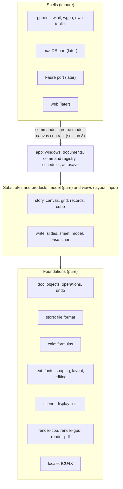
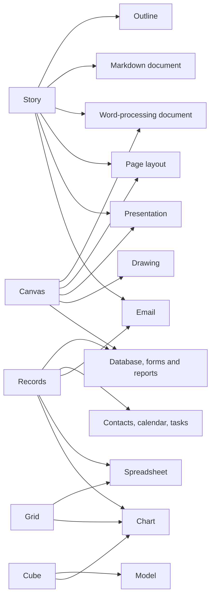

# Architecture

**Status: draft for the project owner's review.** Decisions marked
*(project owner, date)* are settled. Everything else is a proposal until the
owner approves it; section 14 lists the open decisions with a recommendation
for each. Once a decision is settled, change it only after discussing it with
the project owner, then update this document.

## 1. Goals

xWorks is an office suite built from scratch to be **usable, fast and
correct**. Microsoft Office shows what happens when thirty years of
compatibility layers pile up. We want to find out how good an office suite
can be without them.

- **Usable.** Everyday work in a few obvious steps. Nothing appears unasked,
  and nothing reflows behind your back.
- **Fast.** Every interaction finishes within a frame, or shows progress and
  never blocks. Startup, opening and saving are measured against budgets
  (section 12), and CI fails when a budget is broken.
- **Correct.** A document means one thing. It lays out the same and computes
  the same on every machine, every time. Saving never loses work, and arithmetic
  follows rules a user can predict.

**Design rule.** When a choice comes up, ask:

> What would we build if the file formats, menus and habits of 1990s office
> software had never existed, but we knew everything those suites taught us?

Office conventions that are genuinely good (the grid, styles, master slides,
the outline view, Improv's categories) stay. Accidents of history (the 1900
leap-year bug, three ways to number a list, page breaks that change with the
printer driver) go.

## 2. Settled decisions

- **Native first, web later** (project owner, 2026-10-18). There is one Rust
  core. The first shell is a native desktop app for Linux, Windows and macOS.
  The core also compiles to WebAssembly, so a browser build can come later
  without a rewrite. That rules out threads, files or clocks inside the core
  (section 3).
- **Our own file format only** (project owner, 2026-10-18). It carries no
  legacy. Modules that import and export other formats (OOXML, ODF, CSV, PDF)
  come later. They live outside the core and convert to and from our model;
  the model never bends to fit them.
- **Operation-based core; collaboration later** (project owner, 2026-10-18).
  Every change is an operation in a transaction. Operations are what undo,
  history, autosave and scripting work on, and later what live multi-user
  editing exchanges. The rules in section 5 keep that later step possible
  without paying for it now.
- **Our own GPU toolkit for the generic version; native widgets in later
  platform ports** (project owner, 2026-10-18). A port for macOS (AppKit),
  and one for [Fauré](../../faure), will use those platforms' own menus,
  toolbars, panels and dialogs. That comes late, once the core functionality
  is dialed in, but the shell is designed for it from the start (section 8).

These were settled in review session pamnqej6 (project owner, 2026-10-18):

- **One integrated app,** in which every kind of document is a part and
  parts embed in each other (section 4).
- **SQLite as the file container,** with a fixed, versioned schema
  (section 6).
- **Continuous autosave into the file,** with named versions; Save marks a
  version (section 6).
- **Fonts embedded in documents,** subset where the font's license requires
  (section 6).
- **128-bit decimal numbers,** to be confirmed by an M1 prototype against the
  budgets (section 7).
- **MIT / Apache-2.0** licensing (section 11).
- **A walking skeleton (M1) before the tracks fan out**
  ([TRACKS.md](TRACKS.md)).

## 3. System overview



Arrows point from a layer to the layers it depends on.

**Three layers, and code only depends downwards.**

- **Foundations and track models are pure.** They do no I/O, open no
  threads, read no clocks and draw nothing to a screen. Bytes come in and
  data structures come out. That makes them testable without a display,
  identical in WebAssembly, and safe to run on any thread.
- **Track views** turn a model into layout and a display list, and turn input
  events into commands. They are also pure: given the same model, size and
  events, they give the same output.
- **The app and the shells** own everything impure: windows, files, threads,
  timers, the clipboard, the GPU and the platform's widgets.

## 4. Substrates, views and parts

xWorks is **one application** that opens every kind of document, as
ClarisWorks did (project owner, 2026-10-18). It is not a bundle of separate
programs.

### Substrates

*Proposal, review pamnqej6, from the owner's answer to decision 8.* Many
familiar document types are special cases of each other. A presentation is a
pasteboard of landscape pages. A text document is a few big text frames per
page, and a drawing is small scattered frames, if any. An outline is a terse
text document, and a Markdown file is a text document with structure and no
styling. So xWorks has a small number of **substrates**: kinds of content,
each with its own data model and its own way of addressing things. Every
document type people know is one or two substrates seen through a **view**.

| Substrate | What it holds | Things are addressed by | Views |
|---|---|---|---|
| **Story** | a tree of blocks: headings, paragraphs, lists, quotes, tables, embedded parts | block IDs and text anchors | outline; draft (structure, no pages); poured into frames on a canvas |
| **Canvas** | pages or an open pasteboard, with masters, holding positioned objects: text frames showing stories, shapes, images, embedded parts | object IDs and coordinates | pages; slide sorter; presenter; drawing |
| **Grid** | an open-ended sheet of cells, with formulas that refer to positions | row and column | the grid |
| **Records** | typed tables, relations and queries | table, key and field | table; form; list; card; calendar; report |
| **Cube** | Improv's model: categories of named items, and formulas over them | category items, by name | pivot views, rearranged by dragging categories |

Story and canvas are the substrates of documents. Grid, records and cube are
the substrates of data. Each of those three is a type of its own because its
addressing is: a spreadsheet *is* positional references, a database *is* keys,
and a model *is* names.

Some things are views rather than substrates:

- **Charts** read live, by reference, from a grid range, a records query or a
  cube view, and go wherever a part can be embedded.
- **Forms and reports** are canvases whose frames are bound to records.

### Document types as substrates and views



- **Outline:** a story, in the outline view.
- **Markdown document:** a *structure-only* story. It has no direct
  formatting; its look comes only from the stylesheet. That maps one to one
  onto CommonMark with tables.
- **Word-processing document:** a story poured into a canvas whose pages are
  generated automatically from page styles. Automatic pagination, with
  footnotes, floats and tables that break across pages, is a layout mode of
  the canvas, not a separate engine.
- **Page layout (DTP):** a canvas with pages laid out by hand and stories
  threaded through frames.
- **Presentation:** a canvas of slide-sized pages in sequence, with masters.
  Each slide's text is a small story. Its outline view edits all of them as
  one outline.
- **Drawing:** a canvas, usually one large page or an open pasteboard, mostly
  of shapes.
- **Spreadsheet:** a grid. A table inside a sheet, with typed columns and
  structured references, is a records table living in the grid, and a
  database table can be opened in a grid view.
- **Model:** a cube. A cube can be fed from a records query, and a pivot of a
  table is a cube derived from it.
- **Database:** records, with forms and reports on canvases.
- **Contacts, calendar and tasks:** records with built-in schemas and
  purpose-made views.
- **Email:** a mailbox is a records table, a message body is a story, and
  writing a message is editing a story. The mail protocols belong to the app
  layer, outside the pure core.

**What this buys:**

- **One outline, many outputs.** Ideas typed into an outline can be laid out
  as a document or as slides by changing the view, not by exporting.
- **Write, Slides, page layout and Draw share one canvas engine.** Each adds
  only what makes it different: automatic pagination, slide sequence and
  presenting, threading and typographic control, or drawing tools.
- **Markdown is exact.** A structure-only story reads and writes Markdown
  without loss.
- **Data flows by reference.** Charts, record tables and cube feeds all point
  at their source, so one change updates every place it shows.

**What a file is.** A `.xw` file holds any number of substrate objects and
views. Its "kind" is just the view it opens in, which also decides the
commands the shell shows. A report with a chart from a sheet holds a story, a
canvas, a grid and a chart view, all in one file.

### Parts

The unit of embedding is the **part**: a view of a substrate object, placed
inside another. Examples are a chart in a report, a live sheet range on a
slide, and a model view in a memo. Every part implements one interface:

- lay out within constraints (a width, or a page box), producing a display
  list
- hit-test a point, and take input events as commands
- describe its commands and the inspector fields for its current selection
- read and write its objects through `doc` (section 5)

Embedding is in-process and typed, with none of OLE's or OpenDoc's
machinery. One shared document model and one file format make that possible.

## 5. Document model and operations (`doc`)

**Objects with stable IDs.** A document is a graph of typed objects:
paragraphs, cells, slides, shapes, records, styles. Each has an ID that never
changes and is never reused. Operations refer to objects by ID, and to text
positions by an anchor (paragraph ID and offset) that is carried across edits.
Array indices are never used as addresses. That rule is what makes
collaboration possible later, and it makes cross-references and comments
survive editing now.

**Operations.** An operation is a small, typed change: insert text, set a
property, move an object, set a cell's formula. Every operation:

- is **invertible**. Applying it returns its inverse, and undo replays the
  inverses.
- is **serializable**, in the file's history and later over the network.
- has a defined **rebase** against every other kind of operation, stating
  how it moves when a concurrent operation lands first. Rebasing isn't used
  until collaboration, but property tests check it from the start. An
  operation without a sound rebase doesn't get merged.

A **transaction** groups operations into one undoable step with a name ("Undo
Typing", "Undo Sort"). Commands produce transactions; nothing else changes a
document.

**Immutable snapshots.** Documents are persistent data structures: an edit
produces a new version that shares everything unchanged with the old one.
Snapshots are cheap, so layout, recalculation, spell checking, rendering and
saving all run on background threads against a snapshot, while the UI thread
goes on editing. Large tables (sheets, databases) are stored in chunks, so an
edit copies one chunk, not the table.

**Collaboration, when it comes,** uses a central server that orders
transactions, with clients rebasing their pending work onto the server's
order, as Google Docs and Figma do. That's simpler and faster than a CRDT,
and the rules above are all it needs from the model. Offline editing and
peer-to-peer sync are not goals.

## 6. File format (`store`)

One file per document, with the extension `.xw`, the same for every kind of
part. The kind is recorded inside the file.

**Container: SQLite** (project owner, 2026-10-18). A document is an SQLite
database with a fixed, versioned schema: objects, the transaction log, embedded
fonts and images, and metadata. The reasons:

- **Saving is atomic and incremental.** Saving a large file writes only what
  changed, and a crash or full disk never leaves a half-written file.
- **Opening is lazy.** A million-row sheet opens on its first screen; the
  rest loads as needed.
- **History is free.** The transaction log is a table. Autosave appends to it
  continuously, so a crash loses at most the last second of work.
- **It is the best-tested storage engine there is,** it runs in WebAssembly,
  and the database track needs an engine anyway.

**Saving is continuous** (project owner, 2026-10-18). Every transaction is
written to the file as it happens; there is no "Save changes?" dialog and no
recovery file. Save names a version, which the user can go back to or copy
out as a document of its own. Undo history and named versions survive closing
the file.

The cost of SQLite is one C dependency (bundled through rusqlite) and files that aren't
text. To make up for the second, `xworks dump` writes any document in a
canonical text form, and tests and goldens use that form.

**The format is specified,** in `spec/format/`, as part of the work rather
than after it. A reader that sees a newer schema version opens the file
read-only and says so; it never guesses.

**Documents carry their fonts** (project owner, 2026-10-18). The fonts a
document uses are embedded, subset where the font's license requires it, so it
lays out the same on every machine. Missing-font substitution, and the reflow
it causes, is one of the commonest ways office documents break.

## 7. Values and formulas (`calc`)

One formula language serves every track: sheet cells, model formulas,
database computed fields and queries, and fields in text. Each track binds
names differently (`B7`, `Revenue[Q3]`, `Order.Total`); the parser, type
checker, evaluator and function library are shared.

**Typed values.** A value is one of: number, text, boolean, date, time,
date-time, duration, error, empty, or array. Dates are dates, not serial
numbers: there is no 1900 leap-year bug and no 1900/1904 epoch switch.

**Numbers are decimal** (project owner, 2026-10-18, to be confirmed by
the M1 prototype). Arithmetic uses 128-bit
decimal floating point (34 significant digits), so `0.1 + 0.2 = 0.3` and money
adds up to the cent. Binary floating point causes the commonest "the
spreadsheet is wrong" complaints, and Excel hides them with display rounding
that breaks equality tests. Transcendental and statistical functions compute
in binary and round to decimal at a documented boundary. This costs speed
(software decimal is several times slower than hardware binary). The budgets in
section 12 decide whether that's acceptable, measured on a prototype before
the decision is final.

**Recalculation** is incremental, over a dependency graph, on worker threads,
against snapshots. Its results don't depend on thread count or scheduling:
order-sensitive operations such as summing a range always run in a defined
order. Cycles are errors unless the user turns on iteration for that part.

**The function library is data.** Each function's signature, documentation and
test cases live in `spec/functions/` as RON files. Tests are generated from
them, and so are the help pages and the autocomplete.

## 8. Shells, toolkit and native ports

The shell boundary is drawn so that a platform port replaces the chrome and
keeps the documents. Three things cross it.

**1. Commands.** Every user action is a named command with typed arguments,
an enabled state, a checked or mixed state, a title and a default shortcut:
`format.bold`, `sheet.insert-rows`, `slides.play`. Commands are described as
data (`spec/commands/`), and drive everything: menus, toolbars, shortcuts,
the command palette, undo names, macros, scripting, tests and the agent
interface. The Fauré port publishes them as a scripting dictionary to
Fauré's broker, and the macOS port can later map them to AppleScript.

**2. The chrome model.** The app describes its chrome declaratively, the way
the Elm architecture describes a view: menus, toolbars, an inspector made of
typed fields (a font picker, a length, a color, a choice), dialogs as forms,
and the status bar. It describes *what* is there, never pixels. The generic
toolkit draws this model itself. The macOS port builds NSMenus, NSToolbars and
panels from it, and the Fauré port builds Fauré toolkit widgets and publishes
menus through Fauré's menu protocol. Chrome that can't be expressed in the
model is a gap in the model, to be filled there, not in one shell.

**3. The canvas contract.** Document content is always drawn by xWorks, in
every shell, because it must look identical everywhere. A shell gives each
part a surface and passes it input events (pointer, keys, IME composition,
scrolling, gestures). The part returns frames (a display list) and an
accessibility tree (AccessKit), and asks for a caret, IME placement, cursor
shape or redraw.

**The generic shell** uses winit for windows and input, wgpu for drawing,
AccessKit for accessibility, and the xWorks toolkit for the chrome: a small,
retained, data-driven toolkit that draws the chrome model with the same
renderer as the documents. It doesn't try to be a general-purpose GUI library.

**App model.** The app follows the Elm architecture, as Fauré's toolkit does:
a model, an `update(command)` and a `view` that returns the chrome model. It
avoids webs of shared mutable callbacks, and app logic can be tested without a
display.

**Threads.** The UI thread handles input, applies transactions, and draws
frames. A worker pool (rayon) does layout, recalculation, pagination,
spelling, import and saving, against snapshots; results are tagged with the
version they were computed for. There is no async runtime.

## 9. Text (`text`)

Text is the hardest shared piece; every track depends on it. We write our own
layout and editing, on the same pure-Rust stack Fauré uses:

- **Fonts and glyphs:** skrifa (fontations). **Shaping:** HarfRust.
  rustybuzz was archived in 2026 and isn't used.
- **Unicode and locale:** ICU4X for line breaking, word and sentence
  segmentation, bidirectional text, collation, case mapping, and number and
  date formatting.
- **Paragraph breaking:** optimal (Knuth–Plass) breaking for justified
  text, and first-fit where it's cheaper and looks the same, with
  hyphenation from TeX's pattern files.
- **Layout units are fixed-point integers.** One unit is 1/914 400 inch,
  divisible by points (12 700), millimetres (36 000) and 96-dpi pixels
  (9 525). With integer layout, line and page breaks are identical on
  every platform and in WebAssembly, where float behavior can differ.
- **Editing:** carets, selections, IME composition and bidi caret movement
  are part of `text`, so the word processor, text boxes on slides, sheet
  cells and database fields all edit text the same way.

Fauré's `text` and `typeset` crates are tuned for pixel-exact Platinum UI
text; xWorks needs resolution-independent document text. The two share the
stack and the lessons, not the crates.

## 10. Rendering (`scene`, `render-*`)

Views produce a **display list** (`scene`): glyph runs, paths, fills,
strokes, images, clips, and transforms, in layout units. Three backends draw
it:

- **render-cpu:** a software rasterizer, the reference. Output is the same
  every run, so tests and golden images use it, and it is also the fallback
  when there's no usable GPU.
- **render-gpu:** wgpu, for the shells. It must match render-cpu closely,
  not bit for bit; tests compare the two within a tolerance.
- **render-pdf:** PDF output, for print and export. Printing is "render to
  PDF, hand it to the system", so what prints is what's on screen.

The renderer choice inside render-cpu and render-gpu (Vello and its CPU
variant, or tiny-skia plus our own wgpu pipeline) is decision D7.

## 11. Security, robustness and licensing

- **License:** MIT / Apache-2.0, at the user's option (project owner,
  2026-10-18). As for Fauré, copyright in largely AI-generated code is
  uncertain in some jurisdictions and copyleft depends on it, so a permissive
  license is the safer fit. Dependencies must be permissively licensed too;
  `cargo deny` checks it.

- **No macros run on open.** Scripts in a document run only after the user
  allows them, and then only with the capabilities they declare (this
  document, the network, files); nothing gets ambient access. Macro viruses
  should be impossible by construction, not patched later.
- **Every reader is fuzzed:** the file format, and later every importer.
  Malformed input gives an error, never a panic, a hang or unbounded memory.
- **Limits are explicit:** nesting depth, formula length, table sizes, image
  dimensions. Each limit is documented, and tested at the limit.
- **Unsafe Rust is confined** to the shells and renderer backends, and each
  use is justified in a comment.

## 12. Performance budgets

These numbers are proposals, to be fixed once the walking skeleton (milestone
M1 in [TRACKS.md](TRACKS.md)) measures what's achievable. Each is checked in
CI on fixed hardware, and a regression fails the build.

| Interaction | Budget |
|---|---|
| Cold start to an editable blank document | 300 ms |
| Keystroke to the glyph on screen | one frame at 60 Hz (16 ms) |
| Open a 500-page report, first page shown | 200 ms |
| Open a sheet with 1 million filled cells, first screen | 300 ms |
| Recalculate after one edit, typical dependent chain | under one frame |
| Scroll any document | every frame at the display's rate |
| Save after a small edit, any document size | 50 ms |
| Memory for an empty document window | 60 MB |

## 13. Engineering approach

As with Fauré, most code will be written by agents, so checking it, not
writing it, is the bottleneck. The rules follow from that:

- **Tests come first.** Every track starts with its acceptance tests, specs
  and golden renders. People write or approve those, and agents implement
  until they pass.
- **Output is the same on every run, and nothing needs a screen.** Views
  render through render-cpu into exact images. The `shot` tool renders any
  document, part or scripted session to a PNG, so agents can see what they
  built. Goldens are stored as hashes, as in Fauré.
- **Scripted sessions** replay input (commands, or raw events) against the
  headless app and compare the resulting document dump and frames.
- **Specs are data:** commands, functions, styles, default themes and limits
  live as RON under `spec/`, where they make readable diffs.
- **Properties and fuzzing:** operations are property-tested for inversion
  and rebase. Readers are fuzzed, and formulas are differentially tested
  against independent implementations where their meanings coincide.
- **Plain, explicit Rust; small crates; few pinned dependencies.** That
  keeps each agent's context bounded and its feedback loop fast. Contracts
  between crates are written before parallel work starts on either side.

## 14. Open decisions

D2 to D6 and D9 were settled in review session pamnqej6 (section 2). These
remain:

| # | Decision | Recommendation | Alternatives |
|---|---|---|---|
| D1 | Language | Rust, stable, edition 2024, the same toolchain as Fauré; assumed in review pamnqej6 without objection | — |
| D7 | 2D renderer | chosen by measurement in M1: Vello (GPU) with its CPU variant as reference, behind our own `scene` | tiny-skia for CPU plus our own wgpu pipeline |
| D8 | Macro and scripting language | decide later, with the scripting track; commands are its foundation either way | — |

## 15. Tech stack (proposed)

| Area | Choice |
|---|---|
| Language | Rust, stable toolchain, edition 2024 |
| Windows and input (generic shell) | winit |
| GPU | wgpu |
| 2D rendering | our `scene` display list; Vello / Vello CPU (D7) |
| PDF | krilla or pdf-writer |
| Text | skrifa, HarfRust; our own layout and editing; TeX hyphenation patterns |
| Unicode and locale | ICU4X |
| Accessibility | AccessKit |
| Storage | SQLite through rusqlite (bundled) |
| Decimal arithmetic | to be chosen with the M1 decimal prototype |
| Persistent data | imbl, or our own chunked structures for tables |
| Parallelism | rayon; no async runtime |
| macOS port (later) | objc2 bindings to AppKit |
| Fauré port (later) | Fauré's toolkit, menu protocol and scripting broker |
| Errors, logging, data | thiserror (libraries), anyhow (tools only), tracing, serde + RON |
| Tests | cargo-nextest, our image-diff harness, insta, proptest, cargo-fuzz, criterion for budgets |

## 16. Repository layout (planned)

```
crates/
  doc/          objects, IDs, operations, transactions, undo, snapshots
  store/        the .xw format: schema, reading, writing, history, dump
  calc/         values, decimal numbers, formula language, functions, recalculation
  locale/       ICU4X wrappers: segmentation, collation, number and date formats
  text/         fonts, shaping, paragraph layout, hyphenation, editing
  scene/        the display list
  render-cpu/  render-gpu/  render-pdf/
  part/         the part interface, embedding, the canvas contract
  chrome/       commands and the chrome model
  toolkit/      the generic shell's toolkit, drawing the chrome model
  app/          documents, windows, scheduler, autosave; no platform code
  story/  canvas/  grid/  records/  cube/    substrates: model and views
  write/  slides/  sheet/  model/  base/  chart/   product features over them
  testkit/      golden images, scripted sessions, document dumps
shells/
  generic/      winit + wgpu
  macos/  faure/  web/     later
tools/
  shot/         render a document, part or session to PNG
  xworks-dump/  canonical text form of a document
spec/
  format/  commands/  functions/  styles/  limits/  golden/  sessions/
docs/
  ARCHITECTURE.md  TRACKS.md
```
