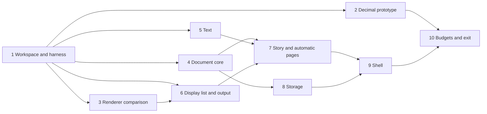

# Roadmap

Each milestone is a gate with explicit exit criteria, and each one starts by
writing its acceptance tests. The tracks of work and their order are in
[TRACKS.md](TRACKS.md); this document holds the milestones' plans.

## M0: Architecture and tech stack

**Status (2026-10-18): done.** The project owner approved
[ARCHITECTURE.md](ARCHITECTURE.md) and [TRACKS.md](TRACKS.md) in review
session pamnqej6. Open: the 2D renderer (D7), chosen in M1; the macro
language (D8), chosen with the scripting track.

## M1: Walking skeleton

*Plan approved by the project owner in review session yyhb2j3d
(2026-10-18).* The owner chose:
- **Platforms at the exit:** M1 is used live on Linux and Windows. macOS is
  built and tested headless in CI only.
- **Budgets:** measured by hand on the owner's workstation at the exit. A
  self-hosted CI runner that checks them on every push comes later (see
  Later, below).
- **Scripts:** Latin, Arabic, Hebrew and CJK from M1. Greek and Cyrillic
  join the test cases too. They lay out as Latin does, but their language
  tag must reach the shaper: Bulgarian and Serbian Cyrillic take their own
  letterforms through OpenType's `locl` feature, and Greek capitals drop
  their accents in case mapping.

One thin path through every layer, so every later track builds on real,
tested interfaces instead of inventing its own. M1 is a word-processing
document at its simplest: a story poured into automatically generated
pages, typed into with styles, undone and redone, saved continuously,
reopened and printed to PDF. M1 also settles two questions by measurement:
whether decimal numbers are fast enough, and which 2D renderer to use.

Every interface in M1 is crude, but each is the real one. A stage's work
goes into the crate the architecture names, behind the contract a later
track will harden, never into a throwaway.

**Out of scope:** optimal (Knuth–Plass) line breaking, hyphenation, tables,
lists, images, embedded parts, footnotes, any sheet or slide, Markdown
saving, collaboration, interchange, and every shell but the generic one.

### Stages

Each stage starts with its tests. The stages after the first can run in
parallel where the diagram allows; an arrow means "needs the contracts of".

1. **Workspace and test harness.** The Cargo workspace, with Rust pinned as
   Fauré's toolchain is, edition 2024, lints, and `cargo deny` allowing
   permissive licenses only. CI on GitHub Actions runs format, Clippy,
   nextest and deny on Linux, Windows and macOS. It also builds every pure
   crate for `wasm32-unknown-unknown`, which keeps I/O, threads and clocks
   out of the core by construction. `testkit` holds the golden-image harness
   (renders recorded as hashes of their pixels, as in Fauré). `shot` renders
   a test document to PNG. The check commands go into `CLAUDE.md`.
   *Exit:* an empty crate per M1 component, all checks green on all three
   platforms, and a golden test of a filled rectangle passing.

2. **Decimal prototype** (`calc`'s number type only). Two or three
   candidates for 128-bit decimal arithmetic, compared with `f64`:
   - **Correctness:** the General Decimal Arithmetic test vectors, fetched
     by CI rather than committed.
   - **Speed:** add, multiply and divide, and a synthetic recalculation of a
     million cells in chains and range sums.

   The candidates are a pure-Rust crate, bindings to libdecNumber, and our
   own decimal128 where neither fits. *Exit:* a report with the numbers and
   a recommendation, brought to a review. It settles decimal numbers for
   good, or brings the question back to the owner.

3. **Renderer comparison** (D7). Vello, with its CPU renderer as the
   reference, against tiny-skia on the CPU plus a small wgpu pipeline of our
   own. Both render the same corpus: text-heavy pages, a dense grid, and a
   slide of paths and gradients. The comparison measures:
   - frame time on the GPU and on the CPU
   - how close the GPU output is to the CPU output
   - whether CPU output is identical across the three platforms
   - shader start-up cost and binary size
   - whether it builds for WebAssembly

   *Exit:* a report, and D7 decided in a review.

4. **Document core** (`doc`). Object IDs, text anchors and the M1
   operations: insert and delete text, split and join paragraphs, and set
   character and paragraph properties. Then transactions, undo and redo, and
   persistent snapshots. Property tests, generated from random edit
   sequences:
   - every operation's inverse undoes it
   - rebasing converges: applying *a* then *b* rebased over *a* gives the
     same document as applying *b* then *a* rebased over *b*
   - a snapshot is unchanged by later edits

5. **Text** (`text`, `locale`). Fonts loaded with skrifa from files bundled
   for M1, shaped with HarfRust. Lines are broken with ICU4X, first fit. Bidi
   comes from ICU4X too, and mixed-direction lines put their caret where
   readers of each script expect it. Layout uses fixed-point units, and
   carets and selections are hit-tested against the lines. *Tests:* layout
   cases as data under `spec/text/` (paragraph, width, expected line breaks
   and positions), in Latin, Greek, Cyrillic, Arabic, Hebrew and CJK, with
   the language tag reaching the shaper, and caret movement through
   mixed-direction lines.

6. **Display list and output** (`scene`, `render-cpu`, `render-pdf`). The
   display list, a CPU renderer on the library stage 3 recommends, and PDF
   output with the fonts embedded and subset. *Tests:* golden hashes of the
   corpus. The PDF tests check that the text extracts back as typed, that the
   fonts are embedded, and that each page has its expected size.

7. **Story and automatic pages** (`story`, `canvas`). A story of paragraphs
   with paragraph styles (Body, Heading 1 to 3) and character properties
   (font, size, bold, italic). It is poured into a canvas whose pages come
   from one page style, with page size and margins. Paragraphs break across
   pages between lines. This is the first form of the canvas's automatic
   pagination mode, the one Write will grow. *Tests:* golden renders of
   multi-page documents, and page breaks that stay put when nothing before
   them changes.

8. **Storage** (`store`, `tools/xworks-dump`):
   - schema version 1, specified in `spec/format/`: objects, the
     transaction log, embedded fonts and metadata
   - every transaction appended as it's committed, and named versions
   - opening from the latest snapshot plus the log after it
   - the canonical text dump

   *Tests:*
   - Reopening gives an identical dump and identical renders.
   - A crash test kills the writer at random points, a thousand times. The
     file always opens, at the last committed transaction.
   - A fuzz target for the reader.
   - A file from a newer schema version opens read-only and says so.

9. **Shell** (`chrome`, `toolkit`, `app`, `render-gpu`, `shells/generic`):
   - **Commands, as data:** new, open, save a version, export PDF, quit,
     undo, redo, bold, italic, the paragraph styles and font size.
   - **The app:** Elm-style, over the document and its views.
   - **The generic shell:** winit and wgpu, showing the pages with
     scrolling, the caret and selection by mouse and keyboard, typing, IME
     composition and plain-text clipboard.
   - **The toolkit's first chrome:** a menu bar, menus and a status bar,
     drawn from the chrome model.
   - **Accessibility:** a first AccessKit tree, with the document as text.

   *Tests:* scripted sessions, played headless, compared by document dump
   and by frames.

10. **Budgets and exit.** A benchmark harness (`tools/budgets`) for the
    budgets that apply to M1: cold start, keystroke to glyph, opening a
    500-page document, saving after a small edit, scrolling, and memory for
    an empty window. It runs on any machine and prints each measurement
    against its budget; at the exit the owner runs it on their workstation,
    on Linux and on Windows. Keystroke-to-glyph is
    measured from the event arriving to the frame being presented; latency
    to the display itself needs a camera and is out of scope. The measured
    numbers replace the placeholders in ARCHITECTURE.md section 12.

### Progress

**Stage 1 is done (2026-10-18).** The workspace, testkit, `shot`, the
purity rules and CI; the checks pass on Linux, Windows and macOS, and the
owner approved the first golden and accepted the stage (review 3w3kya1p).

**Stage 2 is done (2026-10-19).** The owner confirmed decimal numbers with
calc's own decimal128, and exact equality (review h6nsn9xm). Neither
candidate fit: `fastnum` isn't decimal128 (it rounds at 38 or 39 digits),
and libdecNumber is C that can't build for WebAssembly. So calc has its own
decimal128 in pure Rust, `calc::decimal`. It passes every applicable
decimal128 test case and agrees with libdecNumber on ten million random
results. It adds in 31 ns and multiplies in 13 ns, and recalculates a
million cells in 160 ms, about twelve times `f64`'s time. The measurements
are in [prototypes/decimal/README.md](../prototypes/decimal/README.md).

### Exit criteria

- A scripted session types a document of several pages, with headings, bold
  and italic text in Latin, Greek, Cyrillic, Arabic, Hebrew and CJK, and
  undoes and redoes through it.
  Its dump and its renders match the approved goldens.
- A crash at any point loses nothing committed: the crash test passes a
  thousand runs.
- Reopening gives the same dump and the same renders, and PDF export gives
  the same pages, with the text extractable.
- Every pure crate builds for WebAssembly in CI.
- The decimal and renderer decisions are made, on the reports' numbers.
- The budgets are measured on the owner's workstation, and any that M1
  misses has a plan.
- The project owner uses it live on Linux and Windows: types a document,
  quits, reopens and prints it. macOS passes CI headless.

## Later

Noted for after M1, not yet planned:

- **A self-hosted CI runner** on a fixed machine with a GPU, so the budgets
  are checked on every push and a regression fails the build (project owner,
  2026-10-18, review yyhb2j3d).
