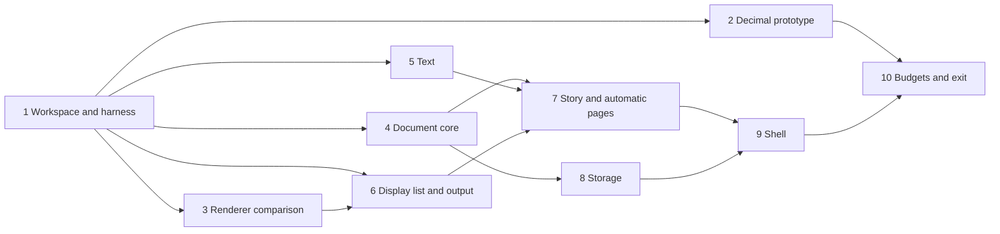
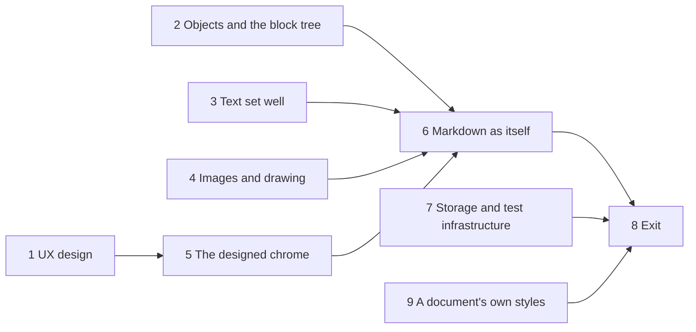

# Roadmap

Each milestone is a gate with explicit exit criteria, and each one starts by
writing its acceptance tests. The tracks of work and their order are in
[TRACKS.md](TRACKS.md); this document holds the milestones' plans.

## M0: Architecture and tech stack

**Status (2026-10-18): done.** The project owner approved
[ARCHITECTURE.md](ARCHITECTURE.md) and [TRACKS.md](TRACKS.md) in review
session pamnqej6. Open: the macro language (D8), chosen with the
scripting track. The 2D renderer (D7) was chosen in M1's stage 3.

## M1: Walking skeleton

*Done: the project owner accepted its exit in review gqbnbar4
(2026-10-22). Plan approved by the project owner in review session
yyhb2j3d (2026-10-18).* The owner chose:
- **Platforms at the exit:** M1 is used live on Linux and Windows. macOS is
  built and tested headless in CI only.
- **Budgets:** measured by hand on the owner's workstation at the exit. A
  self-hosted CI runner that checks them on every push comes later (see
  Later, below).
- **Scripts:** Latin, Arabic, Hebrew and CJK from M1. Greek and Cyrillic
  join the test cases too. They lay out as Latin does, but their language
  tag must reach the shaper: Bulgarian and Serbian Cyrillic take their own
  letterforms through OpenType's `locl` feature, and Greek capitals drop
  their accents in case mapping.

One thin path through every layer, so every later track builds on real,
tested interfaces instead of inventing its own. M1 is a word-processing
document at its simplest: a story poured into automatically generated
pages, typed into with styles, undone and redone, saved continuously,
reopened and printed to PDF. M1 also settles two questions by measurement:
whether decimal numbers are fast enough, and which 2D renderer to use.

Every interface in M1 is crude, but each is the real one. A stage's work
goes into the crate the architecture names, behind the contract a later
track will harden, never into a throwaway.

**Out of scope:** optimal (Knuth–Plass) line breaking, hyphenation, tables,
lists, images, embedded parts, footnotes, any sheet or slide, Markdown
saving, collaboration, interchange, and every shell but the generic one.

### Stages

Each stage starts with its tests. The stages after the first can run in
parallel where the diagram allows; an arrow means "needs the contracts of".

1. **Workspace and test harness.** The Cargo workspace, with Rust pinned as
   Fauré's toolchain is, edition 2024, lints, and `cargo deny` allowing
   permissive licenses only. CI on GitHub Actions runs format, Clippy,
   nextest and deny on Linux, Windows and macOS. It also builds every pure
   crate for `wasm32-unknown-unknown`, which keeps I/O, threads and clocks
   out of the core by construction. `testkit` holds the golden-image harness
   (renders recorded as hashes of their pixels, as in Fauré). `shot` renders
   a test document to PNG. The check commands go into `CLAUDE.md`.
   *Exit:* an empty crate per M1 component, all checks green on all three
   platforms, and a golden test of a filled rectangle passing.

2. **Decimal prototype** (`calc`'s number type only). Two or three
   candidates for 128-bit decimal arithmetic, compared with `f64`:
   - **Correctness:** the General Decimal Arithmetic test vectors, fetched
     by CI rather than committed.
   - **Speed:** add, multiply and divide, and a synthetic recalculation of a
     million cells in chains and range sums.

   The candidates are a pure-Rust crate, bindings to libdecNumber, and our
   own decimal128 where neither fits. *Exit:* a report with the numbers and
   a recommendation, brought to a review. It settles decimal numbers for
   good, or brings the question back to the owner.

3. **Renderer comparison** (D7). Vello, with its CPU renderer as the
   reference, against tiny-skia on the CPU plus a small wgpu pipeline of our
   own. Both render the same corpus: text-heavy pages, a dense grid, and a
   slide of paths and gradients. The comparison measures:
   - frame time on the GPU and on the CPU
   - how close the GPU output is to the CPU output
   - whether CPU output is identical across the three platforms
   - shader start-up cost and binary size
   - whether it builds for WebAssembly

   *Exit:* a report, and D7 decided in a review.

4. **Document core** (`doc`). Object IDs, text anchors and the M1
   operations: insert and delete text, split and join paragraphs, and set
   character and paragraph properties. Then transactions, undo and redo, and
   persistent snapshots. Property tests, generated from random edit
   sequences:
   - every operation's inverse undoes it
   - rebasing converges: applying *a* then *b* rebased over *a* gives the
     same document as applying *b* then *a* rebased over *b*
   - a snapshot is unchanged by later edits

5. **Text** (`text`, `locale`). Fonts loaded with skrifa from files bundled
   for M1, shaped with HarfRust. Lines are broken with ICU4X, first fit. Bidi
   comes from ICU4X too, and mixed-direction lines put their caret where
   readers of each script expect it. Layout uses fixed-point units, and
   carets and selections are hit-tested against the lines. *Tests:* layout
   cases as data under `spec/text/` (paragraph, width, expected line breaks
   and positions), in Latin, Greek, Cyrillic, Arabic, Hebrew and CJK, with
   the language tag reaching the shaper, and caret movement through
   mixed-direction lines.

6. **Display list and output** (`scene`, `render-cpu`, `render-pdf`). The
   display list, a CPU renderer on the library stage 3 recommends, and PDF
   output with the fonts embedded and subset. *Tests:* golden hashes of the
   corpus. The PDF tests check that the text extracts back as typed, that the
   fonts are embedded, and that each page has its expected size.

7. **Story and automatic pages** (`story`, `canvas`). A story of paragraphs
   with paragraph styles (Body, Heading 1 to 3) and character properties
   (font, size, bold, italic). It is poured into a canvas whose pages come
   from one page style, with page size and margins. Paragraphs break across
   pages between lines. This is the first form of the canvas's automatic
   pagination mode, the one Write will grow. *Tests:* golden renders of
   multi-page documents, and page breaks that stay put when nothing before
   them changes.

8. **Storage** (`store`, `tools/xworks-dump`):
   - schema version 1, specified in `spec/format/`: objects, the
     transaction log, embedded fonts and metadata
   - every transaction appended as it's committed, and named versions
   - opening from the latest snapshot plus the log after it
   - the canonical text dump

   *Tests:*
   - Reopening gives an identical dump and identical renders.
   - A crash test kills the writer at random points, a thousand times. The
     file always opens, at the last committed transaction.
   - A fuzz target for the reader.
   - A file from a newer schema version opens read-only and says so.

9. **Shell** (`chrome`, `toolkit`, `app`, `render-gpu`, `shells/generic`):
   - **Commands, as data:** new, open, save a version, export PDF, quit,
     undo, redo, bold, italic, the paragraph styles and font size.
   - **The app:** Elm-style, over the document and its views.
   - **The generic shell:** winit and wgpu, showing the pages with
     scrolling, the caret and selection by mouse and keyboard (the arrow
     keys move the caret on screen), typing, IME composition and
     plain-text clipboard.
   - **The toolkit's first chrome:** a menu bar, menus and a status bar,
     drawn from the chrome model.
   - **Accessibility:** a first AccessKit tree, with the document as text.

   *Tests:* scripted sessions, played headless, compared by document dump
   and by frames.

10. **Budgets and exit.** A benchmark harness (`tools/budgets`) for the
    budgets that apply to M1: cold start, keystroke to glyph, opening a
    500-page document, saving after a small edit, scrolling, and memory for
    an empty window. It runs on any machine and prints each measurement
    against its budget; at the exit the owner runs it on their workstation,
    on Linux and on Windows. Keystroke-to-glyph is
    measured from the event arriving to the frame being presented; latency
    to the display itself needs a camera and is out of scope. The measured
    numbers replace the placeholders in ARCHITECTURE.md section 12.

### Progress

**Stage 1 is done (2026-10-18).** The workspace, testkit, `shot`, the
purity rules and CI; the checks pass on Linux, Windows and macOS, and the
owner approved the first golden and accepted the stage (review 3w3kya1p).

**Stage 2 is done (2026-10-19).** The owner confirmed decimal numbers with
calc's own decimal128, and exact equality (review h6nsn9xm). Neither
candidate fit: `fastnum` isn't decimal128 (it rounds at 38 or 39 digits),
and libdecNumber is C that can't build for WebAssembly. So calc has its own
decimal128 in pure Rust, `calc::decimal`. It passes every applicable
decimal128 test case and agrees with libdecNumber on ten million random
results. It adds in 31 ns and multiplies in 13 ns, and recalculates a
million cells in 160 ms, about twelve times `f64`'s time. The measurements
are in [prototypes/decimal/README.md](../prototypes/decimal/README.md).

**Stage 3 is done (2026-10-19).** The owner chose Vello's sparse-strips
renderers for D7: `vello_cpu` for render-cpu and `vello_gpu` for
render-gpu. They draw nearly the same pixels (within 1 to 6 of 255), and
with their glyph cache a full A4 page of text takes 3.5 ms on the GPU and
6.6 ms on eight CPU threads. Vello's compute renderer is as fast but draws
differently and starts slowly on DirectX 12, and tiny-skia is two to three
times slower. GPU measurements run as a Windows build from WSL. The
measurements are in
[prototypes/renderers/README.md](../prototypes/renderers/README.md).

**Stage 4 is done (2026-10-19).** `doc` holds documents as objects by
stable ID in a persistent map of its own, a 32-way trie, since the
persistent-collection crates are all MPL-licensed. A clone is an O(1)
snapshot. Its six operations (insert and delete text, split and join
paragraphs, set a character or a paragraph property) apply with
validation, return their inverses, and rebase over each other. Property
tests over random documents in several scripts check the stage's three
properties, and transactions, undo and serialization besides. Tests of
each tie rule pin the conventions convergence alone can't, and deliberately
broken rules showed the tests catch them. Rebasing a sequence of operations
over another, which collaboration needs, waits for that track.

**Stage 5 is done (2026-10-20).** `locale` wraps ICU4X: language tags,
line breaks, graphemes, script runs and bidi levels. `text` loads fonts
with skrifa, shapes with HarfRust, breaks lines first fit, orders them by
the bidi algorithm, and answers the editing questions: where the caret is
drawn, where it goes on screen and in the text, what a click hits, and how
a selection is highlighted. Fifteen layout cases under `spec/text/` cover
Latin, Greek, Cyrillic, Arabic, Hebrew and Japanese, alignment, hard
breaks, a word too long for its line, and text of both directions in one
line and across wrapped lines, with caret walks through them worked out by
hand. Their widths come from HarfBuzz itself, and HarfRust matches them
exactly. Language cases check that the tag reaches the shaper: Serbian,
Japanese, Korean, Chinese, Urdu, Romanian and Catalan forms. Property tests over
random mixed-script paragraphs found one bug, a line that came out wider
than measured where a break split a kerning pair; lines are now measured as
they will be shaped. The bundled fonts, 87 MB of Noto, are fetched by hash.
The owner accepted the stage (review manq394m) and settled four things: the
fonts stay fetched, the arrow keys move the caret on screen, italic in a
family without an italic face is slanted, and Noto Serif falls back to Noto
Serif CJK.

**Stage 6 is done (2026-10-22).** The owner approved its goldens and
chose tagged PDF in M1 (review 64capttj); PDFs now carry the document's
structure, and right-to-left text extracts as typed. `scene` is
the display list: pages of fills, strokes and glyph runs that carry their
text. `text` paints laid-out paragraphs into it. render-cpu draws it with
`vello_cpu`, at a portable scalar level for tests and goldens and the
machine's fastest for the screen; the approved `filled-rect` golden still
matches, drawn this way. render-pdf writes it with krilla: fonts embedded
and subset, page sizes exact, the same bytes every time, tagged with the
document's paragraphs and headings, and text that extracts back as typed in
every script. `shot` draws the shapes and text scenes, now goldens, and
writes any scenes as PDF.

**Stage 7 is done (2026-10-22).** The owner approved its golden and kept
M1's styles (review 0y4qbpmt). `story`
reads a document's paragraphs as styled text: paragraph styles from
`spec/styles/m1.ron` (Body, Heading 1 to 3), with bold, italic, font,
size and language over them. `canvas` paginates: paragraphs break between
lines with no widows or orphans, headings keep with what follows, and
space is dropped at page edges. A sample document of about three A4 pages
(`spec/documents/m1-sample.ron`) is drawn as a scene, and as a PDF of its
pages. Tests check that its text stays within the margins and that an
edit leaves every page before it as it was, on the sample and in property
tests over random documents.

**Stage 8 is done (2026-10-22).** The owner chose a binary encoding inside
the file, kept commits durable against program crashes, and embeds only
fonts that aren't bundled (review dfx97ttt). `spec/format/` specifies schema 1 of
the `.xw` file, and `store` reads and writes it: new files are renamed
into place whole, every transaction is appended as it's committed with a
snapshot every hundred, and opening starts from the latest snapshot and
rebuilds undo from the whole log. A file from a newer schema opens
read-only. Reopening gives the same dump and the same renders; the crash
test passes a thousand runs; a fuzz target reads any bytes as a file;
`xworks-dump` prints a file in canonical text.

**Stage 9 is done (2026-10-22).** `chrome`
holds the commands as data (`spec/commands/m1.ron`) and the menu model;
`toolkit` draws the menu bar, menus, status bar and an Open panel; `app`
is the editor, Elm-style, whose view is a display list; render-gpu draws
it with vello_gpu; and the generic shell (`xworks`) runs it on winit and
wgpu, with the input method, AccessKit, and render-cpu where the only GPU
is software. Ten scripted sessions in `spec/sessions/` play input headless
and check the document. Typing undoes as one run, kept across reopening
by a new kind of log entry. Cut, copy and paste go through the system
clipboard, with arboard, once the owner allowed the Boost license its
Windows crates use (review yzmxnt0g, 2026-10-22). The owner approved the
editor's goldens and used it live on Windows (review v0qk8k5d). From that
use, Export as PDF now shows the file it wrote. The owner chose to leave
the look to a UX design stage after M1, and only to move it into data
now, which `spec/themes/m1.ron` holds.

**Stage 10 is done (2026-10-22).** `tools/budgets` measures the six budgets that apply to M1, against
`spec/budgets.ron`, and splits each into its parts: the shell's start into
the phases it times itself in a measuring mode, and frames into update,
view and drawing. Three fixes came from its first numbers: the status
bar counted every word of the document each frame (5 ms of each frame on
the 500-page report); the shell compiled GPU shaders it never used when
drawing on the CPU (150 ms of the start under WSL); and paragraphs were
laid out one after another (740 ms to open the report). Paragraphs are
now laid out on rayon's pool, and the report opens in 100 to 150 ms. On
the owner's workstation every budget held on both systems but two:
Windows' cold start, and memory on both. The owner settled the budgets,
revised memory's to 120 MB, and chose a plan for each miss, carried out
before M1's exit (review 094846qg): the CJK faces load once text needs
them, and the GPU opens on a thread while render-cpu draws the first
frames. Every budget now holds on both systems (ARCHITECTURE.md, section
12).

**M1 is done (2026-10-22).** Checking the exit criteria found one gap: no
session yet typed several pages and undid and redid through them.
`spec/sessions/exit.ron` now types three pages in every M1 script, with
headings, bold and italic, undoes them to an empty page, redoes them and
reopens the document; the owner approved its pages as the golden
`exit-pages`. A test checks that the document it types reopens with the
same dump and pages, and exports as a PDF of the same pages with its text
extractable. The owner let the live use on Windows stand for Linux too,
to be tried on native Linux once the workstation runs it (review
gqbnbar4).

### Exit criteria

- A scripted session types a document of several pages, with headings, bold
  and italic text in Latin, Greek, Cyrillic, Arabic, Hebrew and CJK, and
  undoes and redoes through it.
  Its dump and its renders match the approved goldens.
- A crash at any point loses nothing committed: the crash test passes a
  thousand runs.
- Reopening gives the same dump and the same renders, and PDF export gives
  the same pages, with the text extractable.
- Every pure crate builds for WebAssembly in CI.
- The decimal and renderer decisions are made, on the reports' numbers.
- The budgets are measured on the owner's workstation, and any that M1
  misses has a plan.
- The project owner uses it live on Linux and Windows: types a document,
  quits, reopens and prints it. macOS passes CI headless.

## M2: Foundations for documents

*Plan approved by the project owner in review 3p2m36fm (2026-10-22).* The
owner chose:
- **Scope:** foundations for documents, proven by Markdown; calculation
  waits for M3, with the grid.
- **Pace:** several stages at once, by agents in separate worktrees. Each
  stage still has its plan and its reviews, and lands on `master` when its
  checks pass.

M1 made one thin path through every layer. M2 hardens the interfaces that
documents build on into the contracts the substrate and product tracks
need ([TRACKS.md](TRACKS.md), phase 2). Two things people use prove them:
Markdown files opened, edited and saved as themselves, the first stage of
S1 Story; and word-processing text set well, in chrome designed rather than
improvised.

**In M2:** F1 Document core, F2 Storage, F3 Text, F4 Rendering, F5 Shell
and toolkit, and F7 Test infrastructure, each as far as documents need;
then S1 Story's Markdown. **Not in M2:** F6 Calculation, which nothing in
M2 needs, and chunked tables. They come in M3, with the grid that proves
them. Also out: the canvas beyond automatic pages, slides, sheets, and the
later tracks.

### Stages

Each stage starts with its tests, as in M1, and each gets a plan of its
own when it starts.

1. **UX design** (F5; project owner, 2026-10-22, review v0qk8k5d). A
   design document and mockups drawn with `shot`, before the toolkit grows
   more widgets. It settles:
   - windows and tabs, and moving between embedded parts;
   - menus, an inspector, a toolbar or a command palette;
   - selection and modes across text, objects and cells;
   - the keyboard;
   - the visual language: type, spacing, colour, density, dark mode and
     HiDPI.

   It must map onto AppKit's and Fauré's widgets through the chrome model.
   *Exit:* the design in ARCHITECTURE.md section 8, its look in
   `spec/themes/`, and its mockups approved as goldens.

2. **Objects and the block tree** (F1, with S1's model). Objects are
   created, deleted and moved by operations, not only edited. A story
   becomes a tree of blocks: paragraphs, headings, lists and their items,
   quotes, code blocks and tables. Text gains the marks Markdown needs:
   emphasis, strong, code and links. Snapshots move to schema 2, and
   schema 1 files open and are upgraded. *Tests:* every new operation
   inverts and rebases, by property tests as in M1; a file M1 wrote, kept
   as a fixture, opens with the same text and history.

3. **Text set well** (F3):
   - optimal (Knuth–Plass) line breaking, and justified text;
   - hyphenation from TeX's patterns, fetched by hash where their licenses
     are unclear;
   - moving and selecting by word and sentence, and double- and
     triple-click;
   - a language set on text by a command, so Japanese takes its own forms;
   - the default document fonts, chosen.

   *Tests:* layout cases as data, as in M1, for justified and hyphenated
   paragraphs in several languages, and sessions for the new movement.

4. **Images and drawing** (F4). Images in the display list, decoded in the
   app and stored in the file, drawn by all three renderers. Clips,
   transforms, and underline and strikethrough. Frames redrawn only where
   they changed. PDF text read back by a second reader as well, where
   pdf-extract misreads Arabic. *Tests:* goldens, and render-gpu within its
   tolerance of render-cpu.

5. **The designed chrome** (F5): what stage 1 settled, built. That includes
   managing documents (naming, renaming and moving them, and recent ones),
   the Open dialog it calls for, the `part` crate and the canvas contract,
   and AccessKit with the text's real ranges. *Tests:* sessions and frame
   goldens for each new piece of chrome.

6. **Markdown as itself** (S1's first stage; ARCHITECTURE.md section 6).
   A `.md` file opens as a structure-only story, is edited, and is saved
   back as CommonMark with tables, whole and atomically. Undo and versions
   last as long as it's open. Adding what Markdown can't hold asks before
   the document becomes an `.xw` file. *Tests:*
   - CommonMark's own examples, fetched rather than committed, read and
     written back;
   - a round trip, by property tests: what's written reads back as the
     same story;
   - a fuzz target for the reader;
   - a session that opens, edits and saves a Markdown file.

7. **Storage and test infrastructure** (F2, F7). Named versions opened and
   copied out as documents, and a document open twice refused. The budgets
   checked in CI on a self-hosted runner, once the owner's workstation runs
   Linux, with budgets for opening and saving Markdown. The fuzz targets
   run on a schedule in CI. A recorder writes what a person does in the
   shell as a session, for bug reports.

9. **A document's own styles** (added by the project owner, 2026-10-24,
   review ydqhfds0; ARCHITECTURE.md section 6). Styles and the page
   become the document's, edited by operations, from stylesheets that come
   with xWorks and people's own. It starts with research into how word
   processors and page layout programs build styles on each other, and
   how they set columns, brought to the owner as a design to decide. Then
   it's built, on the design the owner settled (review 30dmn1js): styles,
   based on each other in chains of any depth, and the page become objects
   in the document, edited by operations; new documents copy one of six
   stylesheets; the inspector shows where each value comes from, edits
   styles and the page, and clears direct formatting; pasting takes the
   destination's styles. Columns' model is settled, and Write (T1) builds
   them.

8. **Exit.** Each foundation crate's contract is written down in its
   `lib.rs` and the architecture, and the budgets are measured again.

### Progress

**Stage 1 is done (2026-10-22).** The owner settled the interaction model
(review frhewnk0), now in ARCHITECTURE.md section 8. That's a window per
document; parts edited in place; one selection at one level; a menu bar,
inspector, palette and status bar, with a ruler and no global toolbar;
platform shortcuts; Inter, compact, light and dark; Lucide's icons; and
white pages on an off-white desk. The owner then approved four mockups as
goldens and chose xWorks' own title bar (review 3ce247c2). Along the way:
- `fetch-fonts` learned to take fonts out of release archives, which
  brought Inter and, for stage 3, Source Serif 4 and JetBrains Mono;
- `toolkit` reads and draws Lucide's icons.

Stages 2 to 4 ran in parallel, each by an agent in its own worktree, on
plans the owner approved in review pysc65hp.

**Stages 2 to 4 are done (2026-10-23).** The owner approved their renders
and settled what they left open (review dcn5ejrd). ARCHITECTURE.md
sections 5, 6, 9 and 10 say what each built.
- **Stage 2:** a story is a tree of blocks (lists, quotes, code, Markdown's
  tables), made, deleted and moved by operations that rebase with the
  document. Schema 2 upgrades M1's files, kept as a fixture.
- **Stage 3:** justified text breaks by Knuth and Plass, and words
  hyphenate by TeX's patterns in ten languages. It also brought tab stops,
  moving by word and sentence, a language for every document, and Source
  Serif 4 and Inter as the defaults.
- **Stage 4:** the display list has images, clips and transforms. Pictures
  are decoded into sRGB, text has underlines and lines through it, and
  windows draw only what changed. That made a keystroke three to four
  times faster.
- **Ligatures:** styles now set them class by class, and code has none
  (review zym9j5k0).

**Stages 5 and 7 are done (2026-10-24),** built in parallel on plans the
owner approved in review a23vvez8.

- **Stage 7 (review k07a0fw7):**
  - pictures in documents' text, with sRGB JPEGs passed to PDF unchanged;
  - named versions opened read-only and copied out;
  - a document open to write in one program at a time, behind a hidden
    lock file;
  - the last minutes of input kept for bug reports, without undo
    history;
  - the fuzz targets run nightly in CI.
- **Stage 5 (review ydqhfds0):** the chrome of the approved mockups, with
  our own title bar, light and dark, the draft view, the ruler, the
  inspector, the palette, menus holding every command, the system's file
  dialogs, documents named by their first line, the `part` contract, and
  text ranges for screen readers.
- **Live use** asked for the ruler across the window with units in View,
  and the system's caret rate. A follow-up built them, with the ruler
  counting from the margin or the paper's edge, spacing in points and the
  inspector's tab stops read as the ruler reads (review 77nh3z47).
- **Stage 6** is built, with a follow-up from live use: saving as you
  type, files changed by other programs, autolinks and Markdown budgets.
  It awaits the owner's review (jy4a2tx5).
- **The owner added stage 9,** a document's own styles. Its research came
  back as a design the owner settled and accepted (review 30dmn1js). It's
  built, and its goldens are approved (review sjj5ak5a). A follow-up
  builds what that review settled: quotes' space, a Table Header style,
  Clear Formatting clearing marks, three-way stylesheet updates, and the
  inspector's screens for every kind of style.

### Exit criteria

- A Markdown file, opened in xWorks, edited and saved, is still the same
  Markdown where it wasn't edited, and CommonMark's examples read and write
  back.
- Justified, hyphenated paragraphs, lists, quotes, code, images and links
  lay out, draw and print the same on every platform, against approved
  goldens.
- The chrome follows the approved design, and a session drives each piece
  of it.
- Every operation inverts and rebases, and M1's files open in M2.
- The budgets hold on the owner's workstation, Markdown's included, and CI
  checks them on every push once the runner is in place.
- The owner uses it live on Linux and Windows: writes a Markdown file and a
  document with images, quits, reopens and prints.

## Later

Noted for after M1, not yet planned:

- **A self-hosted CI runner** on a fixed machine with a GPU, so the budgets
  are checked on every push and a regression fails the build (project owner,
  2026-10-18, review yyhb2j3d).
- **Native Linux, live and measured,** once the owner's workstation runs
  Linux alone: M1's live use there, and the budgets on a hardware GPU
  (project owner, 2026-10-22, review gqbnbar4).
- **PDF text checked with a second reader,** in F4: pdf-extract misreads
  some Arabic letters in the exit document's PDF, which pdftotext reads
  correctly.
- **UX design opens F5** (project owner, 2026-10-22, review v0qk8k5d).
  Before the toolkit grows more widgets, a design document and mockups
  drawn with `shot`, reviewed by the owner, settle what the tracks would
  otherwise each invent:
  - windows and tabs, and moving between embedded parts;
  - menus, an inspector, a toolbar or a command palette;
  - selection and modes across text, objects and cells;
  - the keyboard;
  - the visual language: type, spacing, colour, density, dark mode and
    HiDPI.

  It must map onto AppKit's and Fauré's widgets too. M1's chrome is crude
  on purpose; its look is data (`spec/themes/`), so the design replaces it
  as data.
