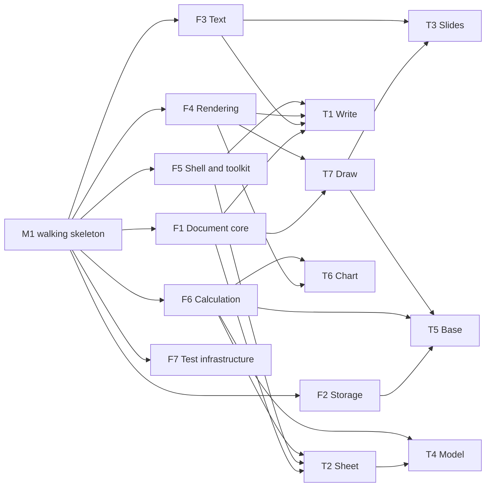

# Tracks

**Status: draft for the project owner's review.** This lists the tracks of
work, what each owns, and the order they can start in. Each track gets its own
plan, with acceptance tests and stages, once the owner approves the
[architecture](ARCHITECTURE.md).

## How the work is staged

Parallel tracks only work if they share foundations that already exist. If
five tracks start at once, each invents its own text layout, undo and file
I/O. So the work goes in three phases:

1. **M1, the walking skeleton.** One thin path through every layer. That
   means a window, a page, typing styled text, undo, save and reopen, print to
   PDF, drawn by both the CPU and the GPU renderer, with the budgets
   measured. Every interface is crude, but it's real and it's tested. M1
   proves the architecture, confirms decimal numbers and chooses the
   renderer (D7) with measurements instead of guesses. The owner approved
   building it first (project owner, 2026-10-18).
2. **Foundation tracks** harden the skeleton's interfaces into the contracts
   the product tracks build on. They overlap with phase 3: a product track
   starts once the foundations it needs have stable contracts.
3. **Product tracks** run in parallel, each owning its crates, specs and
   tests.

## Foundation tracks

| Track | Owns | Delivers |
|---|---|---|
| **F1 Document core** | `doc` | Objects and IDs, operations with inversion and rebase, transactions, undo, snapshots, chunked tables |
| **F2 Storage** | `store` | The `.xw` format and its spec, incremental save, history, autosave, `xworks dump`, fuzzing |
| **F3 Text** | `text`, `locale` | Fonts, shaping, bidi, optimal line breaking, hyphenation, editing, IME, font embedding |
| **F4 Rendering** | `scene`, `render-*` | The display list, CPU reference and GPU renderers, PDF output, printing |
| **F5 Shell and toolkit** | `chrome`, `toolkit`, `part`, `app`, `shells/generic` | Commands, the chrome model, the generic toolkit, the canvas contract, accessibility, clipboard, drag and drop |
| **F6 Calculation** | `calc` | Typed values, decimal numbers, the formula language, the function library as data, incremental parallel recalculation |
| **F7 Test infrastructure** | `testkit`, `tools/` | `shot`, golden hashes, scripted sessions, performance budgets in CI |

## Product tracks

| Track | Needs | Scope |
|---|---|---|
| **T1 Write**, word processing | F1, F3, F4, F5 | Styles first: paragraph, character, list and page styles. Sections, headers and footers, footnotes, tables, fields, cross-references, an outline view, track changes, comments |
| **T2 Sheet**, spreadsheets | F1, F5, F6 | The grid, typed cells, formulas, names, tables with structured references, sorting and filtering, conditional formats, pivots |
| **T3 Slides**, presentations | T7, F3 | Masters and layouts, slide sorter, outline, speaker notes, presenter view, transitions kept tasteful |
| **T4 Model**, multidimensional modeling | F6, the T2 grid | Lotus Improv's model: named categories and items instead of cell addresses, formulas over categories, views that pivot by dragging category tiles, several views of one model |
| **T5 Base**, office databases | F2, F6, T7 | Tables, relations, forms and reports laid out with T7, queries in the formula language, import from CSV, up to millions of records |
| **T6 Chart** | F4, F6 | Charts as parts, fed from sheets, models and databases; good defaults in the spirit of Tufte |
| **T7 Draw** | F1, F4 | Shapes, paths, connectors, groups, alignment and distribution, the shared layer under slides, forms and diagrams |

T6 and T7 aren't documents people open on their own as often, but slides, forms,
reports and embedded charts all stand on them, so they're tracks of their own.

## Later tracks

These are planned for, but come after the core is dialed in.

| Track | Scope |
|---|---|
| **L1 Interchange** | Import and export: OOXML, ODF, CSV, Markdown, PDF import. Each is a separate crate, converting to and from the model, differentially tested against reference documents |
| **L2 Collaboration** | The ordering server, client rebasing, presence, comments in real time |
| **L3 Scripting** | The macro language (D8), its capability sandbox, macro recording from commands, the agent interface |
| **L4 macOS port** | AppKit chrome from the chrome model, Metal surfaces, the system's services |
| **L5 Fauré port** | Fauré's toolkit and menus, commands as a scripting dictionary on Fauré's broker |
| **L6 Web** | The core in WebAssembly, WebGPU or canvas rendering, storage in the browser |

## Candidate tracks

xWorks doesn't aim to cover everything. Track ideas are written down here as
they come up, and work on one starts when we've found enough pain points with
the incumbents to make it worth doing (project owner, 2026-10-18).

| Candidate | Why it might earn a track |
|---|---|
| **Email** | Raised by the owner, 2026-10-18 |
| **PIM:** contacts, calendar, tasks | Raised by the owner, 2026-10-18 |
| **Outliner** | Raised by the owner, 2026-10-18. People use outlines to feed their documents and presentations |

## Dependency order

An arrow means "must have stable contracts before the next can start".
F7 runs alongside everything.

