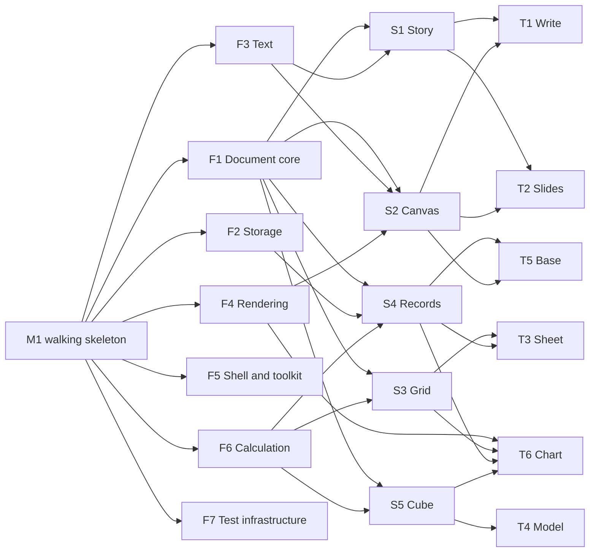

# Tracks

**Status: draft for the project owner's review.** This lists the tracks of
work, what each owns, and the order they can start in. Each track gets its own
plan, with acceptance tests and stages, once the owner approves the
[architecture](ARCHITECTURE.md).

## How the work is staged

Parallel tracks only work if they share foundations that already exist. If
five tracks start at once, each invents its own text layout, undo and file
I/O. So the work goes in three phases:

1. **M1, the walking skeleton.** One thin path through every layer. That
   means a window, a page, typing styled text, undo, save and reopen, print to
   PDF, drawn by both the CPU and the GPU renderer, with the budgets
   measured. Every interface is crude, but it's real and it's tested. M1
   proves the architecture, confirms decimal numbers and chooses the
   renderer (D7) with measurements instead of guesses. The owner approved
   building it first (project owner, 2026-10-18).
2. **Foundation tracks** harden the skeleton's interfaces into the contracts
   everything else builds on.
3. **Substrate tracks, then product tracks,** run in parallel, each owning
   its crates, specs and tests. A track starts once the tracks it needs have
   stable contracts, so the phases overlap.

*Proposal, review pamnqej6:* the substrate and product tracks below follow
the substrates in [ARCHITECTURE.md](ARCHITECTURE.md) section 4. Story,
canvas, grid, records and cube are each built once, and the products are the
features that make a view of them a word processor, a presentation program
or a spreadsheet.

## Foundation tracks

| Track | Owns | Delivers |
|---|---|---|
| **F1 Document core** | `doc` | Objects and IDs, operations with inversion and rebase, transactions, undo, snapshots, chunked tables |
| **F2 Storage** | `store` | The `.xw` format and its spec, incremental save, history, autosave, `xworks dump`, fuzzing |
| **F3 Text** | `text`, `locale` | Fonts, shaping, bidi, optimal line breaking, hyphenation, editing, IME, font embedding |
| **F4 Rendering** | `scene`, `render-*` | The display list, CPU reference and GPU renderers, PDF output, printing |
| **F5 Shell and toolkit** | `chrome`, `toolkit`, `part`, `app`, `shells/generic` | Commands, the chrome model, the generic toolkit, the canvas contract, accessibility, clipboard, drag and drop |
| **F6 Calculation** | `calc` | Typed values, decimal numbers, the formula language, the function library as data, incremental parallel recalculation |
| **F7 Test infrastructure** | `testkit`, `tools/` | `shot`, golden hashes, scripted sessions, performance budgets in CI |

## Substrate tracks

| Track | Owns | Needs | Delivers |
|---|---|---|---|
| **S1 Story** | `story` | F1, F3 | The block tree, named styles, structure-only stories, the outline and draft views, Markdown reading and writing |
| **S2 Canvas** | `canvas` | F1, F3, F4 | Pages, masters and the open pasteboard; frames, and stories threaded through them; shapes, paths, connectors, groups, alignment and distribution; automatic pagination as a layout mode |
| **S3 Grid** | `grid` | F1, F6 | Cells, positional references, filling, the grid view, sheets of millions of cells |
| **S4 Records** | `records` | F1, F2, F6 | Typed tables, relations, indexes, queries in the formula language; the table, form, list and card views |
| **S5 Cube** | `cube` | F1, F6 | Categories and items, formulas over names, pivot views rearranged by dragging categories |

## Product tracks

| Track | Needs | Scope |
|---|---|---|
| **T1 Write**, word processing | S1, S2 | Automatic pages from page styles, sections, headers and footers, footnotes, floats, fields, cross-references, track changes, comments |
| **T2 Slides**, presentations | S1, S2 | Slide sequence, layouts on masters, the slide sorter, the outline view across slides, speaker notes, the presenter view, transitions kept tasteful |
| **T3 Sheet**, spreadsheets | S3, S4 | Names, record tables in sheets with structured references, sorting and filtering, conditional formats, pivots |
| **T4 Model**, multidimensional modeling | S5 | Lotus Improv's way of working: category tiles, several views of one model, models fed from records queries |
| **T5 Base**, office databases | S4, S2 | Forms and reports laid out on canvases and bound to records, import from CSV, up to millions of records |
| **T6 Chart** | F4, S3, S4, S5 | Charts as parts, reading live from grid ranges, records queries and cube views; good defaults in the spirit of Tufte |

Drawing has no product track: a drawing is a canvas of shapes, and S2 Canvas
delivers the drawing tools.

## Later tracks

These are planned for, but come after the core is dialed in.

| Track | Scope |
|---|---|
| **L1 Interchange** | Import and export: OOXML, ODF, CSV, Markdown, PDF import. Each is a separate crate, converting to and from the model, differentially tested against reference documents |
| **L2 Collaboration** | The ordering server, client rebasing, presence, comments in real time |
| **L3 Scripting** | The macro language (D8), its capability sandbox, macro recording from commands, the agent interface |
| **L4 macOS port** | AppKit chrome from the chrome model, Metal surfaces, the system's services |
| **L5 Fauré port** | Fauré's toolkit and menus, commands as a scripting dictionary on Fauré's broker |
| **L6 Web** | The core in WebAssembly, WebGPU or canvas rendering, storage in the browser |

## Candidate tracks

xWorks doesn't aim to cover everything. Track ideas are written down here as
they come up, and work on one starts when we've found enough pain points with
the incumbents to make it worth doing (project owner, 2026-10-18).

| Candidate | Why it might earn a track |
|---|---|
| **Email** | Raised by the owner, 2026-10-18 |
| **PIM:** contacts, calendar, tasks | Raised by the owner, 2026-10-18 |
| **Outliner** | Raised by the owner, 2026-10-18. People use outlines to feed their documents and presentations. If the substrate proposal is approved, S1 Story's outline view covers it, and laying an outline out as a document or as slides is a change of view |
| **Page layout (DTP)** | Typographic and prepress features beyond what Write and Slides need. S2 Canvas already holds pages laid out by hand and threaded stories |

## Dependency order

An arrow means "must have stable contracts before the next can start".
F7 runs alongside everything.

Every track with a view also needs F5, the shell; those arrows are left out.
